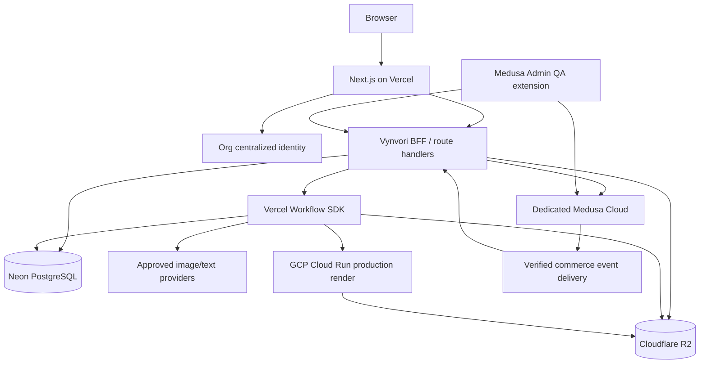
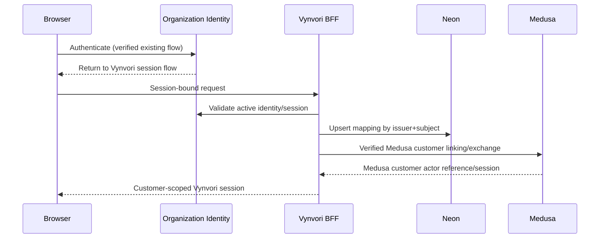

# VYNVORI — Complete  Technical Specification

**Export of the modular coding-agent handoff (2026-10-13).** The ZIP version preserves files and is the recommended source. **LuckyLittleDevil authentication source was inaccessible: bridge must be inspected before implementation.**


---

> Source: `README.md`

# VYNVORI —  technical blueprint handoff

**Status:** founder-approved technical design, implementation pending. **Snapshot:** 2026-10-13. **Target repository:** `TheCrimsonMarket/vynvori` (`main`), private. **No repository mutation performed as part of this handoff.**

This package is a **documentation overlay** to copy into the existing repository. It is not a complete application and does not replace `packages/ai-benchmark` or its tests, fixtures, scripts, reports, or the existing `package-lock.json`.

Start with `docs/technical/00-master-specification.md`, then read `AGENTS.md`, the domain specifications and the milestone plan. Execute in vertical slices; do not attempt a massive one-shot rewrite.

## Critical prerequisite: LuckyLittleDevil source audit

Founder decision **T03**: The Crimson Market centralized authentication is the identity authority for Vynvori. Implement its **existing LuckyLittleDevil-to-Medusa bridge**, adapting it to the new dedicated Vynvori Medusa Cloud project. The repository `TheCrimsonMarket/LuckyLittleDevil` was inaccessible to the connected GitHub app (404) during authorship, while `TheCrimsonMarket/vynvori` was accessible. **The actual bridge implementation was not inspected.** Consequently, implementation milestone M1 contains a mandatory source audit and contract-verification gate. No endpoint names, token format, provider name, session mechanism, or code locations are asserted as facts about LuckyLittleDevil.

Have an authorized coding agent inspect that repository, prepare an auth sequence diagram, list secret requirements and documented auth decisions, and implement/test the faithful secure pattern. If source access is unavailable, **halt customer-auth bridge implementation** and ask the founders for access; other modules can proceed with test doubles. Never improvise trust relationships to unblock development.

## Hard blocked gates

Production payment activation: legitimate legal seller/payment account/provider verified. DTF final approval: manufacturer-provided print profiles, samples and human signoff. US/Australia paid-order promises: validated shipping costs/lead times/customs terms. AI paid release: model license/provider rights, output qualification and effective credit rates validated. Public trademarks/brand IP: clearance before launch. Details: `17-configuration-open-gates.md`.

## File map

- `AGENTS.md`: operating instructions for coding agents.
- `00` scope, non-negotiable invariants, cross references.
- `01–04`: architecture, repository, centralized auth and database domains.
- `05–09`: AI, credit accounting, composition, assets/print, Medusa commerce.
- `10–13`: events, operations, security, deployment.
- `14–16`: tests, milestones, API contracts.
- `17–20`: launch gates, UX routes, notifications, acceptance matrix.

All examples are prescriptive contracts or proposals for implementation, **not claims that the code already exists**. Framework/library APIs must be checked against installed versions in the implementation PR.


---

> Source: `AGENTS.md`

# Agent instructions — VYNVORI

You are evolving **an existing private repository**, `TheCrimsonMarket/vynvori`, not creating a replacement repository or rewriting the existing benchmark harness. Read `docs/technical/00-master-specification.md` and its links before changing code.

## Required operating method

1. Inspect repository tree, `package.json`, root lockfile, benchmark package, existing branches and current tests. Record the starting commit SHA. Protect existing work.
2. Audit the canonical **LuckyLittleDevil** authentication/Medusa integration before implementing customer authentication. The source was not accessible to the blueprint author. Produce verified findings under `docs/technical/research/lucky-little-devil-auth-audit.md`. Do not infer or fabricate authentication endpoints, tokens or secrets.
3. Follow founder-locked decisions exactly. For external unknowns, implement typed configuration with disabled production feature flags; do not insert invented supplier prices, print dimensions, model qualifications, shipping quotes, legal entities, or payment processors.
4. Implement milestone by milestone. Each PR must contain an ADR where architecture changes, migrations, tests, security review notes, and changes to APIs/events. Never make destructive migrations without a documented rollback/backup plan.
5. Keep Medusa as the system of record for catalog, variants, inventory, cart, payments, orders, refunds and fulfillment. Keep Neon/Drizzle as the system of record for creative projects, compositions, AI ledger, assets, rights permissions and print QA. Never write directly into the Medusa database from Vynvori's Drizzle package.
6. Use a verified central identity `issuer + subject` as the global user key; do not use an email address as proof of account ownership or automatic linking. Treat Medusa customer IDs as commerce actor mappings.
7. No uncontrolled billable provider retry. Use idempotency/reservation and reconcile uncertain outcomes; human intervention if a provider's execution state is unknown.
8. A successful checkout is **not** permission to print. Paid custom orders stay on QA hold until Vynvori human pre-print approval; material edits require a new proof and explicit customer approval.
9. Build testable failure and replay paths (events, payments, wallet, production, export entitlements). Enforce ownership on all IDs and signed asset access.
10. Never commit live credentials, user-uploaded private art, identifiable customer data or third-party original provider binaries. Review generated docs for secrets. The root `.env.example` contains placeholders only.

## Definition of done for each milestone

- Proposed interfaces/DB migrations reviewed; `npm ci`, affected lint/typecheck/unit tests and relevant integration tests pass; CI is green; tests cover permissions, idempotency and failure; operational rollback documented; feature flag defaults safe.
- Attach evidence: PR, changeset or commit, test output, API examples, screenshots for UX, performance/cost reports for AI, and reconciliation results for commerce.
- Update `docs/technical/20-acceptance-matrix.md` with actual statuses (do not claim untested gates passed).

## Stop and escalate

Escalate when (a) LuckyLittleDevil auth source is not available, (b) a Medusa version-specific extension mechanism differs from docs, (c) checkout can't safely price validated compositions, (d) post-payment outbox/reconciliation invariants aren't met, (e) rights/print/shipping/payment production gates are absent, or (f) any proposed change breaks previously approved product requirements.


---

> Source: `CODING_AGENT_START_HERE.md`

# Coding-agent initial task — VYNVORI

You are working in `TheCrimsonMarket/vynvori`, an existing private npm-workspace TypeScript repository containing the AI benchmark harness. Your mission is to incrementally implement the Vynvori platform as specified in the accompanying `docs/technical` directory. This is a technical specification package, **not a request to implement the entire platform in one commit**.

**First:** read `AGENTS.md`, `docs/technical/00-master-specification.md`, `02-monorepo-and-development.md`, `03-centralized-authentication.md`, `15-implementation-milestones.md`, `17-configuration-open-gates.md`, `20-acceptance-matrix.md` and inspect the actual existing source/branch. Verify framework API versions in the project you install. Do not erase `packages/ai-benchmark`, scripts or fixtures.

**Authentication blocker:** The Crimson Market has centralized SSO. The actual Medusa identity-bridge implementation must be obtained from `TheCrimsonMarket/LuckyLittleDevil`; the blueprint author could not read that private repository. Do not guess tokens/endpoints or invent a new password system. Request repository access if needed, audit and document the real bridge, and reuse it securely with a new dedicated Medusa Cloud project. This is founder-approved T03.

** decisions:** T01–T02 and T04–T21 approved as originally recommended. T03 overridden to use centralized org auth + verified LuckyLittleDevil Medusa bridge. Vendor roles: Next.js/Vercel UX+BFF, dedicated Medusa commerce, Neon+Drizzle+pg creative/credit domains, R2 assets, Cloud Run deterministic production image processing, AI SDK 7/Workflow SDK 5 bounded agents, React-Konva editor; PostHog/Sentry; GitHub CI. Initial product black oversized DTF tee; BYO editor must work without AI.

**Start with milestone M0.** Deliver: repository baseline report, architectural diff vs blueprint, non-destructive docs proposal, CI baseline and a PR. Before implementing M1 identity bridge, produce the LuckyLittleDevil code audit and seek review. For subsequent milestones produce small reviewable PRs, real test evidence, versioned migrations, runbooks and updated acceptance matrix. Implement all unknown supplier/payment/model/shipping values as disabled, versioned configuration, not fake production defaults.

**Report each milestone:** implemented changes, tests run and results, known limitations, blocking gates, security concerns, migration/deployment steps, links to PRs/commits, next task proposal. Stop on cross-system money/identity/printing ambiguity rather than bypassing a gate.


---

> Source: `docs/technical/00-master-specification.md`

# 00 — Master technical specification

**Project:** VYNVORI. **Repo:** https://github.com/TheCrimsonMarket/vynvori. **Decision baseline:** founder approvals Phases 1–6, 20/21 initial T decisions A; **T03 overridden** with organization centralized auth patterned on LuckyLittleDevil. **Document status:** implementation handoff; subject to verifiable external gates.

## Product goal

Build a globally accessible premium customizable-apparel platform that initially sells **black oversized DTF-printed T-shirts** (mixed sizes). Customers can (1) create original art through guided or freeform AI, (2) upload their own art and customize a shirt **without using AI**, and (3) browse an optional moderated community showcase. Creative workflows, commerce, print production and fulfillment are independently modular. Launch geography focuses on US direct shipping and Australian batch consolidation, configured from actual supplier/carrier evidence.

## MVP paths (both required)

**BYO:** anonymous visitor → upload original PNG/JPEG/WebP → separate free Garment Composition Editor (layers, exact text, position/scale/rotate, multi-zone as supported) → preview → sign in via organization SSO → persist and lock composition → choose size → Medusa personalized cart → checkout (when enabled) → automated print preflight → internal human QA → release to DTF partner → US direct or Australian consolidation → tracking. Paid high-resolution composition export is optional; no export charge to place an order. Original unchanged upload remains retrievable by owner.

**AI:** anonymous visitor → `Guide Me` wizard or `Create Freely` prompt → account required to claim one free preview or generate paid art → CreativeBrief and bounded Creative Director → three concept directions (bundle policy; free promotional preview where eligible) → revisions (two in guided bundle) → qualified Standard final or Premium if a truly differentiated qualified model exists; Advanced Model Selection optional → original art/version in R2 → optional Garment Editor → digital artwork purchase or physical order → partial eligible AI-design spending redemption on physical shirt where economically allowed.

**Gallery:** all projects private by default. Creator explicitly publishes a sanitized representation, moderated and removable, with browse/like/share; no buy-someone-else's-design, download originals, remix or royalties in MVP. Architect future explicit licensing/marketplace as separate optional grants.

## Tech ownership (locked)

- **Vercel:** Next.js App Router/TypeScript, Tailwind, shadcn/ui storefront, AI Studio, guest UX, account, public gallery, secure application BFF.
- **Dedicated Medusa Cloud project:** product, size variants, inventory, cart, calculated prices, payments, orders, promotions, refunds, fulfillment. Separate from organization’s other Medusa service.
- **Organization centralized authentication (T03):** sole human login/credential authority; reuse verified LuckyLittleDevil→Medusa bridge; Vynvori profile and Medusa customer mapping, no parallel passwords.
- **Neon PostgreSQL + Drizzle ORM/Kit + node-postgres** pooled server connection: Vynvori-specific durable business state, particularly ACID ledger and design records. Not used to write Medusa tables.
- **Vercel AI SDK 7 + Workflow SDK 5 / bounded WorkflowAgent:** provider integration and durable non-commerce jobs. Image-provider qualification via benchmark; no assumption of preferred model or rates.
- **Cloudflare R2:** original art, derivatives, mockups, print artifacts; private by default.
- **GCP Cloud Run + Sharp and appropriate deterministic renderers:** high-res layer composition, safe SVG rasterization where enabled, font embedding, print checks, derived artifacts.
- **React-Konva:** focused versioned layer-based garment editor, independent of AI Studio.
- **Existing `packages/ai-benchmark`:** preserve source/tests/fixtures. Reuse proven adapters only after production hardening and provider-contract validation.
- **PostHog, Sentry, GitHub Actions:** product analytics, errors and CI as approved (verify plans and SDK releases before installation).

## Non-negotiable invariants

1. External access is authorized by real identity/ownership; guest resources are constrained by unforgeable scoped session identifiers. Publishable API keys are NOT authorization tokens.
2. Source images and composition version IDs are immutable once attached to a paid order. All final printing comes from source assets/transforms, never from a mockup screenshot.
3. Wallet available balance cannot go below zero; every mutation is a balanced append-only ledger transaction; unique idempotency keys govern grants, holds, charges and reversals.
4. Payment is confirmed by authoritative Medusa/provider state before wallet entitlements or print jobs. All cross-system deliveries tolerate duplicate, delayed, missing or out-of-order events.
5. Paid physical orders cannot be released to print without validated manufacturing profile, allowed customer proof, and a recorded authorized HUMAN pre-print approval.
6. Rights checks and ownership are enforced separately for private creation, public showcase, digital export and possible future commercial reproduction.
7. Unknown external price, legality, provider entitlement or quality must block production operation rather than be replaced by a plausible estimate.
8. Customers see prices in applicable currency, total charges/duties responsibilities and defensible delivery estimates before final checkout.
9. No cross-request raw private artwork caching or public exposure; signed asset URLs expire; retain/version and delete data according to policy.
10. A centralized auth logout/revocation must affect Vynvori and associated Medusa access under the verified bridging model.

## Not MVP

Advanced Photoshop-style masking/brushes; generative virtual try-on; creator marketplace, buying or remixing others' public designs and royalty payouts; multi-color apparel; DTG printing; automatically approving production without a human; real-time carrier API integration where manual verified rate tables suffice; native mobile apps; subscriptions; bulk B2B automation.

## Feature flags and gates

Use typed flags: `commerce.checkout_live`, `payments.live`, `studio.ai_generation_paid`, `studio.premium_final`, `studio.advanced_model_selector`, `studio.free_promo`, `exports.paid`, `production.print_release`, `gallery.publication`, `shipping.australia_batch`. Default dangerous flags to OFF. Model qualifications and supplier profiles are data-driven, never environment-hardcoded.

## Cross references

`01` architecture, `02` workspace, `03` T03 identity bridge, `04` schema, `05` AI, `06` wallet, `07` editor, `08` assets/DTF, `09` Medusa, `10` events, `11` QA logistics, `12` security, `13` operations, `14` tests, `15` milestones, `16` APIs, `17` external gates, `18` routes, `19` notifications/events, `20` acceptance.


---

> Source: `docs/technical/01-system-architecture.md`

# 01 — Runtime architecture and service boundaries

## Context



**Important:** Diagram describes a proposed topology; the verified LuckyLittleDevil identity exchange must be inserted rather than assumed.

## Boundaries

- The **browser** never receives Medusa admin keys, provider API secrets, R2 object secrets, Cloud Run service credentials, signed internal event keys or raw third-party billing payloads.
- **Next.js BFF** validates the centralized session and domain ownership, mediates Medusa customer calls when needed, issues presigned R2 upload/download URLs, starts workflows and serves authorized design state.
- **Medusa** alone changes inventory, prices, checkout state, order statuses, refunds and shipping fulfillment records. Additional placement prices and promotions are applied in trusted Medusa workflow hooks after server-side composition quote verification.
- **Neon** is the authoritative writer for creative entities, credit ledgers, source assets, user/project mapping, publication permissions and print QA decision records. Monotonic lifecycle transitions under transaction control.
- **R2** stores binary bytes. Keys are opaque, never sensitive plaintext; DB references private asset records. Public gallery receives redacted approved derivatives in distinct paths or bucket access policy.
- **Cloud Run** accepts authenticated, versioned render tasks via trusted caller, fetches authorized original objects, returns validated output manifest and signed checksums. No open public arbitrary URL fetch.
- **Workflow SDK** runs bounded durable creative/reconciliation/print operations; not a replacement for Medusa's internal commerce workflows. Paid provider calls have provider request IDs and unknown-outcome reconciliation. Do not presume workflow-step retry gives exactly-once third-party billing.

## Integration contracts

Every boundary must have: idempotency key, schema version, stable entity identifier, trace/correlation ID, explicit timeout, least-privilege auth, retry policy, and a test of failure between persistence and delivery.

**Vynvori → Medusa:** signed server-only API or internal custom Medusa endpoints; stateful product/order actions in Medusa, immutable composition IDs and Vynvori authorization receipts.

**Medusa → Vynvori:** durable authenticated event notification, inbox table, and scheduled reconciliation; no assumption of atomic commit across both databases.

**Vynvori → Cloud Run:** per-job scoped service credentials, source asset IDs plus measured location/sizing, fixed font manifests; Cloud Run confirms emitted artifact dimensions/checksums/alpha/color warnings.

## Scalability and availability

- Prefer server-side caching for public catalog; authenticated price/cart/owner requests never share caches across identities.
- Neon pooled Postgres from Vercel Node.js runtime with reasonable pool limits; transactions require `pg`, not Neon HTTP-only driver. No cross-request transaction object reuse.
- Long processing external to request-response lifecycle; the UI polls/streams verified state from database.
- Operations should degrade by capability: no new paid AI generation if providers unhealthy; existing compositions remain accessible; checkout only if Medusa/merchant validated.
- Shared correlation ID flows end to end, with redacted error logs and incident runbooks.

## ADRs required before implementation

Identity transport and bridge after Lucky audit; customer-vs-admin operator identity mapping; chosen Medusa customization API after version pin; CDN/private R2 access; Cloud Run job execution authentication; deterministic render engine for vector text/print quality; payment/refund provider after eligibility verification.


---

> Source: `docs/technical/02-monorepo-and-development.md`

# 02 — Repository evolution and local development

## Verified existing repository (as inspected via GitHub connector)

The current root includes `.env.example`, `.gitignore`, `package.json`, `package-lock.json`, `docs/Vynvori_AI_Model_Benchmark_Execution_Blueprint.pdf`, and `packages/ai-benchmark/`. The root package is `vynvori-benchmark-workspace`, `private: true`, npm workspace `packages/ai-benchmark`, root scripts `typecheck`, `test`, and `benchmark`. The benchmark has source under `src/`, adapters including `openrouter.ts` and `fal.ts`, research/fixtures, scenario economics, docs and tests. Node engine reports `>=22.23.0`. **Do not overwrite these.**

## Target structure (incremental)

```text
vynvori/
  AGENTS.md
  apps/
    web/                   Next.js App Router
    medusa/                dedicated Medusa v2 service
  packages/
    ai-benchmark/          existing, preserved
    ai/                    production provider registry and workflows
    auth-bridge/           org SSO integration contracts, no copied secrets
    commerce/              typed Medusa API contracts/BFF client
    db/                    Drizzle schema, migrations, repositories
    garment-editor/        React-Konva editor, pure scene schema
    print-contracts/       print profiles, geometry and artifact manifests
    shared/                schemas, errors, IDs, permissions and events
    config/                lint, tsconfig, CI shared config if needed
  services/
    image-processing/      Cloud Run image/DTF production renderer
  docs/technical/...
  .github/workflows/...
```

Do not convert npm to pnpm or add Turbo automatically. Expand npm workspaces to include `apps/*`, `packages/*`, and `services/*` as appropriate; audit Medusa Cloud's build/workspace behavior against the actual installed version. Define per-app builds, no circular package dependency, explicit public/private env var boundaries. Preserve benchmark CLI aliases and tests. If root Node engine versions conflict with Medusa version, document tested resolution; no blind forced upgrade.

## Development scripts (target semantics)

`npm run dev:web`, `npm run dev:medusa`, `npm run dev:worker`, `npm run lint`, `npm run typecheck`, `npm run test`, `npm run test:integration`, `npm run e2e`, `npm run db:generate`, `npm run db:migrate`, `npm run build:web`, `npm run build:medusa`. Actual scripts to be verified in app package manifests.

## Environments

- Local: scoped `.env.local`/secret manager; local Medusa+Postgres or project-provided dev endpoint; Neon dev branch; local R2 test bucket/emulator; Cloud Run local container; mocked centralized identity where real dev authority unavailable.
- Staging: separate Medusa environment + database, Neon branch, R2 prefix/bucket, Cloud Run service and organization auth test tenant/client, payment sandbox, synthetic user profiles.
- Production: isolated Medusa Cloud project, Neon production, locked R2 access, Cloud Run protected, approved origin/domain, real provider billing caps.

## Git/CI

Feature branches → PR → dependency-aware npm install with locked versions → formatting/lint → typecheck → unit → mocked integration → schema generation diff check → container build → targeted E2E for changed domains → approvals → staged deployments. No direct production schema push; commit reviewed Drizzle migrations and Medusa-native migrations separately. Snapshot DB backup before irreversible upgrades.

## Initial repository tasks

1. Record repo HEAD and baseline successful benchmark scripts.
2. Add docs overlay via PR; don't commit generated samples/secrets.
3. Scaffold workspace/app packages with minimal health routes only.
4. Add typed environment parser and feature flags.
5. Establish CI and independent app deployments.
6. Complete central auth repo audit before bridging customers.


---

> Source: `docs/technical/03-centralized-authentication.md`

# 03 — Centralized authentication (T03 override) and Medusa identity bridge

## Status and source truth

**Founder locked:** Organization-wide authentication is the sole login/credential authority. Reuse the mechanism already implemented in `TheCrimsonMarket/LuckyLittleDevil` to bridge a centrally authenticated customer into Medusa. **The original repo returned 404 to the connected GitHub app; its implementation was not verified during blueprint authorship.** Never describe any endpoint, secret, auth SDK or token exchange as confirmed until this audit is complete.

## Required M1 source audit — implementation-blocking

1. Obtain read access to the LuckyLittleDevil repo and identify the central identity issuer, client application, login start/callback, logout, refresh, cookie/session model, CSRF/PKCE protections, claim fields, JWKS/verification approach and error handling.
2. Locate its Medusa bridge: custom authentication provider or token-exchange route, customer lookup/provisioning, AuthIdentity linking, Medusa session issuance, role mapping, retries, deletion/deprovision, admin/customer segregation and tests. Capture **code file paths and commit SHA**.
3. Document trust boundaries. Determine which server validates issuer/audience/subject and which secret manager holds keys. Verify central tokens are not simply forwarded as Medusa JWTs unless explicitly supported by a validated Medusa provider.
4. Verify Medusa major/minor compatibility. Consult official Medusa v2 auth-provider documentation and the actual deployed version. If LuckyLittleDevil uses Medusa v1 or deprecated modules, **adapt deliberately**, not a blind copy.
5. Write `docs/technical/research/lucky-little-devil-auth-audit.md`: trust diagram, request/response shapes, files/versions, verified configurations, migration requirements, tests, limitations and recommendation. Get reviewer approval before implementing production bridge.

## Target security contracts (independent of concrete Lucky transport)

- Canonical identity: `(issuer, subject)` (stable immutable subject, never unverified email). Use `user_id` in Neon as local UUID with unique `(identity_issuer, identity_subject)`. Link a distinct `medusa_customer_id` using unique constraints.
- Browser: secure HttpOnly cookie session under correct domain boundary; CSRF protection for cookie-bearing mutating operations; SameSite, Secure and session lifetime according to organization's verified SSO scheme.
- Server: verify authentic issuer, expected audience, signature via trusted mechanism, time claims, session revocation and replay mitigations before creating or retrieving local account or making customer-scoped Medusa requests.
- Medusa: commerce customer actor obtained through **validated** mapping/bridge (AuthIdentity with `app_metadata.customer_id` or verified equivalent). Do not create privileged Medusa tokens by trusting a customer-supplied email/user ID. Separate customer and Medusa-admin staff actor scopes.
- Provisioning: first verified login links/creates local profile and correct Medusa customer exactly once, protected by unique keys/idempotency and raced-login tests. Email change must not create second user. If an existing Medusa customer conflicts, require controlled manual or verified migration workflow.
- Logout/deprovision: clear Vynvori session; revoke/expire Medusa customer access consistently with known central auth behavior; deactivate entitlement access as instructed by verified policy.
- Profile data: minimize personally identifying fields; mutable email/name treated as profile attributes; Medusa commerce stores its required billing/shipping fields only.
- Staff access: **do not** infer authorization to Medusa Admin from central customer SSO. Separate role/claims and server-side role enforcement; preserve Medusa Admin authentication policies.
- Guests: no permanent identity needed to edit or preview. Anonymous draft ID is a signed, scoped capability with expiry, upload quota and no credit purchase; migrate guest project atomically following verified login.

## Bridge lifecycle



**Diagram is conceptual.** The final SSO transport and Medusa exchange must be replaced with real audited LuckyLittleDevil behavior before implementation.

## Concrete test cases

- New verified identity creates one Vynvori account and one mapped Medusa customer.
- Existing identity returns same mapping across sessions and browsers; concurrent first logins remain one account.
- Login with same email but different verified subject cannot hijack an account.
- Tampered signature, wrong audience/issuer, expired/revoked token, replayed exchange code and insufficient staff claim rejected.
- Customer A can't fetch, mutate, credit, refund, upload, publish or order on customer B's IDs.
- Guest data migrates only when owning guest capability and authenticated identity both presented; stolen draft ID insufficient.
- Logout expires access to both application and commerce operations according to audited central auth semantics.
- Refresh/token expiry recovery doesn't create duplicate Medusa customers or expose privileged tokens.

## Relevant vendor references

Medusa v2 custom auth providers: https://docs.medusajs.com/resources/commerce-modules/auth/auth-providers
Medusa AuthIdentity/actor model: https://docs.medusajs.com/resources/commerce-modules/auth/auth-identity-and-actor-types
Medusa provider linking: https://docs.medusajs.com/resources/commerce-modules/auth/link-provider-identity
Medusa protected route middleware: https://docs.medusajs.com/learn/fundamentals/api-routes/protected-routes


---

> Source: `docs/technical/04-domain-database-model.md`

# 04 — Neon/Drizzle domain model and invariants

## DB boundaries and migrations

The dedicated Medusa instance owns commerce data in its independently managed DB. Vynvori Neon PostgreSQL owns creative/credit/QA/gallery data. Cross-system references are text IDs with unique indexes, **not DB-level FKs to Medusa**. Migration source is Drizzle Kit + reviewed SQL. Use `node-postgres` (`pg`) pooled connection from serverless Node runtime for transactions. Use `timestamptz` UTC, UUID/ULID IDs, soft-delete/retention where required, immutable financial history. Every row with customer ownership must have `owner_user_id` or a chain that resolves to it.

## Core entities (representative schema, adapt after migration review)

| Entity | Key attributes | Important constraints |
|---|---|---|
| `user_profiles` | `id`, identity issuer, identity subject, `medusa_customer_id`, status, created_at | UNIQUE(issuer,subject); UNIQUE(medusa_customer_id) nullable |
| `guest_sessions` | opaque id hash, expiry, quotas, migration state | scoped capability; no raw token persisted |
| `creative_briefs` | `id`, owner, entry_mode, normalized structured brief JSON, refs, schema_version | `entry_mode=guided/free`; mutable until generation freeze |
| `design_projects` | `id`, owner, brief_id, title, privacy, status, timestamps | private default; RBAC/ownership |
| `design_versions` | `id`, project_id, parent_version_id, asset_id, source_model_execution_id, kind, metadata JSON, created_at | append-only; never mutate asset IDs |
| `model_registry` | provider, exact_model_id, capabilities JSON, qualification flags, jurisdiction/rights, unit pricing profile | availability != qualified; version/time-bound |
| `model_executions` | `id`, project, operation, model snapshot, provider job ID, idempotency, status, actual metered cost, artifact id, error | UNIQUE(provider,provider_job_id) where present; unique idempotency |
| `assets` | `id`, owner, type, object_key, sha256, mime, pixel dims, bytes, alpha, provenance, rights status, retention | object key private; checksum unique only where suitable |
| `compositions` | id, owner, current_version_id, garment product family, status | no AI dependency |
| `composition_versions` | id, composition_id, version, scene_json, source hashes, created_at, frozen_at | immutable snapshots when quoted/ordered |
| `print_profiles` | id, supplier, print method `DTF`, zone, dimensions, bleed, effective resolution policy, accepted formats, active_from | draft/approved status; supplier approval needed |
| `print_checks` | composition_version_id, profile_version_id, warnings, hard_errors, renderer hash, pass/fail | deterministic reproducible result |
| `production_jobs` | id, order_id, medusa_line_item_id, composition_version_id, profile_version, state, idempotency | UNIQUE(order_id,line_item_id) under appropriate unit split |
| `qa_decisions` | production_job_id, actor/staff ID, proof asset ID, decision, reason, timestamp | append-only; authorized human identity |
| `digital_entitlements` | owner, export_id, medusa_order_item_id, state, download expiry | UNIQUE(order item, export variant) |
| `gallery_posts` | id, owner, project id, approved asset derivative, status, consent_version, published_at | explicit opt-in; no originals exposed |
| `gallery_likes` | post_id, user_id, created_at | UNIQUE(post_id,user_id) |
| `rights_grants` | owner, project, scope, agreement version, status, revoked_at | independent scopes for showcase/shop/remix/export |
| `credit_wallets` | user_id, available_units, reserved_units, revision | CHECK nonnegative balances |
| `credit_ledger_entries` | id, wallet, event_kind, delta_available, delta_reserved, currency/units, source ref, idempotency, timestamp | append-only; unique cause/key |
| `credit_reservations` | id, wallet, max_cost_units, settled_units, generation id, status, expiry | one active claim per charge intent |
| `credit_packages` | SKU, granted_units, face_value_minor, currency, tax policy, active dates | configurable / immutable purchased snapshot |
| `discount_entitlements` | design project, owner, eligible consumed USD/units, redeemed amount, medusa order ref, expiry | unique redemption; never negative |
| `integration_outbox` | id, event_key, topic, version, payload, state, attempts, next_attempt_at | committed with local state |
| `integration_inbox` | event_id+source unique, hash, status, received_at, processed_at | dedupe and replay support |
| `audit_log` | actor, action, entity, old/new state hash, event correlation, date | append-only tamper-evident preferred |

## Versioned composition scene JSON

Use `schemaVersion`, garment product reference, per-zone pages, layer arrays and immutable source IDs. Layers may be `image|text|shape` with stable layer ID, z-order, visible, locked, transform in **physical/normalized zone coordinates** (not browser pixels), anchor, bounds, rotation, scaling and optional typography (font asset, size, line height, tracking, alignment, fill, outline where supported). Include exact content hash of scene version and source object versions.

## Constraints/indices

- Composite `(owner_user_id, id)` or indexed owner filter for per-request access.
- Ledger CHECK `available_units >=0`, `reserved_units >=0`; transactions serializable where justified or atomic conditional updates+uniqueness under `READ COMMITTED`; append-only writer access.
- Unique event ID on inbox, idempotency per financial command, provider job ID unique where available.
- Foreign keys local DB between project→versions→assets and production job→compositions; enforce `ON DELETE RESTRICT` on referenced paid artifacts.
- Avoid cascading deletes of orders, wallet history, QA decisions or publication consent evidence.
- Store currency in integer minor units or numeric exact type, **never float** for charges; credit balance INTEGER/BIGINT.

## Suggested states

`design_version`: draft/generated/approved/superseded (immutable revision data even if status recorded elsewhere).
`composition`: draft/frozen/archived; frozen version is order bound.
`model_execution`: prepared/reserved/submitted/awaiting_provider/completed/failed/unknown/reconciled.
`production_job`: waiting_payment → preflight_pending → qa_pending → approved_for_print → released → printed → packed → handed_to_carrier → delivered; exception/cancelled/refund paths.
`gallery_post`: draft → moderation_pending → published / rejected → unpublished.

## Multi-DB consistency

No distributed DB transaction across Medusa and Neon. Use transactional outbox/inbox, idempotent Medusa workflow/handlers, compensating commands where safe, and scheduled reconciliation. Store `medusa_order_id`, `order_line_item_id`, `payment_capture_id`, `customer_id`, and immutable composition/price quote IDs in a separate mapping table as appropriate.

## Secrets and migrations

Neon pooled connection via `DATABASE_URL`; controlled direct/admin migration URL optional only if official driver/migration operations require it; no staging connection in production. Drizzle ORM/Kit versions pinned to tested compatible versions, with generated SQL included in PR. Medusa migrations remain Medusa-native in its own deploy lifecycle.


---

> Source: `docs/technical/05-ai-studio-and-agents.md`

# 05 — AI Design Studio and controlled agents

## User experience

Two public entry points into the same creation engine: **Guide Me** visual wizard (`niche`, aesthetic, palette, optional exact phrase, reference moodboard, restrictions) and **Create Freely** prompt-first mode. Both normalize into a versioned `CreativeBrief`. Guest users may prepare briefs but must authenticate to receive their one-time promotional preview or initiate any billable generation. Default design visibility private.

## Bounded design workflow

```text
brief_draft -> brief_ready -> creative_direction_approved -> concepts_pending
 -> concepts_ready (3 distinct concept versions) -> selected_concept
 -> refinement_1 -> refinement_2 -> final_render_pending
 -> final_approved -> optionally_open_composer / paid_digital_artwork
```

A guided bundle includes three paid-or-bundled concept options and two refinements per approved policy; one promotional preview entitlement is separate and anti-abuse protected. Additional refinements require explicit charges. The system must **not silently run** three premium generations if the selected bundle funds only standard preview operations.

The Creative Director: gather intent, propose original directions, check rights risks, ask only essential clarification questions, produce a structured plan. Specialists: prompt construction, generation tool, reference/moodboard analyzer, deterministic quality checks and optional refinement scorer. Agent calls bounded by max iterations, allowed tools, time/cost budget, moderated inputs, cancellation semantics and credit authorization. Machine-generated ratings assist triage but cannot claim physical print qualification.

## Model registry

Versioned rows specify provider gateway, exact identifier, input editing support, multiple references limit, aspect ratios, transparency, resolution, estimated & observed costs, latency percentiles, license/geography approval and qualification results. Expose tiers `standard|premium`; advanced selector only lists models with current qualification for the requested operation/region. `premium` disabled until a meaningful superior qualified route confirmed, not just more expensive branding. Use controlled rollout and fallback with **user price consent** for route changes.

## Benchmark reuse

Existing CLI at `packages/ai-benchmark` contains `src/model-router.ts`, `providers/openrouter.ts`, `providers/fal.ts`, `cost-meter.ts`, `economics.ts`, tests/fixtures and provider research. It is an **experimental harness**, not the authoritative production router. Extract logic to `packages/ai` only with independent tests, provider API validation, safe credentials, identity/quotas, idempotency, retries, model qualification and metering. Preserve reproducibility of benchmark.

Prior screening results: 28/30 delivered, total provider-reported API usage ~$1.28 (not invoiced), GPT Image quality promising, Seedream low-cost but reseller territorial rights unresolved, Nano Banana 2.1 originally unavailable due 429. None achieved provisional full-size native print gate; no physically qualified winner. Do not hardcode model winners or price denominations.

## Workflow execution

1. Validate authenticated account, asset rights and content policy. Resolve immutable brief/version and model capabilities.
2. Present exact credit quote and operation parameters to customer; require explicit confirmation.
3. In Neon transaction create execution record and reserve quoted maximum credits; check eligibility and rate limits.
4. Start durable workflow with execution ID. Call provider with stable external idempotency key if supported; persist submitted provider request ID immediately.
5. Persist original provider bytes in R2 privately; compute digest, mime, dimensions, alpha and provenance. Produce derived preview separately.
6. Validate operation outcome and commit ledger settlement or refund, publish design version and notify UI. A provider response timeout is `unknown`, not automatically refundable or safe to reissue.
7. Reconcile unknowns from job-status APIs/provider invoices; do not silently retry if duplicate charge possible.

## Editing consistency and exact typography

Treat source artwork and precise phrases as separate assets/layers whenever feasible. AI model changes may alter identity/pose/layout; preserve selected approved version. When customer changes providers at final render, create a new draft and require explicit acceptance before replacing prior version. Optional text-only overlays can be edited in garment composer with deterministic vector text rather than asking AI to regenerate exact phrasing.

## Risks and mitigations

User reference copyrights, gaming publisher IP, unsafe content, excessive moderation false positives, prompt injection through uploaded references, adversarial image metadata, uncontrolled tokens, queue failures, model version drift and failed previews. All provider tool outputs are untrusted. Store actual usage/billed cost without exposing raw prompt/reference assets in monitoring. Require licensed model API for US/AU distribution.

## Acceptance tests

Different entry paths produce equivalent `CreativeBrief`; free preview only once per canonical identity; malformed reference rejected; quota enforced; 3 distinct concepts saved as immutable versions; 2 revisions versioned with restore; unauthorized users cannot view designs; charge confirmation exact; concurrency preserves ledger; timeout→unknown needs reconciliation; premium unavailable before qualification; printability not inferred from model score.


---

> Source: `docs/technical/06-credit-ledger-and-entitlements.md`

# 06 — Credits, paid operations and digital entitlements

## Locked commercial product behavior to encode

Minimum $5 credit package; credits for paid AI generation; guided bundle discounts; optional free first preview; Standard/Premium credit prices by qualified model; 4× normal **target** markup on **measured effective cost**, provisional 3× promotion/bundle floor, not hardcoded currency denomination. Eligible AI design spend can partially discount a later garment purchase, with cap and exact rule pending supplier margins. Free garment composition previews; paid high-resolution **composition** export; customers may retrieve their original unchanged uploaded file without a forced export payment.

## Ledger accounting

Define whole-number `credit_units`. Persist rate cards and purchase snapshots; use `quote_id`, `operation_kind`, `model`, `max_charge_units`, expiry, price_version. Reserve, settle or release in one Neon ACID transaction per state transition. An immutable ledger entry describes each debit/credit with a unique cause. Do not simply set wallet balance without a corresponding ledger entry and audited grant source.

### Transaction: authorize generation

1. Verify owner, price quote, eligibility, cancellation window and idempotency key.
2. `UPDATE credit_wallets SET available_units=available_units-:max, reserved_units=reserved_units+:max WHERE user_id=:id AND available_units>=:max RETURNING ...` executed in same `pg` transaction as reservation + ledger insertion.
3. If no wallet row updated, reject insufficient funds; if idempotency key already exists, return prior result, never reserve twice.
4. Trigger external provider only after durable transaction committed and workflow persisted. If enqueue fails, job stays recoverable; don't lose reservation.

### Settle

After artifact persisted and provider status reliable: decrement reserved by reserved amount, capture actual fixed customer charge (normally quoted, unless explicitly permitted pricing policy), return unused hold, append settlement entries. If failed uncharged, release hold. For unknown billed outcome, keep hold under limited grace and notify user while reconciling; explicit policy for eventual release/chargeback. If customer cancels after call started, provider may charge; define an upfront disclosed cancellation rule.

### Top-ups

Medusa records product purchase and authoritative payment capture. Ingest signed, verifiable event ID; verify payment/order/SKU with Medusa; `UNIQUE(order_line_item_id, entitlements_type)` for granting purchased credit units. Refund/chargeback creates reversing ledger entries according to policy (if spent, establish negative receivable/fraud workflow rather than writing wallet negative), never delete history.

### Digital exports

Medusa purchased digital export SKU/order line item → confirmed payment → Neon entitlement linked to exact composition version/render profile → generate/export on Cloud Run → store private R2 object → short-lived owner-specific download link. No re-charge for downloading the same purchased artifact within entitlement window; re-render with changed artwork may require new entitlement under disclosed rules.

### Physical shirt partial redemption

Eligible credits are **spent** on the customer's own design project and separately tracked as potential order discount; this is **not** re-crediting wallet. Quote stage validates project ownership, eligible consumed spending, max applicable %/USD, fixed order, currency and remaining entitlement. Reserve redemption for a single cart (TTL), atomically consume after captured Medusa payment, release on abandoned cart, and reconcile on refund/partial refund. Discount never exceeds configured garment contribution guardrail. Do not double-redeem across carts/claims.

## Reporting and reconciliation

Keep (a) actual API/provider usage vs invoice, (b) customer credits charged, (c) promotion cost, (d) payment and FX fees, (e) redemption liability, (f) model acceptance/retry rates, (g) digital export storage costs. Daily wallet invariant check and orphaned reservation recovery. Alert any mismatch of payment to grant, consumed credits to executions, and Medusa discount to redemption entitlement.

## Test matrix

Simultaneous requests against 1-credit wallet; duplicated payment capture; provider timeout after billing; provider returns artifact but DB write fails; webhook replay/out-of-order; refund after partial credit consumption; unauthorized redemption; concurrent carts reuse entitlement; digital export paid then failed render; guest attempts credit purchase without account; rounding of fractional USD costs; package fee scenario.


---

> Source: `docs/technical/07-garment-composition-editor.md`

# 07 — Independent Garment Composition Editor

## Product boundary

Public route `/customize`, usable without AI credits or AI account. User uploads an existing original design, arranges multiple layers on black oversized T-shirt mockups, previews freely, and can either order a shirt or buy a finished composition export. AI Studio links to `/customize?designVersion=...` after art approval; editor does not depend on AI provider availability.

## MVP features

- Guest create/edit/preview (ephemeral), sign in for durable save, paid export or checkout.
- Upload PNG/JPEG/WebP; sanitized SVG may be added through server conversion after review. Reject malicious SVG, oversized decompression, unsupported vectors, external asset references. PSD/PDF imports outside MVP.
- Front/back and only manufacturer-supported sleeves, each with independent layers. Selected launch product: black oversized T-shirt with size variants.
- Image layers: move, scale uniformly/nonuniform if allowed by aspect policy, rotate, flip (optional), duplicate, delete, reorder, hide, lock, opacity only where print-compatible.
- Text layers: editable exact string, font family from licensed installed fonts, weight, color, tracking, spacing, alignment, rotation, wrap; deterministic text layout in renderer using controlled font assets.
- Alignment tools: snapping to zone center, distribution, safe bounds, numeric transform controls, undo/redo and layer history.
- Mockup: 2D transparent artwork overlay on calibrated black garment base for selected front/back/size. Composition state independent of garment pixels. No claims of exact physical appearance without supplier proof.
- Async autosave for authenticated sessions; stable scene schema version; snapshots immutable once quoted/purchased; restore history without overwriting paid versions.

## Coordinate spaces

`print_profile` defines width/height in **millimeters** for each print zone. Composer maintains physical `x_mm`, `y_mm`, `w_mm`, `h_mm`, angle degrees or normalized 0..1 transforms with a reproducible conversion layer. CSS/viewport dimensions are not persisted as production geometry. Canvas editor pixel measurements are display only.

Layer bounds include print bleed/safety zones; source aspect ratio and crop metadata explicit. Effective raster PPI from original pixel crop width / printed physical width in inches; support configurable minimums per printer/placement (300 PPI full-size target is provisional; do not treat as confirmed). Scaling down may fit; scaling up cannot create missing detail. Block order when required print checks fail, or allow an explicit qualified enhancement workflow with customer review.

## Scene format example (illustrative)

```json
{
  "schemaVersion": "1.0",
  "compositionVersionId": "cv_immutable",
  "productFamily": "black-oversized-tee",
  "pages": [{
    "zone": "back",
    "printProfileId": "profile_pending_supplier_approval",
    "layers": [
      { "id":"layer_a", "type":"image", "assetId":"asset_uuid", "z":0,
        "xMm":42, "yMm":65, "widthMm":210, "heightMm":280, "rotationDeg":0, "visible":true },
      { "id":"layer_t", "type":"text", "z":1, "text":"I'M ONLY MAPPING",
        "fontAssetId":"font_licensed_id", "fontSizePt":30, "xMm":50, "yMm":20,
        "widthMm":200, "rotationDeg":0, "color":"#ffffff", "visible":true }
    ]
  }]
}
```

The example uses **fictional print profile identifiers and coordinates** solely to show data shape. Validate scene with Zod or equivalent and enforce range/size/area constraints server-side before persistence and order quoting.

## Security and integrity

Each uploaded asset has validated owner/guest-session lineage; signed upload cannot be reused for unrelated accounts; immutable version hash includes source hashes and font versions. UI-visible text never treated as HTML. Prevent arbitrary CORS/SSRF/object keys. Merchant-side price quote generated only after user/asset/zone authorization and scene profile validation.

## Performance

Pan/zoom and responsive canvas; preview thumbnails may be downscaled; editor keeps original asset refs separately. Limits for maximum layers, asset bytes and total decoded image memory are configurable; mobile actions accessible via panels and touch transforms. Autosave must debounce, cancel stale writes, reconcile conflict versions on reconnect, and warn before losing guest drafts.

## Acceptance tests

Anonymous user imports image and previews; signed-in owner saves/resumes; changed text preserved and rendered exactly; front/back layers independent; overlay coordinate conversion identical on two screen sizes; low-res large-area design warned/blocked by server; forged zone cost rejected; snapshot referenced by cart immutable after subsequent editing; BYO customer never charged AI credits.


---

> Source: `docs/technical/08-assets-rendering-and-dtf.md`

# 08 — Asset lifecycle, secure uploads, deterministic printing

## Storage architecture

Cloudflare R2 private bucket(s) or appropriately access-controlled prefixes:

```text
private/guest/{scope}/upload/{asset-id}
private/users/{user-id}/original/{asset-id}
private/users/{user-id}/derivative/{asset-id}
private/production/{production-job-id}/proof/{hash}
private/production/{production-job-id}/print/{hash}
public/gallery/{approved-post-id}/{watermarked-preview-hash}
```

Actual keys opaque/non-guessable; names shown are conceptual. Do not expose user IDs in public paths if unnecessary. Object metadata: size, sha256, MIME (magic bytes), dimensions, ICC/color profile observations, alpha, provenance, source rights, retention, created_at. Use restricted presigned uploads with key/size/content-type/time caps and server-side confirmation. Validate and transcode **after** upload and before making bytes usable. Remove EXIF/location metadata from public derivatives.

## Upload service

1. `POST /api/assets/upload-intents` receives declared MIME, byte size, purpose and guest/account identity.
2. Checks quotas/ownership, issues short-lived presigned R2 PUT only for exact target key.
3. Client uploads and reports completion; server HEADs/reads object, verifies dimensions/magic/hash/scans and content safety, commits asset record as `ready`.
4. Reject or quarantine malformed/abusive files; expired guest assets garbage-collected, respecting references to migrated projects.
5. Download URLs short-lived and owner-checked. Community only serves approved derived art; no original private object URLs in API JSON.

## Production rendering

Cloud Run endpoint (service-to-service authenticated) receives `RenderPrintJob` with canonical composition version ID/content hash, specific source asset IDs/hashes, print profile version, output policy and idempotency key. It resolves assets through privileged scoped repository service, **not URLs chosen by client**. Normalize image orientation/ICC, rasterize exact fonts in controlled environment, apply physical mm transforms, draw layers in order with deterministic clipping and alpha handling, create transparent print artifact and proof overlay separately.

Artifacts must record: pixel dimensions, physical mm, effective PPI per raster layer, format (PNG/TIFF/PDF etc depending on supplier approval), alpha/edge quality checks, ICC info, coverage, render-engine version and file SHA256. Never claim DPI metadata alone fixes resolution. Full source/artwork remains immutable; original file can be reprocessed with new print profile without corrupting old approvals.

## DTF-specific validation

- Launch method DTF only; no DTG pipeline. Printer-approved profile controls maximum platen/sheet area, placement per size, bleed/safety margin, min effective detail resolution, accepted color/profile, transparent background, small-line thresholds and output file type.
- Automated preflight: bounding boxes, forbidden overlap, raster effective PPI, missing pixels/alpha, unembedded/unlicensed fonts, oversize, unsupported formats, missing source hashes, potential problematic gradients/small strokes, required white-underbase proof notes. Some checks advisory; any supplier hard requirement blocks print release.
- Physical QA: compare 220 vs 240 GSM identical DTF artwork, wash durability, handfeel, color, stretch, fine details and dimensional change. Supplier signoff necessary before production profiles can be marked `approved`.
- Proof images are for human and customer review; never print from proof JPEG/mockup. If operation modifies approved design materially, generate new proof and require customer approval.

## Print-job lifecycle

`created → assets_verified → preflight_pending → qa_pending → qa_approved → released_to_print → printer_ack → printed → inspected → packed → dispatched`; exception states: `needs_fix`, `customer_reapproval`, `rejected`, `cancelled`, `refunded`. Only authorized human QA actor can transition `qa_pending → qa_approved`; releasing checks valid payment, unchanged proof hash and approved print profile.

## Operational behavior

Retries of deterministic render may be safe only with same immutable content-hash idempotency key; keep each output immutable and compare sha256. Export purchase entitlement required to expose print-ready composition download externally; production render for purchased shirt is internal and not an extra customer export sale. Automatic removal/retention subject to consumer support, chargeback and privacy needs.

## Tests

Malicious SVG and decompression bombs, EXIF stripping, asset IDOR, quote with missing assets, oversized uploaded image, alpha checkerboard illusion vs real alpha, scene visual golden fixtures, true physical dimension measurement, low PPI threshold, versioned fonts, stolen presigned URL, idempotent duplicate render, no print release absent human signoff, print artifact different from UI screenshot.


---

> Source: `docs/technical/09-medusa-commerce-integration.md`

# 09 — Dedicated Medusa Cloud commerce project

## Deployment and responsibility

Founder locked a **new dedicated Medusa Cloud project** for Vynvori, not the existing organization's store. Code under `apps/medusa`; independent Medusa database, deploy credentials, payments, webhooks, admin users, inventory and sales config. Vynvori front end remains Next.js. Medusa version/API behavior must be pinned and validated before coding customizations; do not infer unchanged starter samples.

## Initial catalog

One black oversized T-shirt product family with approved size variants; no color selector beyond black at MVP. Configurable garment unit pricing (test anchors $29/$39/$49 are **research anchors**, not go-live prices). Size guide/version, stock location in Bangladesh, variant-level stock and low-stock alerts, labels and images. Stock consists of 50–100 intended unprinted blanks; custom designs printed per order, not preprinted SKU per design. Inventory reservation semantics should be tested for preorder/backorder setup. Do not permit oversell unless fulfillment policy explicitly approves.

## Personalized cart representation

Medusa line item or custom priced item refers to frozen Vynvori `composition_version_id`, artifact/rights validation receipt (opaque signed quote ID), print zones requested, garment variant and validated price components. Do not attach raw image bytes or trust browser-provided amount to line-item metadata. Same variant with different frozen compositions must remain distinct priced line items; verify Medusa merging behavior and apply unique personalization key if needed.

### Trusted cart API

1. BFF authenticates central identity→Medusa customer bridge, validates composition ownership, version lock, source rights, supported print zones and supplier profile.
2. Vynvori returns short-lived price quote with deterministic hash of composition, print profile, size, print-zone prices, tax policy, currency and expiration.
3. Medusa custom workflow revalidates signed quote and applies **server-authoritative** print/add-on charges. No trust in client price, discount or owner ID.
4. Cart line item records immutable references. Validate again before final payment/order creation to defend mutation, stale pricing, deleted composition or stolen refs.
5. Commerce owns taxes, shipping, payment provider, capture/refund and order state; Vynvori listens to authoritative lifecycle events.

## Payments and digital products

Credit packages and high-res composition exports are legitimate commerce SKUs/product types with entitlements granted only after verified successful capture. No provider selected until legal merchant and payment eligibility approved. Avoid direct custom wallet payments bypassing Medusa for now. Maintain refund/chargeback reconciliation. Credit packages and physical garments may have distinct tax treatment requiring verified rules.

## Human QA hold and fulfillment

Every personalized order is placed on Vynvori production hold after paid verification; Medusa Admin extension shows pending QA/proof. Fulfillment cannot create print release for these line items until Vynvori records human approved state. When partner reports print/pack/shipping events, Medusa fulfillment records updated through verified service connection. Keep production state in Vynvori, commerce fulfillment state in Medusa, reconcile transitions.

## Shipping

- US: Bangladesh direct to customer. Actual carrier quotations, customs/duty handling, rates, return sender, transit ETA and packaging need approval.
- Australia: default economical consolidated shipments via Marcus; dispatch by minimum economical batch or maximum wait deadline, whichever first. At deadline choose lowest cost feasible method meeting customer promise; otherwise customer agrees alternate or refunded/cancelled. Do not silently delay/add fees. International/import/GST and local Australian postage are cost inputs and must be valid at checkout.
- EU deferred operational prioritization; module should remain extensible.
- Initially admin-verified/manual rate tables and dispatch procedures, not fabricated dynamic carrier API integrations; ensure storefront ETA grounded in effective rate table version.

## Promotions

One print placement included in configured base price; additional supported print placements charged separately. Founding customer discounts capped. Credit design-spend redemption validated by Vynvori with single-use benefit ID, delegated to Medusa pricing/promotion with correct financial ledger reconciliation. No duplicate redemption, discounts exceeding approved contribution floor, or automatic refund of spent credits.

## Identity and admin

Centralized SSO through **verified LuckyLittleDevil bridge**. Customer identity mapping cannot be based on email alone. Medusa Admin staff access separately controlled and audited; do not grant customer sessions Medusa Admin privileges. Pending review of exact Lucky Medusa extension.

## Non-goals

Multiple businesses on shared Medusa instance; fully custom checkout/order engine; creator marketplace payouts; real-time shipping APIs before validation.

## Medusa references

Start at https://docs.medusajs.com/ for current Medusa v2 modules/workflows and custom pricing, customer authentication provider, order module, Medusa Cloud monorepo deployment; verify actual installed APIs before authoring code.


---

> Source: `docs/technical/10-cross-system-events.md`

# 10 — Cross-system events, idempotency and reconciliation

## Why this exists

Medusa and Neon do not share a transaction. A captured payment, credit grant, production hold and refund cannot be atomically written in one database. Build eventual consistency with explicit ownership, durable outbox/inbox, dedupe, retry, and reconciliation. Webhook receipt alone is never final proof that an external balance changed.

## Event envelope

```json
{
  "eventId": "evt_opaque_unique",
  "eventType": "commerce.payment_captured.v1",
  "occurredAt": "2026-10-13T00:00:00Z",
  "producer": "vynvori-medusa",
  "schemaVersion": 1,
  "aggregateType": "order",
  "aggregateId": "order_medusa_id",
  "correlationId": "corr_123",
  "idempotencyKey": "order_medusa_id:capture_id",
  "payload": {"orderId":"...","captureId":"...","status":"captured"}
}
```

Authenticity: signed HMAC or compatible managed message signature, secret rotated, timestamp/nonce/replay bound, TLS, producer allowlist and payload validation. Do not put customer address, payment details, artwork bytes or raw model prompts on event bus. Get full authoritative order/payment state from Medusa before granting entitlements.

## Outbox/inbox algorithm

- Producer commits business change and outbox row in same local DB transaction where possible (Medusa module/workflow extension equivalent for its own DB). Dispatcher retries with exponential backoff plus jitter, bounded attempts and dead-letter visibility; do not assume outbox in Neon can atomically reflect Medusa's own writes without Medusa hooks.
- Receiver inserts `eventId+producer` into inbox (unique) and applies local business command once in same local transaction; duplicate returns success. If payload out of order, park and re-query authoritative state.
- Explicit processed vs received distinction, poison-event logging without secrets, operator replay/admin flow and daily reconciliation of unsettled payment/capture/credit/QA/order mappings.

## Required event catalog

| Producer | Event / trigger | Consumer action |
|---|---|---|
| Medusa | payment captured on credit package | Neon credit grant with unique capture+line-item |
| Medusa | physical custom order payment captured | Freeze production job/QA hold with exact snapshot |
| Medusa | digital export payment captured | Grant export entitlement once |
| Medusa | order cancelled/refunded/chargeback | Apply entitlement/refund/reversal policy; hold/stop production |
| Vynvori | print QA approved | Medusa fulfillment command authorized only after payment/profile checks |
| Vynvori | print ready/released/partner handoff | Medusa operational order/fulfillment update |
| Medusa | shipment/tracking update | Vynvori order UX notification and local read model refresh |
| Central auth | account deactivated (if supported) | Revoke Vynvori sessions/entitlements per policy |

## States and policies

Unknown delivery: retry safely if idempotent, otherwise query source state first. Provider billing unknown: no blind retry. Medusa payment events may repeat; credit balance invariant prevents multiple grants. Refund received after a production job is released: hold future steps if possible and escalate manual operations. Compensation is logged (do not erase history).

## Contract versions

Persist payload version, immutable event ID, producer and `schemaVersion`. Schema compatibility rules: additive fields permitted, breaking fields require new version and dual consumer until migration. Tests serialize fixtures for every event version.

## Integration tests

Duplicates, out-of-order delivery, receiver crash after DB commit before ack, Medusa outage during grant, Vynvori outage after capture, wrong signature, replay outside allowed timestamp, partial refund, failed checkout with stale composition, late refund during fulfillment, manual incident replay, reconciliation alert after induced mismatch.


---

> Source: `docs/technical/11-admin-qa-fulfillment.md`

# 11 — Medusa Admin extension, QA approval and logistics

## Admin location

Build custom Medusa Admin route/widgets for Vynvori operations where supported by pinned Medusa version. Admin actions call secure Vynvori endpoints with audited staff authorization; Medusa Admin authentication must not grant automatic access to every Neon creative asset. Role permissions scoped: support, QA reviewer, fulfillment operator, finance analyst, administrator. Separate permissions for viewing private assets, approving print, issuing refunds and editing rate tables.

## Production queue

Admin shows paid order, composition version hash, preview, print-preflight checks, supplier profile, garment size, print zones, deadline promised, gift/note and relevant fulfillment choice. Human reviewer must examine proof and gate the transition. Record decision actor, timestamp, evidence and reason. Two-person review optional policy for high-value exceptions. On rejected proof: hold, request adjustment, re-render, obtain customer reapproval for material differences, then re-review.

## Status model

- `awaiting_payment`, `paid_verified`, `preflight_pending`, `preflight_failed`, `awaiting_qa`, `needs_customer_approval`, `approved_for_print`, `released_to_partner`, `printing`, `printed`, `packed`, `awaiting_dispatch`, `shipped`, `delivered`, `cancelled`, `refunded`, `manual_exception`.
- Guards: only paid and matching immutable proof/profile can enter `approved_for_print`; only admin QA role can approve; only released jobs may be printed; scan tracking event/source; no transition to shipped without parcel/label evidence.
- Every significant transition has idempotent event with actor ID or trusted service identity and audit log. Shipment/delivery states mirrored to Medusa by explicit domain command with reconciliation.

## Bangladesh partner workflow

Approved jobs → packaged print manifest → controlled partner access to artifact (short-lived scoped URL or API) → partner acknowledgement → printed proof photo → packing evidence → courier handoff. Supplier partner should not access unrelated user designs or full payment/contact data beyond necessary shipping label. Vynvori retains final QA signoff authority before sending to print; printing partner performs physical checks after printing.

## Australia consolidation

Attach order to batch candidate after print/QA. Evaluate `international_bundle_cost + import/GST/fees + Marcus_handling + local_post + delay_risk`; compare to feasible direct shipment. Dispatch when minimum economical batch is reached OR earliest customer's contractual wait ceiling is reached. At deadline, select lowest-cost method meeting promise; if none feasible, obtain consent to alternative or offer cancellation/refund. A batch manifest maps each internal shipment line item to final recipient, carrier tracking, declared values and customs documents; do not lose per-customer chain of custody.

## US direct fulfillment

Validated courier contract/rate table including all duties/taxes responsibility, truthful customer ETA and returns sender. Rate quote per parcel weight, dimensions, value, destination. Prepare correct export/customs documentation; use payment/merchant operations verification before go-live.

## Exceptions

Broken print, missing shipment, size mismatch, reprint, returns, customs delay, address edit after label printed, partial cancellation. Define state- and deadline-specific allowable operations; alert owner/staff and preserve consumer-protection rights. Track defect and on-time delivery metrics.

## Tests

Unauthorized employee cannot approve; QA approval requires exact proof hash; cancelled payment cannot print; re-render invalidates old QA approval; double-send release ignored; stale carrier status cannot regress delivery; Australia batch threshold, deadline and fallback policies tested with configurable rate inputs.


---

> Source: `docs/technical/12-security-privacy-abuse.md`

# 12 — Security, privacy, rights and abuse-prevention requirements

## Trust zones

Public browser; Vynvori server/BFF; organization centralized auth; isolated dedicated Medusa Cloud; Neon; R2; Cloud Run; external AI providers; supplier/fulfillment partners. Each exchange authenticated and least privileged. Hardening must be version-specific and audited for OWASP/ASVS relevant controls.

## Access control

Object-level checks on every `projectId`, `assetId`, `versionId`, `compositionId`, `quoteId`, `medusaOrderId`, `exportId` and `galleryPostId`; never trust existence or opaque ID. User subject and Medusa customer actor link verified server-side. Guest upload/draft capability scoped/expiring; guest cannot buy credits. Role claims verified from trusted central auth or explicitly approved operator directory, not freely editable custom metadata.

## Authentication

T03 reuse LuckyLittleDevil verified org SSO and Medusa bridge. Treat uninspected bridge as blocker. Tokens/cookies: HttpOnly/Secure, CSRF prevention, session invalidation, suitable cross-domain callback rules, PKCE/nonce if the audited protocol uses OAuth/OIDC, audience and issuer verification. No passwords stored in Vynvori, no raw central tokens in localStorage, no privileged Medusa tokens in browser.

## Uploaded files and AI prompts

Size/mime/dimension/decoded pixel caps, file-signature check, antivirus or controlled image decode/quarantine, SVG sanitation/rasterization only after security audit, no remote linked fonts/scripts, no untrusted external URL fetch (SSRF). Exif removal for previews. Prompt input and attached reference content untrusted; tool invocation has schema validation, permissions and explicit operational budgets; model output cannot authorize payments, mutations, approvals, or tool calls outside workflow policy.

## Financial security

Neon ledger append-only with DB checks, idempotent grants/refunds, Medusa capture verification, replay-resistant signed events, no dynamic client prices, rate-limited free preview, credit purchase and refunds. Payment and card data remain with authorized provider; do not collect raw PAN/CVV. Suspicious large refunds or payouts require human review.

## Privacy and copyright

Projects private by default. Public gallery posts require explicit opt-in, moderated publication and separate permission scopes; public preview art must never imply reproduction or resale license. Owners can unpublish; follow actual retention, deletion, support, chargeback and legal hold policies. Uploaded reference rights confirmation and gaming publisher trademark/IP checks; brand-name trademark clearance external gate. Digital export licenses and commercial-use limits disclosed before purchase. Do not claim exclusive rights to output solely from AI generation.

## External credential hygiene

Secrets isolated by deploy environment; use managed secret storage and rotation; protected service accounts; minimal R2 actions, minimal Google Cloud IAM, verified Medusa webhook HMAC/secret. Runtime logs remove bearer tokens, PII, prompt/reference payloads and private signed URLs. Secrets scanning in CI and periodic rotation drills.

## Abuse prevention

Account-level and IP/device-aware rate limits using privacy-consistent signals; one free preview per canonical identity subject, not just email; CAPTCHA/step-up only under abnormal risk; upload limits for guest and authenticated; provider spending ceiling; concurrency/queue caps; community moderation/reporting and admin review. Avoid irreversibly banning users solely on automated false positives.

## Security acceptance

Cross-account BOLA/IDOR audit, CSRF/CORS, logout/revocation, malicious files, SSRF, event forgery/replay, payment capture duplication, self-granted credits, exposed production artwork, order state manipulation, Medusa admin escalation, provider-spend abuse, signed URL expiry, lawful deletion without corrupting accounting history.


---

> Source: `docs/technical/13-observability-and-deploy.md`

# 13 — CI/CD, telemetry, operations and disaster recovery

## CI pipeline

GitHub Actions for workspace install (`npm ci`), lint/format, TypeScript, existing benchmark unit tests, new domain/unit/integration tests, migration generation diff, security/scanning, artifact build and Playwright E2E for changed flows. Cache dependencies by lockfile. Different job matrix for `apps/web`, `apps/medusa`, `services/image-processing`. Protect production secrets in GitHub Environments; forbid unreviewed production apply.

## Deployment plan

- `apps/web` → Vercel, Next.js supported Node runtime, environment secrets/flags, feature preview deployments; PR previews point to staging services, not live sensitive production.
- `apps/medusa` → new dedicated Medusa Cloud project; verify workspace root/build command and database migration sequence; independently deploy/rollback.
- `services/image-processing` → private GCP Cloud Run service with least-privilege service identity, controlled time/memory/concurrency, health/readiness; build pinned container.
- `packages/db` → Neon staging/dev branches and production environment; reviewed migration job with backup before risky changes.
- R2 → bucket CORS/private/public gallery policy, lifecycle cleanup and retention, key separation.
- Organization central auth → registered Vynvori client/app via existing org integration; staging and production authorized redirect origins based on verified Lucky pattern.

## Observability

PostHog for consent-appropriate product funnels, Sentry for frontend/server exceptions, structured application logs/traces for latency, model operations, print rendering and payment reconciliation. Correlation ID from browser request to Medusa and workflow/job. No sensitive prompt or PII in analytics. Internal metrics: API requests, AI cost USD/accepted design, generation failure/unknown count, wallet discrepancies, paid-order-to-QA wait, rejected proofs, print defects, shipped-on-time, R2 storage, Cloud Run job cost.

## Alerts

Critical: credits issued without captured payment, negative/imbalanced ledger, unauthorized production release, payment capture with no local order mapping after SLA, exposed bucket access, malformed auth bridge, unknown paid provider outcome beyond review limit. High: production job stuck QA, print file checksum mismatch, order/refund sync failure, product out-of-stock while preorder open, Australian batch delay threshold approaching.

## Recovery

Scheduled verification of Neon and Medusa Cloud backups/restores and R2 object retention. Recovery SOP: freeze live checkout if financial/accounting sync broken; suspend billable AI if credit ledger/provider billing uncertain; preserve event log; replay outbox/inbox idempotently after repair; never fabricate a success event. Maintain and test staging rollback for schema, provider adapter and rendering upgrades.

## Operations documentation

`runbooks/payment-missing-credit.md`, `unknown-ai-billing.md`, `stuck-print-job.md`, `r2-upload-leak.md`, `auth-outage.md`, `shipping-late.md`, `medusa-neon-reconciliation.md`, `rollback.md`. Every production alert links to safe diagnostic queries and escalation owner.


---

> Source: `docs/technical/14-test-strategy.md`

# 14 — Test plan and evidence

## Layers

- **Static/unit:** schemas, credit math, scene geometry/mm conversion, role policies, print profile limits, pricing quote signatures, tariff config validation, currency minor-unit rounding, model eligibility.
- **DB integration:** migrations; full Neon transaction behavior using real Postgres/pg; constraints/lock/race conditions and outbox commit/replay.
- **Medusa integration:** pinned v2 version checkout custom price flows, inventory reservation, customer bridge, capture/refund states, tax/shipping and personalization line-item behavior.
- **Provider contract tests:** mock AI SDK/model gateways with saved compliant example responses; never rely on paid endpoints for CI. Targeted metered smoke only on explicit budget approval.
- **Render golden tests:** scene reference fixture → expected pixel dimensions, PPI, typography positioning, alpha and color properties plus artifact checksum/visual diff with tolerances.
- **E2E:** browser desktop/mobile; guest anonymous draft to centrally authenticated account; separate BYO editor; AI guided/free; fake sandbox credit and digital export; cart and checkout; gallery publishing; Medusa Admin QA; tracked shipping.
- **Security:** IDOR/BOLA, CSRF/session, insufficient rights, uploads, SSRF, signed URLs, publishable key exposure, webhook replay, admin role escalation, race conditions.
- **Chaos/recovery:** missing Medusa subscriber event, delayed capture, receiver crash, Cloud Run timeout, provider unknown-billed, duplicate checkout, R2 upload not finalized, staging backup restore.

## Critical E2E acceptance paths

1. **BYO happy path:** guest uploads unique image; saves after centralized login; creates multi-layer black tee composition; adds exact phrase; selects size and front/back; sees quote; payment sandbox; human QA; production artifact; fulfillment update. No AI charge and no mandatory export purchase.
2. **AI path:** guided brief→3 concepts→select→2 revisions→qualified Standard final→garment composition; independently tested free trial once only; premium unavailable until qualified.
3. **Digital composition export:** original upload available unchanged free to owner; paid composed export requires capture, exact version entitlement and short-lived download; failed render recoverable without duplicate payment.
4. **Cross-account:** authenticated A cannot see/edit/checkout/download B's private design even with stolen stable IDs or same email.
5. **Financial replay:** same Medusa captured payment event delivered N times leads to exactly one paid order production activation/credit grant; refund event reverses entitlements according to defined policy without deleting history.
6. **Print guard:** approved order version replaced by new version requires reapproval; low-PPI artifact blocked per approved printer profile; no automated path bypasses QA.
7. **Australian batch:** threshold reached, deadline reached with cheaper direct fallback, and deadline with no feasible method → explicit customer alternative/refund.
8. **Gallery consent:** private default; moderation pending; creator publication/unpublishing; original R2 asset never public; no third-party remix/shop actions.
9. **SSO bridge:** all cases in `03-centralized-authentication.md` verified against LuckyLittleDevil pattern and canonical org issuer. This is a mandatory launch blocker.

## Quantitative quality gates (proposals, calibrate with reality)

Zero known P0/P1 security defects, zero unreconciled synthetic wallet mismatch, 100% gated production release in tests, no duplicate paid grants under concurrent replay, usable mobile/desktop mockup flows, no loss of immutable design versions. Performance objectives should be established from baseline measurements rather than guessed hard commitments.

## Evidence package for milestone completion

PR/commit, test logs, coverage trend, schema migrations, API reference changes, QA screenshots, benchmark observed metering, ledger stress result, signed event replay result, rendered print artifact manifest, approved supplier profile and real printer output where required. Mark all checks `passed/failed/blocked/not-run` with evidence links—never mark unknown as passed.


---

> Source: `docs/technical/15-implementation-milestones.md`

# 15 — Dependency-ordered implementation milestones

The schedule is capability-driven, not a promise of completion within 90 days. A coding agent must finish each milestone's automated acceptance tests before merging and deploying to staging. Parallel work is permitted only when contracts are stable.

## M0 — Baseline and docs

- Inspect and report Vynvori `main` HEAD, node/npm versions, current benchmark commands and test status. Confirm no accidental live API use.
- Add this documentation overlay; preserve benchmarks/docs/fixtures and lockfile. Establish ADR template, CODEOWNERS, safe `.env.example`, initial CI. No production infrastructure required.
- **Done:** baseline tests pass, source/branch preserved, docs PR reviewed, no secrets present.

## M1 — Central authentication audit and bridge (critical)

- Obtain LuckyLittleDevil repo access; inspect real org SSO/Medusa bridge. Produce `research/lucky-little-devil-auth-audit.md` with verified code paths, sequence, threat model, claims, session/logout behavior, Medusa version differences, env secret list and tests.
- Scaffold `packages/auth-bridge`, implement integration against a dedicated Vynvori Medusa staging project using verified reused flow and immutable subject mapping.
- Guest session and draft migration with ownership/race conditions.
- **Done:** tests in section 03 pass, accounts don't duplicate, one org identity resolves to correct Medusa customer, no local credential copy. **Blocked until repo access.**

## M2 — Monorepo and deployment foundations

- Add `apps/web` Next.js, `apps/medusa` dedicated Medusa project, `packages/shared`, `packages/db`, `packages/commerce`, build/test scripts. Independent Dev/Staging/Production configs and deployment docs. Pin framework and runtime versions compatible with Medusa Cloud/Vercel.
- Neon Drizzle initial migrations and R2 presigned upload/validation service.
- **Done:** branch preview web + staging Medusa + migration CI + secure basic R2 asset roundtrip. No live checkout.

## M3 — Garment Composition Editor / Bring Your Own Art

- `packages/garment-editor` scene schema, React-Konva multi-zone independent editor, text overlays, asset uploads, guest drafts, account saves, immutable composition snapshot and 2D mockup.
- Server-side scene authorization, geometry/print profile config, flexible placeholder profile tagged unapproved for preview only.
- **Done:** user can complete BYO design without AI, zoom/scale/text/switch zone, save/restore; render consistent across screen sizes; no print release with placeholder profile.

## M4 — Medusa catalog, custom pricing and sandbox checkout

- Configure black oversized tee product/size variants, stock, shipping-region model, credit SKUs and digital export SKU; custom add-to-cart workflow with trusted immutable composition quote; quote/token TTL, server recalculation and cart ownership.
- Integrate verified centralized auth Medusa customer mapping; payment sandbox only; signed event relay/outbox/inbox. Include first redemption quote scaffolding disabled pending margin.
- **Done:** E2E BYO custom tee order in sandbox, price tampering rejected, double event doesn't duplicate order activation.

## M5 — Deterministic print assets, human QA and fulfillment

- Cloud Run image processor, R2 asset manifest/hashes, vector typography output, measured effective PPI, preflight checks; Medusa Admin QA workflow; human signoff and immutable proof; supplier handoff in test environment.
- Operational US direct/Australian consolidated batch state engine, configurable price/ETA, cost-aware fallback and customer contacts.
- **Done:** simulated paid order cannot print without QA; golden print tests; supplier-approved profile required for real production. Live shipping remains disabled until verified evidence.

## M6 — AI Studio and model workflows

- Extract production-safe pieces from benchmark to `packages/ai`; AI SDK 7/Workflow SDK 5 routes; controlled Creative Director, input normalization, three preview directions, revisions, image provider registry, artifact storage, versioning, metering, unknown-result reconciliation.
- Feature-flag actual provider routes, establish qualified Standard and Premium only with evidence. Exact editable typography via garment layer pipeline.
- **Done:** mocked AI E2E, single $-capped explicit paid smoke, cost and failure recovery test, no premium until qualified, user can transfer approved artwork into independent garment editor.

## M7 — Credit accounting, digital products and redemptions

- Drizzle wallet/ledger with ACID `pg` transactions; Medusa payment-confirmed grants and refunds, reservations/settlement, guided bundle, one-free-preview gate, digital composition entitlement and download, tentative physical-order redemption with safe calculation/expiry.
- **Done:** concurrency/duplicate/unknown billing tests, no negative balance, audited reconciliation. Live credits only with authorized processor and approved price list.

## M8 — Gallery, customer support, communication, analytics

- Private-by-default gallery publication workflow; moderation, like/share and unpublish. Customer account/order history, Sentry/PostHog integration, transactional notifications, support/refund/QA status.
- **Done:** no private source asset published; event tracking consistent and consent-aware; reporting does not leak private art.

## M9 — Staging acceptance and controlled release

- Full Playwright E2E, penetration-focused tests, load/performance checks, cross-system event replay, backup/restore rehearsal. Verify production gates `17` with actual provider/supplier/legal/carrier evidence. Run physical DTF sample tests. Pilot under feature flags. Record incident/rollback SOP and go/no-go signoff.
- **Done:** release checklist signed, no critical open bug, orders paid and shipped only where rates/payment/QA verified; staged rollout monitored.

## Milestone dependency graph

`M0 → M2 → M3 → M4 → M5 → M9`; `M1` is prerequisite for persistent authenticated user operations in `M3/M4/M7`; `M2 → M6 → M7`; `M2 → M8`; `M5/M7/M8 → M9`. AI model qualification and supplier physical signoff are independent external gates before corresponding **live** features, not reasons to block unrelated code development.

## PR requirements

Each implementation task has: goal, files/packages affected, contracts, migration plans, explicit security and race checks, tests, docs updates, deployment steps, rollback and measurement of completion. Keep changes small and reviewable, one primary architectural concern per PR.


---

> Source: `docs/technical/16-api-contracts.md`

# 16 — Proposed typed API contracts (Next.js BFF, Medusa custom APIs, processing)

All routes are **proposed**; they do not exist yet. Adopt Zod (or equivalent) schemas and OpenAPI generation for stable public contracts. Version `/api/v1` or equivalent; use `application/json`, authenticated cookies protected by CSRF for browser mutation, stable trace ID, `Idempotency-Key` for billable operations, bearer signed service auth for internal endpoints. Every reference to another user's asset returns indistinguishable 404/403 according to API policy.

## Common envelope

Successful API: `{ data: T, requestId: string }`; failure: `{ error: {code, message, retryable?, detailKey?}, requestId }` with no provider secrets or internal stack traces. Pagination by opaque cursor. Every billed request accepts/returns `quoteId`, `idempotencyKey`, `state`, `chargeUnits` with contract version.

## Public/guest surfaces

| Route (proposal) | Method | Request | Response | Security |
|---|---|---|---|---|
| `/api/v1/guest/drafts` | POST | draft type, unsigned client UUID | guest capability and draft ID | short TTL, quota, CSRF |
| `/api/v1/assets/upload-intents` | POST | MIME, length, declared purpose | signed upload URL, opaque asset ID | owner/guest scope, byte limit |
| `/api/v1/assets/:id/complete` | POST | upload nonce, hash | status, normalized metadata | validate bytes/rights |
| `/api/v1/compositions/preview` | POST | scene or draft ID, product/zone | short-lived preview ID | no full-res export |
| `/api/v1/catalog/black-oversized-tee` | GET | region/currency | public Medusa product subset | cached, no private inventory leaks |
| `/api/v1/gallery` | GET | filters, cursor | approved public gallery summary | only sanitized assets |

## Authenticated creative surfaces

| Route (proposal) | Method | Purpose |
|---|---|---|
| `/api/v1/me` | GET | central identity profile + Vynvori profile/linked commerce actor safe summary |
| `/api/v1/drafts/migrate` | POST | guest capability + authenticated identity; transfer exactly once |
| `/api/v1/projects` | POST/GET | create/list private DesignProjects |
| `/api/v1/projects/:id/brief` | PATCH | update structured CreativeBrief with optimistic revision |
| `/api/v1/design-generations/quote` | POST | operation, model tier/exact allowed model, input refs → expiring credit quote |
| `/api/v1/design-generations` | POST | quote + idempotency → execution ID and reserved charge state |
| `/api/v1/design-generations/:id` | GET | authoritative async workflow state and permitted artifact links |
| `/api/v1/design-versions/:id/select` | POST | set approved version in project with compare-and-swap |
| `/api/v1/compositions` | POST/GET | save/list owned compositions |
| `/api/v1/compositions/:id/versions` | POST/GET | create new immutable scene snapshot; list |
| `/api/v1/compositions/:id/quote` | POST | size, composition version, zones, destination → signed pricing intent |
| `/api/v1/credits/wallet` | GET | available/reserved unit balances and recent ledger events |
| `/api/v1/credits/quote` | POST | package/operation rate card snapshot |
| `/api/v1/exports/quote` | POST | exact frozen composition, format allowed, cost |
| `/api/v1/exports/:id` | GET | entitlement and owner-signed temporary download link |
| `/api/v1/gallery/publications` | POST | explicit consent to moderated publication |
| `/api/v1/gallery/publications/:id` | DELETE | owner unpublish |
| `/api/v1/gallery/:postId/likes` | POST/DELETE | authenticated like/unlike |

## Medusa integration endpoints

Use Medusa standard SDK routes for product/cart/order where available. Extensions (route names illustrative):

- `/store/vynvori/validated-add-item` validates frozen composition quote and signed ownership context, adds priced personalization item via Medusa workflow.
- `/admin/vynvori/production/:id/approve` authorized staff triggers verified Vynvori QA approval workflow and marks print-release eligibility only after authoritative checks; ideally route in admin extension links to Vynvori services.
- `/internal/vynvori/events` authenticated receipt endpoint for Medusa commerce events; request HMAC/signature and event ID verification, inbox dedupe, then authoritative Medusa fetch.
- `/internal/vynvori/fulfillment-update` trusted service-mediated state sync for actual shipments.

Specific Medusa paths and auth method MUST be validated against pinned version and audited org SSO bridge before authoring route handlers.

## Worker interfaces

`POST /v1/render/print` from Workflow SDK service identity only: `{jobId, compositionVersionId, printProfileId, expectedSourceHashes[], outputVariant, idempotencyKey}`. Response `{state, artifactManifestId, sha256, pxWidth, pxHeight, warnings[], hardErrors[], engineVersion}`. Worker must independently verify source permission and immutable hashes via trusted metadata service; not accept arbitrary URLs.

## Required HTTP semantics

409 for optimistic revision / already settled mismatches, 422 for user-fixable invalid scene, 402/409 for insufficient/changed credit quote, 429 for rate limits, 503 for temporary unavailable qualified model; 200/202 for idempotent accepted async job, not duplicate execution. Long-running API returns job ID and status route rather than holding connection. Error messages do not leak a different user's resource existence.

## Contract tests

Golden OpenAPI snapshots; versioned event JSON fixtures; canonical error mapping; owner/guest auth and role matrix; MIME/size checks; all billable calls idempotent; rejected cart price injection; Medusa round-trip product IDs; no actual external paid provider calls in CI.


---

> Source: `docs/technical/17-configuration-open-gates.md`

# 17 — Configurable operational values and hard launch gates

## Rule

Do not invent real-world specifications or open paid functionality because a coding milestone is complete. All values below are typed operational configuration with `source`, `verified_by`, `verified_at`, `effective_from`, and `approval_status`. Production actions are blocked until required values are approved.

| Area | Founder policy / known | Still unknown | Behavior until verified |
|---|---|---|---|
| Auth | org centralized identity + LuckyLittleDevil bridge, separate dedicated Medusa project | actual Lucky code, central issuer/client/claims/cookies/token exchange, version match | **block authenticated production and Medusa bridge; use staging mocks only** |
| Garment | black oversized, sizes, 220 vs 240 GSM trial, 50–100 unprinted blanks | final fabric, size measurements, stock mix, manufacturer | build placeholders for UI; do not activate live inventory |
| Printing | DTF only, manual pre-print QA | actual zone dimensions, printer sheet/platen, 300 PPI policy, formats/bleed/color, cost | preview with clearly draft profiles; block print release |
| Suppliers | Essential Group and Dhaka DTF shortlist; Dhaka DTF can supply blanks too | quality samples, quotes, SLAs, lead times, defects | no supplier chosen/production promised |
| US shipping | direct Bangladesh→US, prefer delivered duties-inclusive when valid | carrier pricing, ETA, customs, import/merchant responsibilities | no paid US orders until rate/terms verified |
| AU shipping | economy consolidation via Marcus, threshold or deadline, cost-aware fallback | prices, handling, GST/importer, deadline/threshold | no paid AU orders until realistic ETA/cost agreed |
| Merchant | separate Vynvori Medusa Cloud | actual legal entity, payment processor, bank/FX, tax setup | sandbox payments only |
| AI | 3 concepts/2 refinements standard guided journey, model tiers and advanced chooser | qualified models, API rights, true printable final, actual success rate/cost | mock/flagged test only until qualification |
| Credits | minimum $5 top-up, target 4× effective cost, provisional 3× promotion floor, partial physical-order redemption | credit denomination, actual rate cards, % redemption, fees, acceptable discounts | no final live credit store prices |
| Retail | $29/$39/$49 positioning tests, extra print zones separately charged | final USD/AUD prices, contribution margin, tax and duties treatment | waitlist/price testing only |
| Digital exports | paid composed artwork export; originals unchanged free to owner | licensed format rights, fixed price, service fees, download term | entitlement plumbing test, live sale off |
| Gallery | private by default, opt-in moderated showcase; no creator resale at MVP | moderation operating policy and legal rights agreement | publishing can stay off until approved |
| Brand | VYNVORI domain and IG obtained; logo complete | trademark clearance | launch permission gate |

## Required config mechanisms

Versioned feature flags with rollbacks; validated environment schemas; persisted print profiles, model registry, shipping rate tables, credit price list, tax treatment and SKU mappings. Quotes must reference price/config version and expiry; active version cannot be edited retrospectively to alter paid orders.

## External review artifacts expected

Lucky auth audit, supplier quote PDFs, garment sample QA report, DTF print-file spec signed/confirmed by printer, invoice/shipping quotes with total-landed-cost sheet, merchant/payment eligibility record, applicable taxes/duties analysis, model qualification report with rights status and unit pricing, digital export licensing policy, end-to-end launch approval sheet.

## Launch gate

The founder/authorized owner signs off individual gates independently. A coding agent can mark technical tasks complete while leaving business-dependent gates **BLOCKED**. `feature.checkout_live` and `feature.production.print_release` must remain disabled where required evidence is absent.


---

> Source: `docs/technical/18-ui-routes-and-state.md`

# 18 — Storefront routes, UX states and accessibility

## Public routes

`/` editorial storefront home and two primary CTAs: **Create with AI** and **Upload Your Design**. `/customize` independent garment composer. `/studio` AI onboarding choose `Guide Me`/`Create Freely`. `/gallery` published moderated works browse/like/share. `/products/black-oversized-tshirt` initial product description/size guide. `/collections/gaming` original non-infringing ARPG-inspired curated designs. `/cart`, `/checkout` tied to valid Medusa customer identity. `/policies/*` shipping, returns, privacy, intellectual property/licensing, digital exports.

## Authenticated routes

`/account/projects`, `/account/orders`, `/account/credits`, `/account/exports`, `/account/settings`. Central auth callback/logout routes sourced from **audited Lucky pattern**, not guessed. `/studio/projects/[id]` and `/customize/[id]` resume private drafts. All projects initially private, require owner checks even if IDs are not sequential.

## Main app navigation and semantics

- Top-level navigation: Shop, AI Design Studio, Customize, Community, Account/Cart.
- BYO editor should not redirect through AI Studio or require a credit wallet.
- AI guided start has visual choices and optional moodboard; free start has prompt/ref uploads. Both persist same normalized brief.
- Three generated concepts and iterative versions visible in accessible history. Model tier Standard/Premium choice with advanced model selection optional, informative capabilities and upfront credits.
- Editor desktop: layer list, center canvas front/back, right-side properties, bottom version history and checkout summary; responsive mobile tab/panels and touch controls.
- Storefront product gallery original photography and representative accurate print mockups. A4/A3/A2 sizes are printer constraints, not arbitrary canvas presets.
- Gallery posts explicitly ask consent; explain that visibility ≠ merchandise resale rights; opt-out/unpublish prominent.

## UX state machines

Each screen must render distinct loading/empty/success/error/pending-unknown states. For paid AI, show `charged/held/unknown` clearly without claiming provider execution success. For preorder, show actual charge and shipping window with delay obligations. For QA, `awaiting review` not `printing` before approval. For digital export, differentiate `purchased`, `processing`, `ready`, `failed recoverable`, `expired link`.

## Accessibility and reliability

Semantic labels, keyboard manipulation/alternative numeric placement controls, text contrast, responsive 320+ width, touch dragging guard rails, input validation, autosave conflict messages, WCAG 2.2 AA aspiration with measured automated/manual audits. UI must not render hidden exclusive content in image-only non-accessible form; mockup alt text and captions where appropriate. Avoid unexpected expensive generation on Enter or automatic rerenders while adjusting layers.

## SEO and indexing technical policy

Server-render crawlable home/catalog/collection content, canonical URLs, robots disallow private drafts/account/checkout, noindex unmoderated gallery drafts, OpenGraph cards only for approved public derivatives, structured product data from Medusa only when real prices/availability verified, sitemap incremental. User prompts and private artwork never indexed. Use analytics and UTM attribution only with appropriate user consent.


---

> Source: `docs/technical/19-notifications-analytics.md`

# 19 — Transactional notifications, event taxonomy and data protection

## Channel policy

Email first for paid transactions and operational events, SMS optional later. Organization SSO may already own identity/verification emails; **do not duplicate those without reviewing its configuration**. Medusa or approved provider handles commerce notifications as appropriate, Vynvori Workflow SDK handles design/print-related status notifications; prevent double sends with notification idempotency key.

## Required transactional events

| Trigger | Recipient | Message semantics |
|---|---|---|
| Account or session issue | customer | SSO provider standard behavior (verify) |
| Credit top-up paid | customer | purchased units, balance, receipt/reference, contact link |
| AI job pending/completed/failed/unknown | customer | honest state, settlement/refund and next actions |
| Digital export purchase/ready/failure | customer | secure account link, no permanent artwork attachment |
| Paid T-shirt order | customer | composition snapshot, size, charges, duty/shipping statement, ETA |
| Artwork needs revision/proof consent | customer | signed-in approval, cancellation/fallback options |
| Print QA approved / dispatched / delivered | customer | accurate status from authoritative states |
| Shipping delayed or impossible | customer | consent options, updated date or cancellation/refund |
| Fraud/support/manual hold | authorized staff | secure dashboard link only, limited PII |

Notification log fields: event ID, template version, locale, recipient customer ID, delivery provider message ID, status, dedupe key, created_at; don't retain sensitive body unless needed under privacy policy. Dead-letter/retry for provider failure. Never place bearer tokens or signed production asset URLs in email.

## Analytics taxonomy

- Acquisition: `landing_viewed`, `campaign_attributed`, `waitlist_joined`, `product_viewed`.
- Studio: `studio_entered`, `entry_path_selected`, `brief_completed`, `concepts_requested`, `concept_selected`, `refinement_requested`, `final_tier_selected`, `final_approved`.
- Composer: `composer_entered`, `asset_uploaded`, `layer_added`, `composition_saved`, `mockup_previewed`, `print_zone_selected`, `composition_quoted`.
- Commerce: `cart_started`, `checkout_started`, `payment_succeeded`, `order_created`, `order_refunded`, `shipment_dispatched` (from authoritative server state).
- Community: `gallery_viewed`, `publication_requested`, `publication_approved`, `design_shared`, `design_liked`.

Event data should include opaque session/user ID, source campaign, feature version, selected flow, region only at permitted granularity. Do not log user artwork URLs, raw prompts, address, phone or email into analytics. Track guest↔account identity migration with permission-compliant events and no duplicate conversion counting.

## Metrics

Acquisition funnel conversions and event loss, AI cost per accepted output, per-provider edit success/retry, credits purchased/spent/remaining, mockup-to-cart rate, BYO vs AI conversion, price/size selection, QA lead time, defect rate, fulfillment on time, contribution before acquisition and refund/chargeback rates. Payment-derived revenue only from Medusa captured/refunded records, not from client `purchase` events alone.


---

> Source: `docs/technical/20-acceptance-matrix.md`

# 20 — Traceability and acceptance matrix

Use statuses `NOT_STARTED`, `IN_PROGRESS`, `PASSED`, `FAILED`, `BLOCKED`. **All rows currently NOT_STARTED or BLOCKED:** this documentation does not imply code exists. For each completed requirement record PR/commit, test evidence, migration/deploy link, reviewer and date.

| ID | Area | Acceptance evidence | Current status |
|---|---|---|---|
| ACC-01 | Repository | Existing benchmark CLI/tests unchanged and green after npm workspace expansion | NOT_STARTED |
| ACC-02 | Central auth | LuckyLittleDevil actual bridge audited with source SHA and threat model | BLOCKED: repo access |
| ACC-03 | Auth correctness | org canonical subject maps to one Medusa customer; issuer/audience/logout tests pass | BLOCKED: ACC-02 |
| ACC-04 | Guest onboarding | anonymous BYO editing/preview, expiry/quota, secure sign-in migration | NOT_STARTED |
| ACC-05 | Independent composer | BYO full journey without AI credit/account upfront | NOT_STARTED |
| ACC-06 | Scene model | ordered edit layers/typography, stable mm transforms, immutable version snapshots | NOT_STARTED |
| ACC-07 | Artwork security | private R2 uploads, scans/hash, owner download, expired presigned URL | NOT_STARTED |
| ACC-08 | Medusa catalog | dedicated project, black tee size variants, real stock, separate merchant sandbox | NOT_STARTED |
| ACC-09 | Personalized price | Medusa quote server validated; tampered zone/price rejected; distinct custom items | NOT_STARTED |
| ACC-10 | Payments→Neon | captured order exactly once creates production job / paid entitlement | NOT_STARTED |
| ACC-11 | Credit wallet | immutable ledger, reserved/released, 100-way concurrent test, no negative/double grant | NOT_STARTED |
| ACC-12 | Paid exports | owner entitlement, exact composition snapshot, secure download; originals free unchanged | NOT_STARTED |
| ACC-13 | Studio dual onboarding | guide/free both reach consistent brief; 3 concepts/2 refinements; version restoration | NOT_STARTED |
| ACC-14 | Model qualification | only qualified models show, premium disabled until proven, regional rights checked | BLOCKED: model evidence |
| ACC-15 | Provider metering | no blind billable retry; unknown state reconciled; configured per-call cap | NOT_STARTED |
| ACC-16 | Print preflight | supplier profile version, effective PPI, alpha, fonts, bounds and output manifest | BLOCKED: print spec for go-live |
| ACC-17 | Human QA | paid but unapproved never released to print; new proof invalidates old approval | NOT_STARTED |
| ACC-18 | Physical validation | DTF on 220 and 240 GSM samples inspected; manufacturer signs off final profile | BLOCKED: samples |
| ACC-19 | US shipping | live carrier/import quote and displayed total/duty/ETA, refund/cancel test | BLOCKED: quotations |
| ACC-20 | AU batch | threshold/deadline/least-cost fallback, customer consent/refund path | NOT_STARTED (live blocked) |
| ACC-21 | Gallery | private default, consent moderation, share only safe derivative, original hidden | NOT_STARTED |
| ACC-22 | Identity & privacy | BOLA/IDOR, CSRF, session, admin, object access, user-data deletion tests | NOT_STARTED |
| ACC-23 | Cross-system events | duplicate/reordered/missing delivery and reconciliation simulations | NOT_STARTED |
| ACC-24 | CI/CD & rollback | staging/prod isolation, migrations reviewed, rollback drill, alerting | NOT_STARTED |
| ACC-25 | Legal/payment setup | authorized legal seller/merchant, sandbox→live review and policy approvals | BLOCKED: external |
| ACC-26 | Price cards | supplier-verified per-order margin and credit cost cards, discounted offer safe | BLOCKED: costs |
| ACC-27 | Controlled launch | full signed go/no-go checklist, test order fulfilled end-to-end | BLOCKED: preceding gates |

## Release rules

A row can be `PASSED` only with a reproducible link to test/evidence. No “conditionally passed” row may satisfy a mandatory production launch gate. A coding agent must not change founder-approved scope to make a test easier. Any architecture deviation requires an ADR and explicit founder approval.
