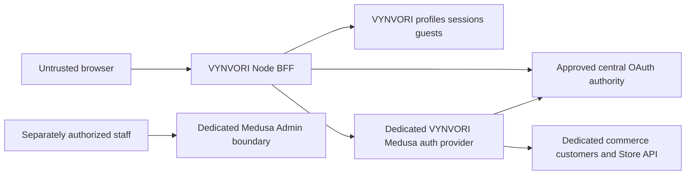

# M1a — Proposed bridge contract v1

Status: **PROPOSED_ONLY / NOT_IMPLEMENTED**. Requires M1a review, central authority evidence and M2 dedicated staging Medusa before M1b. [Source basis](M1a-auth-source-audit.md), [negative tests](M1a-identity-threat-model.md), [open gates](M1a-open-gates.md). These signatures are application interfaces, not claims that upstream endpoints already exist.

## Architecture decision

Use central OAuth authority for human credentials. Selectively wrap verified SDK exchange/refresh/revoke primitives in a server-only adapter; do not reuse Lucky identity/provisioning/session logic unchanged. Product-local opaque sessions hold a reference to encrypted server-side credentials. Neon owns VYNVORI UUID profiles, sessions, guest ownership and integration progress; a **dedicated VYNVORI Medusa Cloud project** owns customers and its AuthIdentity/customer link. All commerce writes go through Medusa workflows/modules/API, never VYNVORI Drizzle access to its database.



Central identity can be shared; product profile, customer, session, inventory, commerce database and staff access cannot. Never use Lucky's app/cookie ID or secrets. Never forward central bearer to Store API as if it were a Medusa JWT. The source-backed custom exchange path is `/auth/customer/tcm/exchange`; retaining that path for the dedicated service is a **proposal**, subject to tested service version and trust validation.

## Proposed TypeScript signatures

```ts
type ProductV1 = "vynvori";
type DeploymentV1 = "preview" | "staging" | "production";
type IdentityKeyV1 = Readonly<{ issuer: string; subject: string }>;
// Runtime verifier alone constructs this opaque/branded type.
declare const verifiedIdentityV1: unique symbol;
type VerifiedIdentityV1 = Readonly<{
  [verifiedIdentityV1]: true;
  contractVersion: 1;
  key: IdentityKeyV1;
  clientId: string;
  audiences: readonly string[];
  verifiedAt: number;
  expiresAt: number;
  authoritySessionRef?: string;
}>;
type AuthOutcomeV1<T> =
  | { status: "ok"; data: T }
  | { status: "unauthenticated" | "reauth_required" | "forbidden" }
  | { status: "unavailable"; correlationId: string }
  | { status: "outcome_unknown"; operationId: string };
type SessionContextV1 = Readonly<{
  contractVersion: 1;
  product: ProductV1;
  deployment: DeploymentV1;
  sessionId: string;
  generation: number;
  userId: string; // VYNVORI UUID; never email or arbitrary request owner
  identity: VerifiedIdentityV1;
  expiresAt: number;
}>;
type CustomerMappingV1 = Readonly<{
  contractVersion: 1;
  userId: string;
  medusaProjectId: string;
  medusaCustomerId: string;
  authIdentityId: string;
  state: "ready";
}>;
type LoginTransactionV1 = Readonly<{
  transactionId: string;
  authorizeUrl: string; // only approved central web origin
  expiresAt: number;
}>;
interface CentralIdentityAdapterV1 {
  begin(input: { request: Request; returnPath: string }): Promise<LoginTransactionV1>;
  complete(input: { request: Request; transactionId: string }):
    Promise<AuthOutcomeV1<SessionContextV1>>;
  verify(request: Request): Promise<AuthOutcomeV1<SessionContextV1>>;
  refresh(session: SessionContextV1): Promise<AuthOutcomeV1<SessionContextV1>>;
  logout(session: SessionContextV1): Promise<{
    localRevoked: true;
    upstream: "confirmed" | "pending" | "unsupported";
  }>;
}
interface CommerceIdentityBridgeV1 {
  ensureCustomer(input: { session: SessionContextV1; operationId: string }):
    Promise<AuthOutcomeV1<CustomerMappingV1>>;
  // Customer bearer stays in server vault; caller receives no token.
  customerRequest(input: {
    session: SessionContextV1;
    mapping: CustomerMappingV1;
    operation: "read_orders" | "read_customer" | "update_customer" | "read_cart";
    resourceId?: string;
    expectedRevision?: number;
  }): Promise<AuthOutcomeV1<unknown>>; // replace unknown with operation DTO union in M1b
}
type GuestCapabilityV1 = Readonly<{
  contractVersion: 1;
  audience: "vynvori-guest";
  deployment: DeploymentV1;
  guestSessionId: string;
  resourceId: string;
  scopes: readonly ("draft:read" | "draft:edit" | "asset:preview" | "draft:claim")[];
  expiresAt: number;
  nonce: string;
  keyId: string;
}>;
interface GuestOwnershipAdapterV1 {
  claim(input: {
    session: SessionContextV1;
    signedCapability: string; // runtime validated; not caller-decoded claims
    expectedRevision: number;
    idempotencyKey: string;
  }): Promise<AuthOutcomeV1<{ userId: string; resourceId: string; revision: number }>>;
}
interface StaffAuthorizationV1 {
  require(input: {
    session: SessionContextV1;
    permission: "qa:review" | "qa:approve" | "support:read";
    resourceId: string;
  }): Promise<AuthOutcomeV1<{ staffGrantId: string; policyVersion: string }>>;
}
```

No interface accepts email as linking proof, arbitrary issuer from browser, raw browser customer IDs as authority, or a browser role as authorization. Brand/type declarations are compile-time aids only; runtime schema validation and live session ownership checks are mandatory. Internal unknown responses above must become validated discriminated DTOs before implementation acceptance.

## Identity and persistence invariants

1. Exact authority-approved issuer namespace + nonempty immutable subject form the global identity key; do not invent an issuer from the API hostname. If the authority is OAuth userinfo-only, establish a verified authority issuer namespace and audience/revocation validation contract; do not fabricate OIDC discovery/JWKS/ID tokens.
2. Proposed Neon `user_profiles`: UUID primary key, unique `(identity_issuer, identity_subject)`, mutable contact fields separate. Email changes preserve user ID. Proposed commerce mapping unique `(medusa_project_id, user_id)` and `(medusa_project_id, medusa_customer_id)`; issuer+subject mapping must be recoverable independently of email.
3. Medusa provider identity uses a collision-free versioned encoding of issuer+subject; dedicated deployment restricts customer auth to the approved central provider. The exact provider ID/encoding and installed module imports require M2 version review. Staff `user` actor policy stays separate.
4. Provisioning journal states `reserved / customer_pending / mapping_pending / ready / outcome_unknown / conflict`; stable operation ID bound to identity/project, lease fencing and unique identity constraints. Medusa customer/link work runs in an idempotent Medusa workflow. Customer write succeeds but response lost: reconcile same immutable identity operation before any create retry. Never fill orphan mapping via first email match.
5. No distributed Neon/Medusa transaction. Persist outbox intent, execute verified command, record customer/AuthIdentity evidence, commit mapping; reconcile partial steps. No production migration in M1a. M1b migration must include unique constraints, backup/rollback and orphan handling; preserve evidence instead of destructive cleanup.

## Login, sessions and protected routes

Begin stores a cryptographically random server-side transaction with browser binding, state, PKCE verifier, exact approved callback/client/product/environment and normalized return path. Ten minutes is the observed Lucky transaction lifetime; a VYNVORI policy value needs review. Atomically consume transaction; replay/concurrent callback has no second session business effect. SDK primitives receive only server-selected parameters. No generic client-payload exchange without transaction validation. Nonce is required only if a verified ID-token flow is adopted; code/state/PKCE protection remains mandatory.

After valid authority verification, create/resolve profile and rotate the local session handle. Cookie proposal: host-only `__Host-` name, Secure, HttpOnly, Path=/, reviewed SameSite=Lax; no parent-domain sharing. Server record stores product/environment/issuer+subject, required finite TTL, generation, revocation and encrypted credential references. Exact TTL, inactivity, revocation SLA and token reuse policy are **BLOCKED**, not guessed defaults. Browser gets only sanitized profile/auth status. Private routes/responses use no-store; no cross-user shared cache.

SSR reads active session through Node server-only DAL. Route Handler/Server Action verifies again before access; Proxy is an optimistic UX aid, never sole permission enforcement. Refresh occurs in cookie-capable request context; no cookie writes inside Server Component render. Avoid middleware loopback dependency; test any request-header forwarding on Vercel Preview. In `/account/*`, owned studio project/history and authenticated saves, 401 means sign-in/re-auth with a safe resumable link; 403 means valid identity lacking permission; outage returns truthful unavailable state without granting access.

Public `/customize` and draft `/studio` access remain guest-capability-bound without Medusa or SSO. Only protected persistence/paid operations require verified authentication. No login/callback routes are added by this document; M1b route naming must be reviewed against canonical route registry.

## BFF and commerce isolation

Customer operations resolve project/customer from verified local mapping, validate resource ownership and use a vaulted customer bearer to the dedicated Medusa base. Lock scheme/host/project/publishable-key environment, methods and resource path allowlist; no arbitrary fetch URL/init cache override. Medusa independently checks customer actor for customer/order/cart access. Validate token/customer response schema and consistency with immutable mapping before cache. Admin credential never substitutes for customer auth. Dedicated project secrets and inventory remain completely separate from Lucky.

Error envelope proposal follows canonical v1: sanitized code/message/retryability + correlation ID. Invalid credentials 401, insufficient grant 403, ownership miss nonrevealing 404, dependency unavailable 503, pending provisioning/claim conflict with stable operation/revision. No upstream body, bearer, contact data or environment values in logs. Identity uncertainty cannot debit customer or create an order. Auth refresh/exchange retries are bounded; uncertain rotation/provisioning requires state reconciliation or reauth, never assumed success.

## Guest transition and signed assets

Guest identity is random scoped session, separate from authenticated identity. Capabilities are signed with audience, environment, resource, scope, expiry, nonce and key ID, bound to guest cookie. Quotas and upload validation apply. A claim requires both currently verified identity and valid claim capability, CSRF check, expected revision and idempotency key. In one Neon transaction, compare guest owner, consume nonce, transfer listed immutable draft/asset ownership, record claim result; emit outbox event. Same owner replay returns prior result, different owner denied. Draft ID alone grants nothing. Rotate guest/session handles; prevent claims after revocation or expiry. Asset URLs minted only after current scope/ownership check with approved short TTL; never transfer public originals or unrelated guest resources.

## Refresh, revocation, logout and staff

Persistent per-session refresh lease uses generation/fencing, bounded timeout and conditional credential rotation. Late refresh/cache cannot revive a revoked generation. Refresh response lost after remote rotation is `outcome_unknown`; reconcile using authority-approved recovery or reauth. App logout first writes durable revocation and evicts tokens, then clears cookie and journals upstream cleanup. Report local logout separately from central/global or already-issued Medusa token revocation. Replayed old handles fail even when authority is down.

P's userinfo performs signature/time/database revocation checks but omits issuer/audience/client enforcement and returns no audience for the bridge. Its code issuance is atomic, but refresh use does not consume the old refresh token, and revoke lacks client ownership/family cascade. The adapter must not brand this existing userinfo result as fully verified product identity. Agree an authority-owned namespace and client/product validation mechanism plus refresh/revocation remedy first; any central source change needs separate authorization. Do not distribute the authority's symmetric signing key or pretend OIDC discovery exists.

Central revocation/role changes require an audited transport or verified polling/introspection policy with approved SLA; duplicate/out-of-order deliveries use versioned inbox/dedupe and reconciliation. No invented webhook path. Immediate protected-operation recheck and bearer lifetime must meet policy; standalone expired-token behavior alone does not satisfy logout propagation.

Staff authorization requires fresh VYNVORI product grant and permission policy, optional step-up when approved, plus dedicated Medusa Admin actor policy. Central customer identity or email domain grants no staff powers. Restrict support/QA independently and log minimal actor/action/resource correlation. Print approval remains explicit human QA; staff authentication does not itself authorize release.

## Configuration and M1b work inventory

Configuration is typed and server-only, validated before enabled operation. Until reviewed, auth and bridge activation proposals default false and all existing M0 commercial flags remain false. These fields are design candidates; **do not add them to current M0 parser**, which correctly rejects unknown VYNVORI/public environment keys.

| Candidate field / dependency | Needed evidence |
|---|---|
| Central web/API origins, approved issuer, allowed audiences/client IDs, exact registered callback | Authority owner evidence; TLS/redirect policy; Preview vs production isolation |
| Central client secret reference, session/vault/guest signing key references and rotation IDs | Separate VYNVORI secret-manager provisioning, no Lucky secret reuse |
| Session/transaction TTL, revocation SLA, token time skew and refresh outcome policy | Approved operational policy + negative tests |
| Dedicated Medusa origin/project/provider/publishable key, JWT policy, Store/Auth/Admin CORS | M2 installed version + isolated staging actor tests; no shared customers |
| Database/vault connection reference, service access/egress rules | Future Neon/Drizzle scoped persistence and migration review |
| Trusted ingress origins/hosts and staff permission source | Vercel request boundary and staff-policy tests |
| `@crimsoncorp/oauth-react` server/nextjs, candidate 1.4.0 | Confirm tarball/source integrity and fix/bypass generic exchange CSRF behavior; pin exact reviewed artifact |
| Medusa 2.15.5 source / JS SDK 2.17.2 client | Observed versions only; M2 must pin compatible tested dedicated service and client |
| Runtime schema validator, crypto/HTTP library, Neon/Drizzle versions | Select/pin in implementation review; no speculative installs in M1a |

M1b work: server-only auth package/DAL, transaction and opaque-session store, central verification wrapper, dedicated Medusa provider/workflow, provisioning journal/outbox reconciliation, guest claim adapter, staff permission gate, route handlers/DTOs, reviewed config parser extension, migrations and AUTH-01–23 synthetic suites. No production login, infrastructure provisioning or release authorized here. Required prerequisite remains `M1a + M2 -> M1b`.
