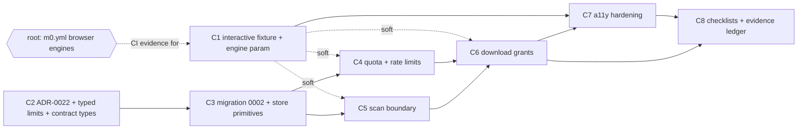

# M3 closure plan — local closure of the BYO garment editor (W1)

Status: **PROPOSED — awaiting founder review. No worker may start until the founder approves this plan** (registry rule 2: a plan is not authorization to implement). Author: M3-closure milestone manager. Base: `main` @ `1fa10e8` (CI green per root). Date: 2026-11-02. Revision 1.

Authority: founder-authorized W1 scope as relayed in the M3-closure manager kickoff. ADR-0022, migration number `0002` in `packages/db/composition-migrations/` and additive edits to the M3-owned contract files are granted by root. This document changes no code, schema, flag, workflow or protected file.

## 1. Objective, scope and outcome

Close every M3 gap that can be closed **inside the repository**, and prepare exact, evidence-ready checklists for the gaps only the founder can close.

**In scope (workers, all behind OFF flags where they touch production behaviour)**

| # | Workstream | ACC |
|---|---|---|
| A1 | Guest quota and rate limiting: per guest capability, per owner, and IP-independent global keys | ACC-04 |
| A2 | Short-lived, owner-checked, single-use download grants for private originals | ACC-07 |
| A3 | `ArtifactScanPort` plus an append-only scan-status lifecycle; unscanned/unknown assets are never served, previewed or frozen | ACC-07 |
| A4 | Editor accessibility hardening, verified by automated checks in the browser harness | ACC-05 |
| A5 | Browser harness parameterised by engine (Chromium, Firefox, WebKit) plus a reproducible interactive editor fixture | ACC-04/05 |

**Out of scope here:** staging Neon, R2, real identity, screen-reader pass, scanner vendor (§9 checklists, §8 questions); any Medusa/checkout/print/QA behaviour (M4/M5); the AI wallet (M7); derivative generation; garbage collection of expired guest objects (§11).

**Outcome.** M3 can be proposed as **LOCAL CLOSURE COMPLETE** when C1–C8 are merged with CI green and the B checklists are ready. It is **never PASSED** until the B items have executed evidence. Root and the founder decide acceptance changes. ACC rows change only with CI-executed evidence (§10).

## 2. Hard constraints (copy into every worker brief)

1. **System of record.** Neon/Drizzle owns compositions, assets, rights, print QA. **Never write Medusa's database.** No FK to Medusa.
2. **Identity.** Verified `issuer + subject` is the user key; email never links or proves ownership. Guests are capability holders only.
3. **No invented values.** No limits, TTLs, prices, print specs, supplier data, vendor choices. Production code carries **no numeric policy values**; they arrive as typed config and an unset value fails closed. Numeric fixtures exist only in `tests/`, are named `SYNTHETIC_*`, and are never exported from `src/`.
4. **No print permission.** Preview-only profiles stay non-print-eligible; nothing here moves any Plane E state. Paid never means print.
5. **Ownership everywhere.** Every ID and every asset access is checked in SQL with the existing access predicate. Absent, foreign, expired and claimed all return the same `NOT_FOUND`. Object keys are built on the server from validated IDs and a content hash, never from client input.
6. **Flags.** `assets.production_uploads` stays `false` and unsettable. No new `VYNVORI_*` variable (that prefix is reserved for operational flags that must stay `"false"`); new configuration uses `M3_*`.
7. **Migrations.** Non-destructive; documented, **tested** rollback; checksum pinned in `plan.json`.
8. **Never commit** user art, customer data, EICAR files or third-party binaries/vendor SDKs.
9. **Lanes.** Not granted: `package-lock.json`/dependency fields, `security/**`, `scripts/security/**`, `scripts/security-smoke.mjs`, `.github/workflows/**`, `scripts/deployment-check.mjs`, `scripts/integrity.mjs`, `docs/implementation/M0-protected-files.json` and every file it lists (including `docs/technical/20-acceptance-matrix.md` and `design/reference/**`), `MILESTONE-PROGRESS.md`, the registry, canonical specs `docs/technical/00`–`25`. Contracts: **additive only** and only in `composition-scene.ts`, `composition-port.ts`, `editor.ts`, `assets.ts` plus export lines in `index.ts`; never `state-machines.ts`, `operations.ts`, `quote.ts` or any ledger file (shared with M7).
10. **Stop and escalate** (AGENTS.md): need for any invented value or vendor; need for a lane not granted; contract conflict with a canonical doc; a change that would break an approved requirement.

## 3. Cloud-sandbox facts (verbatim block for every brief)

- No Docker daemon or live databases in sessions; no GCP, Neon, R2 or Vercel access. A throwaway loopback PostgreSQL from locally installed binaries (e.g. `/usr/lib/postgresql/16/bin`, if present in your container; verify) is allowed for fast feedback only; results are reported **NOT_RUN** as evidence. Only CI counts.
- Chromium and Playwright are preinstalled. **Never run `playwright install`.** Firefox/WebKit evidence comes only from CI.
- Containers are ephemeral and isolated: only pushed work exists; sessions cannot see each other's files.
- One designated branch per session; GitHub through the MCP tools (`gh` only for search). Never push to another session's branch, never merge, never force-push shared branches.
- Before reporting a PR ready: `npm ci`, then `npm run verify`, `npm run security:audit` and the affected tests. Postgres tests use `{ skip: !url && process.env.CI_REQUIRE_PG_TESTS !== "1" }`.
- Never use the `VYNVORI_*` prefix for test or CI variables.
- Only skills/commands listed in `.claude/VENDORED.md` exist (no `/security-scan`, `/verify`, `/tdd`, `/save-session`). For security review use `npm run smoke:security`, `npm run security:audit`, the `security-review` skill and the `security-reviewer` agent; record findings in the PR's security notes.

## 4. Verified repository findings (read on `main` @ `1fa10e8`)

| # | Finding | Consequence |
|---|---|---|
| F1 | **CI runs M3's Postgres suites.** `m2.yml` `foundation` provides Postgres 17.6, sets `M3_TEST_POSTGRES_URL` (`…/vynvori_m3_migration_test`) and `CI_REQUIRE_PG_TESTS=1`, creates `vynvori_m3_migration_test` and `vynvori_m3_service_test`, and sets `max_connections=250`. The migration runner (`packages/db/src/composition-migrations.ts`) accepts **only** those two database names, user `synthetic`, host `127.0.0.1`. | DB evidence comes from `foundation` log lines showing `ok`, not `# SKIP`. New DB tests reuse these two names. A third name needs a one-line allow-list edit in M3's own runner. The `browser` job lives in `m0.yml`, a separate job without Postgres. |
| F2 | **Asset path today.** `uploadAsset`: `inspectImage` (magic bytes, CRCs, size/pixel bounds) → key `private/composition/v1/{compositionId}/{sha256}` built server-side → `storage.put` (`If-None-Match: *`) → `insertAsset`. `readAsset` streams bytes through the API after an ownership check. No scanner and no scan status exist. `assets` rows are **immutable** (UPDATE/DELETE/TRUNCATE rejected by trigger). | A scan status cannot be a column on `assets`. It must be an append-only table. Existing rows have no scan record, so "no record = `pending`" makes them fail closed with no backfill. |
| F3 | **Invented numeric defaults already exist.** `defaultCompositionConfig` (`composition.ts`): guest TTL 24 h, image 25 MiB / 36 MP / 20 000 px, 24 assets and 150 MiB per composition. `composition-runtime.ts`: 256 KiB JSON body. `0001` hard-codes `byte_size <= 26214400` and `width/height <= 20000` as CHECKs; the editor status text says "expires in 24 hours". ADR-0018 records no founder approval for any of them. | Constraint 3 is already violated by M3's own implementation. Q1 asks the founder to ratify or replace them; C2 removes the defaults unless ratified. The DB CHECKs stay as structural ceilings either way (security bounds), pending Q1. |
| F4 | **No rate limiting or quota exists in the composition path.** Anonymous `POST /api/v1/compositions` is guarded only by same-origin. Doc 16 requires "short TTL, quota, CSRF" for guest drafts; doc 12 says "account-level and IP/device-aware rate limits … CAPTCHA/step-up only under abnormal risk". | The repository can enforce capability-, owner- and global-keyed limits. IP/device-aware limits and challenges are edge decisions (Q5). |
| F5 | **Browser harness.** `scripts/browser-web.mjs` is single-engine (`chromium.launch`, `channel: "chrome"` unless `M0_BROWSER=chromium`; any other value silently falls through to the Chrome channel). It runs route-level axe (WCAG 2.0–2.2 A/AA) over five routes × nine viewports, a mobile-menu keyboard check, the disabled-upload assertion, and a text-inflation/reduced-motion check. It never exercises editor interaction. CI (`m0.yml` job `browser`) installs Chromium only and sets `M0_BROWSER=chromium`. | The interactive journey in `M3-Evidence-20261102.md` (upload, numeric edit, drag, save, reload, freeze, restore) has **no script in the repository** (only `browser-web.mjs`, `browser-preview.mjs`, `editorial-layout.mjs` mention `/customize`). It is not reproducible by CI. C1 builds a committed fixture. |
| F6 | **Candidate editor accessibility observations** from reading `editor.tsx` (hypotheses; the worker must reproduce each before fixing): tablist has `role=tab`/`aria-selected` but no roving tabindex, arrow-key or `tabpanel` wiring; "Move up/down", "Hide layer" buttons share names across layers; each canvas layer repeats the full key help in its `aria-label`; arrow-key nudges change only an `aria-label` (no live announcement); the issues list is `aria-live="polite"` and re-announces wholesale; deleting a layer sets `selected=null` with no focus target; no announcement for freeze/restore/claim outcomes; numeric fields commit on blur/Enter with no visible validation message. | Drives C7 and the A4 assertions. |
| F7 | **Presigned URLs are not available without a dependency.** `@aws-sdk/s3-request-presigner` appears in the lockfile only as another package's dependency; `commerce` does not declare it. A presigned GET is also a bearer URL that bypasses the app's ownership and scan checks at fetch time. | Download access is app-issued, principal-bound and DB-backed (D4). The presigned option is recorded as rejected. |
| F8 | **`0001` rollback leaves the journal schema.** `rollback/0001_composition_scene.down.sql` drops `vynvori_composition` and deletes the journal row but not `vynvori_composition_migrations`; the runner then sees `hasJournal && !hasSchema` and throws `HISTORY_OR_SCHEMA_DRIFT` on a re-apply. (Read from source; **to be confirmed by a test in C3**.) | C3 tests up → down → up for `0002` and, if confirmed, repairs the `0001` down script (rollback files are not hash-pinned). |
| F9 | `CompositionError` codes drive a `Record<…>` status map in `composition-http.ts`; adding a code forces a compile-time update. `AssetRecord` has no `scanStatus`. The conformance suite (`composition-suite.ts`) runs one scenario list against an in-memory port and the PostgreSQL store. | New store methods land in both implementations, and tests prove parity. |
| F10 | **Connection budget.** `foundation` shares `max_connections=250` with M1b and M3 suites and, once merged, M7's ledger concurrency file (M7 plan D15: up to 110 connections plus ≤45 for other ledger files). | M3 tests cap their pools (≤ 5 per file, ≤ 20 concurrent actors in race tests). C3 records the budget in the ADR. |
| F11 | Playwright is 1.62.1 and axe-core 4.14.0 (lockfile); both are already workspace dependencies. | `locator.ariaSnapshot()` and the `target-size` rule are available. No dependency change is needed anywhere in this plan. |

## 5. Design decisions (proposed content of ADR-0022)

**Review method.** The kickoff allows a council only where the design is genuinely ambiguous. D3 and D4 were the candidates; both follow from existing constraints (immutable `assets`, ownership re-check, no new dependency), so a four-voice council was **not** convened. Instead D1–D7 went through the blueprint adversarial review (§12). The founder may override any decision at plan review.

**D1 — Typed limits, no defaults.** `CompositionLimitsV1` (commerce) holds every policy number: guest TTL seconds; image bytes/pixels/side; assets and bytes per composition; JSON body bytes; download-grant TTL seconds; scan timeout; per-operation rate policy `{ windowSeconds, max }`; global live-guest-draft cap. `parseCompositionLimits(env)` returns the limits or the list of missing/invalid keys (`M3_LIMIT_*` names; positive safe integers only; no zero, negative, float or `NaN`). **Each capability closes when its keys are missing**: guest creation without TTL and its rate keys; uploads without image/asset limits; downloads without a grant TTL; every rate-limited operation without its policy. A closed capability answers `503 COMPOSITION_LIMITS_NOT_CONFIGURED` (not 429). A static test asserts that `packages/commerce/src` and `apps/web/src/server` contain no numeric limit literals for these fields.

**D2 — Rate limiting and quota (ACC-04).**
- Storage: Postgres table `rate_limit_buckets(bucket_key, window_start, count)` in `vynvori_composition`. Admission is one atomic statement: `INSERT … ON CONFLICT (bucket_key, window_start) DO UPDATE SET count = b.count + 1 WHERE b.count < $max RETURNING count`. No row returned means limited. It works on Neon's pooled transaction-mode connections and across serverless instances; there is no in-process state.
- Keys (all IP-independent): `guest_create:global`; `guest_write:{compositionId}` and `asset_upload:{compositionId}`, `download_grant:{compositionId}`, `rescan:{compositionId}` (per guest capability; guest draft id equals composition id); the same operations keyed `…:{userId}` for owners. Subjects are charged **only after the access predicate succeeds**, so unauthenticated probing cannot create bucket rows (bounded cardinality). Flooding with invalid cookies is an edge concern (Q5).
- Quota: a global cap on live guest drafts (unexpired, unclaimed), counted in the same transaction as the creation insert under `pg_advisory_xact_lock`; per-composition asset count/bytes (existing mechanism, now typed config).
- Window: fixed window computed from the injected clock. A two-window burst at a boundary and cross-instance clock skew are documented, accepted trade-offs. A sliding window needs more state and is deferred.
- Response: `429 COMPOSITION_RATE_LIMITED` with `Retry-After`. The editor shows a polite status message and stops retrying until the retry time.
- **Known limit:** with no IP signal, one abusive client can exhaust the global `guest_create` budget and deny other guests. That is the cost of IP independence and is disclosed in Q5, which is where a per-client control belongs.
- Pruning: `pruneRateBuckets({ olderThan })` takes a required cut-off with no default and is operator-run; no scheduler exists in W1. The runtime role gets no `DELETE`.

**D3 — Scan lifecycle (ACC-07).**
- Table `asset_scan_events` (append-only; UPDATE/DELETE/TRUNCATE rejected, same style as `0001`): `asset_id`, `composition_id`, `asset_sha256`, `seq`, `from_status`, `to_status`, `scanner_id`, `engine_version`, `definitions_version`, `evidence_ref`, `reason_code`, `recorded_at`. **Current status** = latest `seq`; **no event = `pending`**.
- Allowed edges, enforced by a database trigger: `pending→clean`, `pending→quarantined`, `pending→unknown`, `unknown→pending` (explicit rescan request), `clean→quarantined` (late detection). `quarantined` is terminal and never auto-released. `clean`/`quarantined` events require scanner id, engine and definitions versions and an evidence reference; `unknown` requires a reason code; `asset_sha256` must equal the asset row's hash. Events for one asset are serialised (row lock) so `seq` is gap-free.
- Scan results are **not shared** across compositions even for identical bytes (no cross-tenant existence oracle).
- Port (`assets.ts`, types only): `ArtifactScanPort { scannerId; scan(request, signal): Promise<ArtifactScanResult> }` with `request = { assetId, sha256, byteSize, mime, bytes }` and a strict Zod-parsed result `{ verdict: "clean" | "infected" | "error", sha256, engineVersion, definitionsVersion, evidenceRef, scannedAt }`. Mapping: `clean`→`clean`; `infected`→`quarantined`; **anything else — error, timeout, throw, malformed or unrecognised result, result hash not equal to the request hash — maps to `unknown`**. The default wiring is `unconfiguredScanPort`, which always reports `error / SCANNER_NOT_CONFIGURED`. A scan is attempted once per request; `unknown→pending` happens only on an explicit rescan request (rate-limited), never automatically.
- **No vendor, binary, SDK or service is chosen or vendored** (Q4). When a vendor is chosen, a richer request shape (stream or reference instead of bytes) is an additive contract revision.
- Uploads require a wired scanner: with `unconfiguredScanPort` the upload route answers `503 UPLOADS_DISABLED`, so no unservable bytes accumulate. Until Q4 is decided, only tests (with a `SYNTHETIC_*` scan double) exercise the upload path; the editor's upload control stays unavailable.
- Scanning is attempted inline after the asset row is inserted, with a typed timeout. An asynchronous worker is future work tied to the vendor decision.

**D4 — Download access (ACC-07).**
- Table `asset_download_grants`: `grant_id`, `token_hash` (unique), `asset_id`, `composition_id`, `principal_kind` (`owner` | `guest`), `principal_hash` (SHA-256 of the user id or the guest capability hash), `issued_at`, `expires_at` (`> issued_at`), `redeemed_at`.
- `POST /api/v1/compositions/:id/assets/:assetId/download-grants` (mutating: same-origin, CSRF for sessions, rate-limited) mints a 256-bit token, stores only its hash, and returns `{ downloadUrl, expiresAt }`. TTL comes from `M3_LIMIT_DOWNLOAD_GRANT_TTL_SECONDS` (Q3); unset closes the endpoint. Minting needs the asset to be `clean`.
- `GET …/assets/:assetId/download?grant=<token>` **redeems**: one atomic `UPDATE … SET redeemed_at = now WHERE token_hash = $ AND redeemed_at IS NULL AND expires_at > now RETURNING`. Redemption also requires that the **same principal** presents its normal credential (session cookie or guest capability cookie) and passes the standard access predicate, and that the asset is still `clean` and belongs to that composition. A leaked or logged URL is therefore useless to anyone else. Unknown, expired, already-used, foreign, wrong-principal and non-clean all return the identical `NOT_FOUND`.
- The response is `Content-Disposition: attachment` with a server-generated filename (`original-<sha12>.<ext>`), `X-Content-Type-Options: nosniff`, `Content-Security-Policy: default-src 'none'; sandbox`, `Cache-Control: no-store`, `Cross-Origin-Resource-Policy: same-origin`, and a SHA-256 integrity check against the stored hash (the existing storage adapter already verifies size and hash). The bytes are the **unchanged original**.
- No wallet, entitlement or payment check exists on this path (doc 06: originals are never gated behind export payment). A static test asserts that the download module imports nothing from the ledger or entitlement code.
- The existing inline `GET …/assets/:assetId` (used for editor thumbnails) stays. It is cookie-authenticated, `no-store` and not a bearer URL, but it now serves only `clean` assets.
- Expired and redeemed grants are not deleted in W1; pruning is operator-run.
- **Rejected:** (a) R2 presigned GET (needs a dependency; bearer; bypasses re-checks), (b) stateless HMAC tokens (need a new signing secret and cannot be revoked or made single-use without state), (c) permanent per-asset public URLs (forbidden).

**D5 — Fail-closed choke points.**

| Operation | Requires | Otherwise |
|---|---|---|
| `readAsset` (inline) | `clean` | `NOT_FOUND` |
| download-grant mint | `clean` | `409 ASSET_NOT_AVAILABLE` (the owner may learn the state of their own asset) |
| download redeem | `clean` | `NOT_FOUND` |
| `freeze` | every image layer's asset `clean` | `409 ASSET_NOT_CLEAN` |
| `saveDraft` | asset belongs to the composition (unchanged) | `ASSET_NOT_OWNED` |
| editor preview | asset `clean` | placeholder block with an announced status; **no pixels**, including no local object-URL preview of the picked file |

Draft saves may reference a `pending` asset so work is not lost; the preflight reports `ASSET_NOT_SCANNED` and freeze is blocked. Restore copies a frozen scene, whose assets were clean at freeze, but the check at freeze time is repeated for the next freeze.

**D6 — Migration `0002` (one migration, three tables).** `0002_asset_access_and_limits.sql` creates `asset_scan_events`, `asset_download_grants` and `rate_limit_buckets` plus triggers. One migration keeps one staging apply and one rollback drill. It grants nothing (runtime-role grants are a documented proposal, as in ADR-0018). `plan.json` gains the entry with a pinned SHA-256. **Rollback** `rollback/0002_*.down.sql` refuses while any scan event or grant row exists, otherwise drops only the `0002` objects and deletes only its journal row, leaving `0001` untouched and re-appliable. If a later step proves that more schema is needed, it asks root for `0003`; a merged `0002` is never edited.

**D7 — Flags and wiring.** No new feature flag. The new routes sit behind the existing composition gate (isolated staging identity canary **and** `M3_COMPOSITION_ENABLED=true`, never production). `M3_COMPOSITION_UPLOADS=true` additionally needs a wired scanner (D3) and complete limits (D1). `assets.production_uploads` is untouched. The static test from `composition-config.test.ts` (all flags OFF by default) is extended to cover the new variables.

## 6. Steps, dependencies and lanes

One step = one branch = one PR = one worker. **One worker PR in flight for M3 closure** (W1 total 2; M7 holds the other). Suggested model tier: strongest for C3, C5 and C6 (security-critical), default for the rest. Execution is serial in the order below; the graph shows true dependencies only.



Order of execution: **C1 → C2 → C3 → C4 → C5 → C6 → C7 → C8.** C1 goes first because it carries the largest unknown (can a faithful interactive fixture be built from committed code without a production seam?) and every later UI change benefits from it. It is independent of C2–C6 (soft edges: later steps *should* extend its scenarios; they do not need it to compile).

| Step | Title | Migration | Hard deps | Evidence source |
|---|---|---|---|---|
| C1 | Interactive editor browser fixture and engine-parameterised harness | — | — | `m0.yml` `browser` (Chromium); Firefox/WebKit only after root's CI step |
| C2 | ADR-0022, typed limits config, contract types | — | — | `m0.yml` `verify` (contracts, web), `m2.yml` (commerce) |
| C3 | Migration `0002`, store port and primitives (PG + in-memory), rollback drill | `0002` | C2 | `m2.yml` `foundation` |
| C4 | Quota and rate limiting | — | C3 | `m2.yml`, `m0.yml` |
| C5 | Malware-scanning boundary | — | C3 | `m2.yml`, `m0.yml` |
| C6 | Short-lived owner-checked download grants | — | C4, C5 | `m2.yml`, `m0.yml` |
| C7 | Editor accessibility hardening | — | C1, C6 | `m0.yml` `browser` |
| C8 | Founder checklists and evidence ledger | — | C6, C7 | docs-only; link check |

### C1 — Interactive editor browser fixture and engine-parameterised harness (default model)

*Context.* F5. Today CI proves only route-level axe on `/customize` with every flag OFF. The interactive M3 journey is documented in the evidence file but cannot be reproduced from the repository.

*Tasks.*
1. Make the engine explicit: `M0_BROWSER` ∈ `chrome` (current default channel), `chromium`, `firefox`, `webkit`. **An unknown value must fail the run** (today it silently falls through). Record engine and `browser.version()` in `results.json`. Use `playwright` exports for all three engines already in the lockfile.
2. Build a committed, test-only fixture (suggested `scripts/browser-editor-fixture.mjs`, imported by `browser-web.mjs`). It must run the **production Next build** with synthetic configuration that makes `editorCapabilities()` report upload available, and serve `/api/v1/compositions*` through the real `compositionHttpHandlers` over an in-memory store behind a same-origin proxy (the approach recorded in the evidence file). **No production code seam, no new route, no test-only branch in `src/`.** If that proves impossible, stop and escalate: do not add a seam.
3. Port the evidence journey into assertions that run in CI: upload (using a generated PNG), numeric X to 1 µm, arrow and Shift/Alt nudges, drag with a single undo step, text layer, out-of-bounds issues, front/back independence, guest save, `HttpOnly` + `SameSite=Strict` + `__Host-` cookie, identical geometry after reload, freeze, restore, ED-03 review link, no horizontal overflow at 1280/390/320.
4. Engine notes: assert where engines legitimately differ (e.g. `setPointerCapture` and `getScreenCTM` drag math, `<input type="color">`) rather than skipping silently.
5. **Do not edit `.github/workflows/**`.** Produce the exact CI step in the PR description for root (see RESOURCE REQUEST text in §7).

*Files/lanes.* `scripts/browser-web.mjs`, new `scripts/browser-editor-fixture.mjs` (and helpers), fixtures under `scripts/` or `apps/web/tests/` (test-only), docs. No `src/` product code.

*Verify.* `npm ci`; `npm run build:web`; `npm run test:browser:web` with `M0_BROWSER=chromium` (local result NOT_RUN as evidence); `npm run verify`; `npm run security:audit`.

*Exit.* CI `browser` job green on Chromium with the new scenarios; harness rejects unknown engines; Firefox/WebKit invocation documented and ready for root's step. Firefox/WebKit rows stay **NOT_RUN** until root's workflow change merges and CI executes them.

### C2 — ADR-0022, typed limits and contract types (default model)

*Tasks.* Write ADR-0022 (D1–D7, rejected options, rollout/rollback, security notes). Add `CompositionLimitsV1` + `parseCompositionLimits` and the closed-capability behaviour (D1) in commerce. **Remove numeric defaults** from `defaultCompositionConfig` and the web runtime (unless Q1 ratifies them); update existing tests to explicit `SYNTHETIC_*` config. Add types-only contracts: `ArtifactScanStatus` (`pending | clean | quarantined | unknown`), `ArtifactScanPort`/request/result schemas (`assets.ts`), `scanStatus` on `AssetRecord` and the new error-code vocabulary (`composition-port.ts`/`editor.ts`). Extend the flags-OFF config test.

*Files.* `docs/implementation/ADR-0022-*.md`; `packages/contracts/src/{assets,composition-port,editor}.ts`; `packages/commerce/src/composition*.ts`; `apps/web/src/server/composition-runtime.ts`; tests in the same packages and `apps/web/tests/`. No migration, no route.

*Verify.* contracts, commerce, web unit tests; `npm run verify`; `npm run security:audit`; static no-literal test.

*Exit.* With no limits configured the composition runtime refuses guest creation, uploads and downloads with `LIMITS_NOT_CONFIGURED`; with `SYNTHETIC_*` config all existing M3 behaviour is unchanged (existing composition suites green on both stores).

### C3 — Migration `0002`, store port and primitives (strongest model)

*Tasks.* Author `0002_asset_access_and_limits.sql` + `plan.json` entry (pinned SHA-256) + `rollback/0002_*.down.sql` (D6). Extend `CompositionStore` with: `recordScanEvent`/current-status join in asset reads; `createDownloadGrant`/`redeemDownloadGrant`; `consumeRateToken`; `countLiveGuestDrafts`; `pruneRateBuckets`. Implement in the PostgreSQL store **and** the in-memory conformance harness. Confirm F8 by test and repair `0001`'s down script if confirmed. Record the connection budget (F10) in the ADR.

*Tests (all CI-counted in `foundation`).* replay and drift; scan edges (each illegal edge rejected, `clean→quarantined` allowed, hash mismatch rejected, immutability, `seq` gap-free under concurrent inserts); grant single-use under N concurrent redeems (exactly one winner), expiry boundary, wrong principal; bucket admission under concurrency (limit `SYNTHETIC_L`, N concurrent ⇒ exactly `SYNTHETIC_L` admitted); live-guest cap race; rollback up → down → up, down refusing with data, `0001` still intact; additive-only SQL scan (no GRANT/DROP of foreign objects).

*Files.* `packages/db/composition-migrations/**`, `packages/db/src/composition-store.ts`, `packages/db/tests/**`, `packages/contracts/src/composition-port.ts`, `packages/commerce/tests/composition-suite.ts` (memory harness).

*Exit.* DDL and conformance suites green in `foundation` with `ok` lines; no runtime import of the new primitives yet.

### C4 — Quota and rate limiting (default model)

*Tasks.* Service-level limiter wrapping the mutating operations (D2 keys; charge after access check); `guest_create` global bucket and live-guest cap; `429` mapping with `Retry-After`; `COMPOSITION_RATE_LIMITED` error; editor 429 handling (status message, backoff, no retry storm); per-composition asset count/bytes read from typed config. Extend the conformance suite with SYNTHETIC policies.

*Tests.* each operation limited at exactly `SYNTHETIC_L`; window rollover; a foreign or expired subject creates no bucket row and gets the uniform `NOT_FOUND`; unset policy ⇒ `LIMITS_NOT_CONFIGURED`, never "unlimited"; owner and guest keys independent; global cap race; browser scenario (C1 fixture) for the 429 status message.

*Verify/exit.* Foundation + browser green; every limit value in the repo is `SYNTHETIC_*` and lives in `tests/`.

### C5 — Malware-scanning boundary (strongest model)

*Tasks.* `unconfiguredScanPort`; service `scanAsset`/`requestRescan`; upload refuses when no scanner is wired (D3); choke points per D5 (`readAsset`, `freeze`, grant mint); projection of `scanStatus` through the HTTP asset list; preflight code `ASSET_NOT_SCANNED`; editor placeholder state and live announcements for `pending`, `clean`, `quarantined`, `unknown`; no local pixel preview of unscanned files.

*Tests.* port result mapping table including malformed, wrong-hash, timeout and thrown results ⇒ `unknown`; every illegal transition; existing pre-scan rows treated as `pending` (migration compatibility); unscanned/unknown/quarantined asset cannot be read, frozen or granted; owner of a clean asset can read it; cross-composition scan results are not shared; upload refuses with `unconfiguredScanPort`; security review of the scan boundary. A `SYNTHETIC_*` scan double lives in `tests/` only.

*Exit.* Foundation + browser green; **no scanner vendor, binary or SDK in the diff**; `assets.production_uploads` unchanged.

### C6 — Short-lived owner-checked download grants (strongest model)

*Tasks.* Service `mintDownloadGrant`/`redeemDownloadGrant`; two route files under `apps/web/src/app/api/v1/compositions/[id]/assets/[assetId]/` (`download-grants`, `download`) forwarding to the handlers; response headers per D4; editor "Download original" control (available only for `clean` assets, named with the file context, announced on mint/redeem outcome).

*Tests.* owner and guest happy path returns the unchanged bytes with matching SHA-256; second redeem, expired, wrong principal, foreign composition, claimed guest, non-clean asset and unknown token all return the **identical** `NOT_FOUND` body; mint without TTL config closed; mint rate-limited; headers asserted; token never appears in JSON responses, logs or error bodies; no ledger/entitlement import (static); no payment coupling; browser scenario for the download control.

*Exit.* Foundation + browser green; security-reviewer sign-off recorded.

### C7 — Editor accessibility hardening (default model; `react-reviewer` required)

*Tasks (audit first, then fix; reproduce each F6 hypothesis before changing code).* Keyboard-only journey for every editor action; focus order and focus restoration after add/delete/duplicate/restore/freeze; roving tabindex and arrow-key support for the zone tablist with `tabpanel` wiring; unique accessible names for per-layer actions; one shared description for key help instead of per-layer repetition; debounced polite announcements for position changes, save/conflict/freeze/restore/claim/scan/download outcomes and a summarised issue count (no wholesale re-announcement); visible focus indicators on SVG layers; target size ≥ 24 × 24 CSS px for all controls; inline validation text for numeric fields; reduced-motion and 200 % text behaviour on every interactive state; reflow at 320 px.

*Automated checks (in the C1 harness, engine-parameterised).* axe (WCAG 2.0–2.2 A/AA) on each interactive state, not just the initial page; `locator.ariaSnapshot()` assertions for the editor landmark tree, tablist, layer list and selected-layer fieldset; keyboard-only scenario that completes the whole journey without a pointer event; live-region assertions (text appears in the status region after nudge, save, scan transitions); focus-order and focus-restoration assertions; computed-style assertions for focus outline, target size and `transition-duration: 0s` under `prefers-reduced-motion`; text inflated to 200 % with no horizontal overflow at 320 px.

*Limits stated in the PR.* These checks do not replace the manual screen-reader pass (B4); Playwright's WebKit build is not Safari and its Tab behaviour differs from macOS Safari defaults.

*Files.* `apps/web/src/components/editor/**`, `apps/web/src/app/globals.css` (editor block only), harness files from C1. Not `design/reference/**` (protected).

*Exit.* CI `browser` green with the new scenarios; every accessibility change has a failing-first assertion; findings that cannot be fixed inside the approved design are listed as founder questions rather than silently waived.

### C8 — Founder checklists and evidence ledger (default model, docs-only)

*Tasks.* Write `docs/implementation/M3-Closure-Checklists.md` (§9 outline, expanded with the final env names, routes, labels and commands) and an evidence ledger (`M3-Closure-Evidence-<date>.md`) listing, per step, PR, merge commit, CI run, the exact job/test lines that executed, and what was **NOT_RUN**. No acceptance-matrix edit (protected; root writes).

*Exit.* Every B item has exact commands, expected output and an evidence artifact name; links resolve.

## 7. Resource requests and sequencing with root

| Request | When | Text |
|---|---|---|
| **RESOURCE REQUEST — CI, `.github/workflows/m0.yml` job `browser`** (Firefox + WebKit evidence) | When C1's PR is open | See below |
| ADR-0022 (granted); migration `0002` (granted) | in hand | — |
| Migration `0003` | only if a later step proves schema is missing | ask then |
| Dependencies/lockfile | **not needed**; if a scanner client ever is, ask then (any new advisory fails `security:audit`, ADR-0020) | — |

**Exact CI change requested of root** (keeps the existing required-check name `browser`):

```yaml
      - run: npx playwright install --with-deps chromium firefox webkit   # was: chromium only
      - run: npm run build:web
      - run: npm run test:browser:web
        env: { M0_BROWSER: chromium, M0_EVIDENCE_DIR: "${{ runner.temp }}/m0-browser-chromium" }
      - run: npm run test:browser:web
        env: { M0_BROWSER: firefox,  M0_EVIDENCE_DIR: "${{ runner.temp }}/m0-browser-firefox" }
      - run: npm run test:browser:web
        env: { M0_BROWSER: webkit,   M0_EVIDENCE_DIR: "${{ runner.temp }}/m0-browser-webkit" }
      # one upload-artifact step per engine directory; each with if: always() and if-no-files-found: error
```

Notes for root: (a) alternative is a matrix over `engine`, which would rename the required check to `browser (chromium)` etc.; (b) `timeout-minutes` (currently 15) very likely needs raising for three engines and the new interactive scenarios; the right value is unknown until the first CI run and must not be guessed; (c) the harness must land first (or in the same PR), because today an unknown `M0_BROWSER` value silently runs the Chrome channel; (d) `--with-deps` installs OS packages on the runner; install runs in CI only, never in a session.

## 8. Founder questions

No default is invented for any of these. Where a question has an option set, no option is picked on the founder's behalf except where noted as the plan's working assumption.

| # | Question | Needed by | If unanswered |
|---|---|---|---|
| Q1 | **Ratify or replace M3's existing numbers** (F3): guest TTL 24 h; 25 MiB / 36 MP / 20 000 px per image; 24 assets and 150 MiB per composition; 256 KiB JSON; hard DB CHECKs of 25 MiB and 20 000 px. | C2 | C2 removes the defaults and the runtime fails closed until values are configured. DB CHECKs stay. |
| Q2 | **Rate/quota values** (`windowSeconds` and `max`) for: `guest_create` (global); live-guest-draft cap (global); and, per guest capability and per owner, `guest_write`, `asset_upload`, `download_grant`, `rescan`. | before staging use | Each operation stays closed. |
| Q3 | **Download-grant TTL** (seconds). | before staging use | Downloads stay closed. |
| Q4 | **Scanner selection** (Table below). | before any upload is enabled | Uploads stay refused (D3). No vendor is chosen by this plan. |
| Q5 | **Edge controls** for what the repository cannot do: IP/device-aware limits and challenge/step-up (doc 12 says CAPTCHA only under abnormal risk). Disclosed gap: one client can exhaust the global `guest_create` budget. | before any public exposure | Global-key limits only. |
| Q6 | **Scan-policy edges:** (a) may an owner ever download a non-`clean` original (default: no)? (b) retention/disposal of `quarantined` objects (storage has no delete today); (c) wording for the owner when an asset is `unknown` or `quarantined`. | C5 | strict default (a: no); no deletion; neutral wording drafted by the worker for review. |
| Q7 | **Accessibility findings that conflict with the approved design** (if C7 finds any) — for example colour contrast of tokens, or target sizes fixed by the design reference. | C7 | Listed and waived by nobody; row stays IN_PROGRESS. |
| Q8 | **Staging drill preference:** may a staging-only "hold-pending" upload mode exist (bytes stored, never served, scanner absent) so the R2 round trip can be rehearsed before Q4 is decided? | before B2 | No: the R2 round trip is rehearsed with the operator script only (B2). |

**Q4 — scanner options and trade-offs (no recommendation).** The categories below are generic. Product availability, licensing, data-handling terms and prices change; each must be verified at decision time.

| Option | For | Against / risks |
|---|---|---|
| Self-hosted open-source engine as a separate service (e.g. a ClamAV-class daemon in a container) | no per-scan fee; customer art never leaves the platform; Cloud Run/GCP already used (M2) | we run it: signature update pipeline, hosting, scaling, patching; it is a new image in the supply chain (root-owned security lane; no binaries are committed); weaker on novel threats; scan latency and memory limits |
| Hosted multi-engine scanning API | broader detection; no ops | customer artwork goes to a third party (privacy/rights/DPA, jurisdiction vs the pinned US R2 bucket, ADR-0007); per-scan cost; rate limits; vendor availability sits on the upload path; SDK may need a dependency (lockfile lane) |
| Edge/WAF or storage-provider native upload scanning | no code on our side | availability depends on provider plan and product; coverage of server-side uploads (our path streams through the API) must be verified; limited visibility into verdict evidence |
| No content scanner; rely on strict validation only | zero cost and zero data sharing | does not meet ACC-07 ("scans"); polyglot/metadata payloads in originals remain; originals must be returned **unchanged**, so re-encoding is not available for them |

Decision inputs the founder needs to weigh: where bytes go; who operates it; fail-closed behaviour on outage (`unknown` blocks the owner from their own file, so an outage is a user-visible event); latency inside an upload request versus an asynchronous worker; cost per scan; evidence the scanner returns (engine and definitions version are mandatory in D3).

## 9. Founder-only checklists (outline; C8 writes the full text with exact commands)

These are prepared, not executed. Each item will list prerequisites, ordered steps, the exact command, the expected result, the evidence artifact to attach, and the rollback.

| Item | Prerequisites | Core steps | Evidence to produce |
|---|---|---|---|
| **B1 Staging Neon migration + rollback drill** | separate founder remote-database approval; pinned target added to the plan; native backup per `M2-Neon-Migration-Procedure.md`; runtime-role grants for `0001` and `0002` (§5 D6 proposal); a **staging-capable apply path** — the current runner is deliberately loopback-only, so a reviewed staging variant is a separately authorised work item, not part of W1 | backup → apply `0001`+`0002` → read-only inspection (journal rows, SHA-256s, table list) → synthetic row round trip → rollback drill on an empty copy (down refuses with data; down succeeds when empty; re-up) → restore drill | journal digest, schema digest, drill transcript, backup/restore transcript |
| **B2 R2 private round trip** | R2 credentials already scoped to the staging bucket (ADR-0007); jurisdiction endpoint | operator script writes a synthetic object at a server-shaped key; read-back verifies size and SHA-256; second write is refused (`If-None-Match`); hash-mismatch is detected; unauthenticated GET and listing fail (bucket not public, no CORS); the **API** read path is not used (it now requires a clean scan) | transcript with status codes and hashes; bucket-privacy proof; confirmation that no public URL exists |
| **B3 Real identity claim** | blocked on M1b live gates | staging canary on; create a guest draft; sign in through central identity; claim; old guest cookie is dead; a second real user gets `NOT_FOUND` for the composition and its assets; owner sees it in the list | request/response transcript (secrets redacted), screenshot of the claimed draft, database state of `guest_drafts`/`compositions` |
| **B4 Manual screen-reader pass** | final labels from C7 | NVDA + Firefox and NVDA + Chrome (Windows); VoiceOver + Safari (macOS) and iOS Safari; per-step script with the **expected announcement** for every action (add text, select layer, nudge, numeric edit, reorder, hide, delete, switch side, save, conflict, freeze, restore, scan states, download) plus 200 % browser zoom and OS reduced-motion | filled results table (pass/fail/notes per step per reader), short recordings, defects filed as issues |
| **B5 Scanner vendor selection and drill** | Q4 decision; adapter PR (separate, authorised) | decision record with criteria and chosen option → integration → clean file ⇒ `clean`; standard antivirus test string (assembled at run time, never committed) ⇒ `quarantined`, never servable; scanner outage ⇒ `unknown`; rescan path | decision record, drill transcript, scan-event rows |
| **B6 Edge controls (if Q5 chosen)** | Q5 decision | configure the edge rule/challenge; replay the C4 scenarios against staging | rule export, test transcript |

## 10. Evidence policy and proposed ACC effects

- **Counts:** only CI-executed results, cited by job and test lines. `m2.yml` `foundation` for PostgreSQL and commerce suites; `m0.yml` `verify` for contracts/web; `m0.yml` `browser` for the harness.
- **Does not count:** any local run, local PG16 run or local Chromium run. These are reported `NOT_RUN`.
- **Every step PR** includes: ADR link or reference, tests, security-review notes, API examples for new routes, and an explicit "NOT_RUN" list.
- **Proposed ACC effects (root writes the matrix; nothing changes without executed evidence):**

| Row | Today | After C1–C8 with CI evidence | Still open (needs B items) |
|---|---|---|---|
| ACC-04 | IN_PROGRESS (no quota, no real SSO) | note updated: capability/owner/global limits and live-draft cap enforced and tested in CI | real SSO claim (B3); edge controls (Q5, B6); values (Q2) |
| ACC-05 | IN_PROGRESS | note updated: interactive journey in CI on three engines (Firefox/WebKit after root's step) | none beyond B4 for accessibility |
| ACC-06 | IN_PROGRESS | unchanged | staging Neon (B1) |
| ACC-07 | IN_PROGRESS (no scanning, no expiring URLs) | note updated: scan boundary and expiring owner-checked grants tested in CI; **no scanner exists** | staging R2 (B2), vendor and drill (B5, Q4), staging Neon (B1) |
| ACC-22 | NOT_STARTED | owner/BOLA tests for the new routes feed ACC-22 evidence | live identity (B3) |

## 11. Risks, assumptions and known gaps

| # | Item | Mitigation |
|---|---|---|
| R1 | A faithful interactive fixture may need a production seam | C1 is first and must escalate rather than add a seam |
| R2 | Postgres connection budget shared with M1b, M3 and (soon) M7 | caps in F10; budget recorded in ADR-0022; coordinate with M7 plan D15 |
| R3 | Shared `packages/contracts` lane with M7 | M3 edits only its four files and `index.ts` export lines; rebase before merge; conflicts go to root |
| R4 | Removing defaults (C2) changes many existing tests | worker moves them to `SYNTHETIC_*` fixtures in one commit; flags are OFF, so no runtime path changes |
| R5 | Playwright WebKit and Firefox may expose real defects and iterate through CI | evidence only from CI; failures are recorded and fixed, never skipped; skip lists need founder approval |
| R6 | Scanner `unknown` blocks the owner from their own original | by design (fail closed); visible status, rescan path, operator runbook in B5; trade-off is Q4/Q6 |
| R7 | Fixed-window limiter allows a boundary burst and depends on clock agreement | documented and accepted in ADR-0022 |
| R8 | `next build` ends with a Next.js "security upgrade" gate message after a successful compile (recorded in M3 evidence) | not touched here |
| Gap | Expired guest drafts' R2 objects are not garbage-collected (doc 08 step 4) and the storage adapter has no delete | not in W1; recorded as a post-closure item, needs a deletion policy and root-approved storage change |
| Gap | Derivatives/thumbnails, deterministic text renderer, async scanning worker | M5 / vendor decision |

## 12. Review gate record

Adversarial review of this plan is recorded below once complete (reviewer given the plan and read access to the repository, instructed to find defects rather than confirm; dispositions listed here).

*(filled in by the review step)*

## 13. Plan mutation protocol

Steps may be split, inserted, skipped, reordered or abandoned only by a plan revision PR that states the reason and the affected steps; the founder approves it. A merged step is never rewritten: corrections are new steps. Findings that block a step go to the manager, then root, then the founder; a worker never works around a denied lane.

After founder approval the manager issues one `/orch-*` command and a standalone worker brief per step (via `plan-orchestrate`) and hands each to the founder to start. Briefs embed §2, §3, the step's section and its ADR references verbatim.
