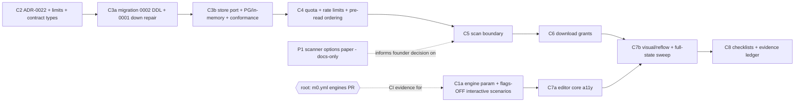

# M3 closure plan — local closure of the BYO garment editor (W1)

Status: **PROPOSED — awaiting founder review. No worker may start until the founder approves this plan** (registry rule 2: a plan is not authorization to implement). Author: M3-closure milestone manager. Base: `main` @ `1fa10e8` (CI green per root). Date: 2026-11-03. **Revision 3** (rev 1 = first draft; rev 2 = adversarial review applied, §12; rev 3 = founder rulings relayed by root applied, §0). No revision approves anything: the founder approves this plan directly.

Authority: founder-authorized W1 scope as relayed in the M3-closure manager kickoff. ADR-0022 and migration number `0002` in `packages/db/composition-migrations/` were granted by root in that kickoff, and so were additive edits to the M3-owned contract files. The registry does not yet record them (§7 asks root to). This document changes no code, schema, flag, workflow or protected file.

## 0. Founder rulings relayed by root (rev 3)

The founder gave these rulings to root, and root relayed them to this manager on 2026-11-03. **They are rulings relayed by root, recorded here as such. They are not approval of this plan.** The founder approves the plan directly, and no worker starts before that.

| # | Ruling | Effect on this plan |
|---|---|---|
| **QB** (preview of the user's own local file) | **Accepted.** Browser-held bytes may stay in the local preview. Server-sourced pixels (anything read back from storage, used in a freeze, export or derivative) require scan status `clean`. Unscanned/unknown assets are never served from the server. | D5 states exactly this. No change to the editor's local `data:` preview. |
| **QC** (scanner) | **No vendor is chosen.** Deliver an options paper (vendor / doc 12:17 "controlled decode" interim / defer). Build only the fail-closed `ArtifactScanPort` boundary and the `pending → clean \| quarantined \| unknown` lifecycle. M3 stays at **LOCAL CLOSURE COMPLETE, not PASSED**, and **W2 stays blocked, until the founder picks a scanner and uploads are enabled.** | New named deliverable **P1** (§6), the scanner options paper. C5 builds only the boundary. The Outcome in §1 says so. |
| **QA** (server-backed browser fixture) | **Accepted: flags-OFF scenarios only.** No identity canary, no spoofed Vercel environment, no test seam. **C1b is conditional and NOT approved.** | C1a only. C1b is kept in §6 solely to record the limitation; it is not approved and no brief will be issued. Server-backed states are covered by handler-level and PostgreSQL tests and by the founder's B checklists. |
| **Q1** (existing invented values) | **Accepted.** C2 removes the policy defaults: 24 h guest TTL, 25 MiB / 36 MP / 20 000 px, 24 assets, 150 MiB, 256 KiB. The runtime fails closed until typed config supplies a founder-approved value. **No replacement numbers are picked.** Every value the founder must supply is listed in one table. The editor's client-side `LOCAL_LIMIT` and `36_000_000` check are in this plan's lane and route through the same config; no second copy is left. | §5.1 is that table. C2 removes the editor's copies (§6 C2). |
| **RR-1** (Firefox + WebKit in `m0.yml` `browser`) | **Granted in principle.** Root makes the workflow PR after the C1a PR is open and this manager sends the exact step text (§7) and the measured Chromium run time. Do not guess `timeout-minutes`. | §7. The C1a PR reports the CI-measured duration of the `browser` job. |
| **RR-2** (advisory lock) | **Granted: `pg_advisory_xact_lock(742110, 4)`** for M3 runtime and quota serialization. In use: `(742110,1)` identity migrations, `(742110,3)` composition migrations (so `0002` stays under key 3), `(742110,7)` ledger migrations; 5 and 6 are unassigned. | D8 uses key 4; any further key is requested from root. |
| **RR-3** (registry) | **Recorded** in root's next registry PR: ADR-0022, composition migration `0002`, DB-name pattern `vynvori_m3_<name>_test`, connection budget. Each manager declares peak connections per test file; the fixture asserts the sum fits under 250 minus 20 for tooling. | D8 declares the M3 budget; the total goes to root in the STATUS message. |

## 1. Objective, scope and outcome

Close every M3 gap that can be closed **inside the repository**, and prepare exact, evidence-ready checklists for the gaps only the founder can close.

**In scope (workers, all behind OFF flags where they touch production behaviour)**

| # | Workstream | ACC |
|---|---|---|
| A1 | Guest quota and rate limiting: per guest capability, per owner, IP-independent global keys | ACC-04 |
| A2 | Short-lived, owner-checked download grants for private originals | ACC-07 |
| A3 | `ArtifactScanPort` plus an append-only scan lifecycle; unscanned/unknown assets are never served from the server or frozen (**boundary only; no scanner is chosen**) | ACC-07 |
| A6 | **P1:** scanner options paper for the founder (docs-only deliverable) | ACC-07 |
| A4 | Editor accessibility hardening with automated checks | ACC-05 |
| A5 | Engine-parameterised browser harness (Chromium, Firefox, WebKit) with flags-OFF interactive scenarios | ACC-04/05 |

**Out of scope:** staging Neon, R2, real identity, screen-reader pass, scanner vendor (§9, §8); Medusa/checkout/print/QA (M4/M5); the AI wallet (M7); derivatives; garbage collection of expired guest objects (§11).

**Outcome.** M3 can be proposed as **LOCAL CLOSURE COMPLETE** when the unconditional steps are merged with CI green and the B checklists are ready. It is **never PASSED** until the B items have executed evidence **and the founder has picked a scanner and uploads are enabled (QC). Until then M3 stays at LOCAL CLOSURE COMPLETE and W2 stays blocked.** Root and the founder decide acceptance changes. ACC rows change only with CI-executed evidence (§10).

## 2. Hard constraints (copy into every worker brief)

1. **System of record.** Neon/Drizzle owns compositions, assets, rights, print QA. **Never write Medusa's database.** No FK to Medusa.
2. **Identity.** Verified `issuer + subject` is the user key; email never links or proves ownership. Guests are capability holders only.
3. **No invented values.** No limits, TTLs, prices, print specs, supplier data, vendor choices. Production code carries **no numeric policy values**; they arrive as typed config and an unset value fails closed. Numeric fixtures exist only in `tests/`, are named `SYNTHETIC_*`, and are never exported from `src/`.
4. **No print permission.** Preview-only profiles stay non-print-eligible; nothing here moves any Plane E state. Paid never means print.
5. **Ownership everywhere.** Every ID and every asset access is checked in SQL with the existing access predicate. Authenticated-but-not-entitled requests (absent, foreign, expired, claimed) return the same `NOT_FOUND`. Object keys are built on the server from validated IDs and a content hash, never from client input.
6. **Flags.** `assets.production_uploads` stays `false` and unsettable. No new `VYNVORI_*` variable, and no test or CI use of that prefix; new configuration uses `M3_*`.
7. **Migrations.** Non-destructive; documented, **tested** rollback; checksum pinned in `plan.json`; a merged migration is never edited.
8. **Never commit** user art, customer data, antivirus test strings or third-party binaries/vendor SDKs.
9. **Lanes.** Not granted: `package-lock.json`/dependency fields, `security/**`, `scripts/security/**`, `scripts/security-smoke.mjs`, `.github/workflows/**`, `scripts/deployment-check.mjs`, `scripts/integrity.mjs`, `docs/implementation/M0-protected-files.json` and every file it lists (including `docs/technical/20-acceptance-matrix.md` and `design/reference/**`, which also declares the Playwright/axe-core dependencies), `MILESTONE-PROGRESS.md`, the registry, canonical specs `docs/technical/00`–`25`. Contracts: **additive only**, only in `composition-scene.ts`, `composition-port.ts`, `editor.ts`, `assets.ts` plus export lines in `index.ts`; never `state-machines.ts`, `operations.ts`, `quote.ts` or any ledger file (shared with M7).
10. **Security-smoke policy (root-owned, read it before writing UI or fixtures).** `scripts/security-smoke.mjs` allows `fetch(` in `.ts`/`.tsx` only in the listed files (for M3: `editor.tsx`, `review.tsx`) and bans `localStorage`, `eval(` and `dangerouslySetInnerHTML` across `apps/web`. All new browser-side network calls (download mint, scan status) therefore live in `editor.tsx`/`review.tsx`, and fixtures live in `scripts/` as `.mjs`. Needing anything else is a RESOURCE REQUEST.
11. **Stop and escalate** (AGENTS.md): need for any invented value or vendor; a lane not granted; a contract conflict with a canonical doc; a change that would break an approved requirement.

## 3. Cloud-sandbox facts (verbatim block for every brief)

- No Docker daemon or live databases in sessions; no GCP, Neon, R2 or Vercel access. A throwaway loopback PostgreSQL from locally installed binaries (e.g. `/usr/lib/postgresql/16/bin`, if present in your container; verify) is allowed for fast feedback only; results are reported **NOT_RUN** as evidence. Only CI counts.
- Chromium and Playwright are preinstalled. **Never run `playwright install`.** Firefox/WebKit evidence comes only from CI.
- Containers are ephemeral and isolated: only pushed work exists; sessions cannot see each other's files.
- One designated branch per session; GitHub through the MCP tools (`gh` only for search). Never push to another session's branch, never merge, never force-push shared branches.
- Before reporting a PR ready: `npm ci`, then `npm run verify`, `npm run security:audit` and the affected tests. Postgres tests use `{ skip: !url && process.env.CI_REQUIRE_PG_TESTS !== "1" }`.
- Never use the `VYNVORI_*` prefix for test or CI variables.
- Only skills/commands listed in `.claude/VENDORED.md` exist (no `/security-scan`, `/verify`, `/tdd`, `/save-session`). For security review use `npm run smoke:security`, `npm run security:audit`, the `security-review` skill and the `security-reviewer` agent; record findings in the PR's security notes.

## 4. Verified repository findings (read on `main` @ `1fa10e8`; rev 2 corrections marked ✎)

| # | Finding | Consequence |
|---|---|---|
| F1 ✎ | **CI runs M3's Postgres suites in `m2.yml` `foundation` only.** It provides Postgres 17.6, sets `M3_TEST_POSTGRES_URL`, `CI_REQUIRE_PG_TESTS=1`, creates `vynvori_m3_migration_test` and `vynvori_m3_service_test`, and sets `max_connections=250`. The `m0.yml` `verify` job also runs `test:m2`, where these suites print `# SKIP`. The migration runner (`composition-migrations.ts:36`) **and** the test fixture (`composition-fixture.ts:9`) allow-list exactly those two names. `freshComposition()` **drops all three schemas** on whichever database it opens, and `test:m2` runs all test files in one `node --test`, which runs files in parallel. | Evidence is `foundation` lines showing `ok`. A new DB test file must **not** share a database with an existing one (they would drop each other's schema mid-run). Each new DB test file gets its own database created by the fixture (D8). |
| F2 | **Asset path today.** `uploadAsset`: `inspectImage` → duplicate/quota pre-check → key `private/composition/v1/{compositionId}/{sha256}` built server-side → `storage.put` (`If-None-Match: *`) → `insertAsset`. `readAsset` buffers the object and returns it after an ownership check. `assets` rows are **immutable** by trigger. No scanner, no scan status. | Scan status must be an append-only table, not a column. Existing rows have no scan record; "no record = `pending`" makes them fail closed. |
| F3 ✎ | **Invented numeric values already exist and no founder approval is recorded (ADR-0018:11).** `defaultCompositionConfig`: guest TTL 24 h, image 25 MiB/36 MP/20 000 px, 24 assets and 150 MiB per composition; web runtime: 256 KiB JSON body; `0001` CHECKs 26 214 400 bytes and 20 000 px; `editor.tsx:146,201` hard-code "24 hours". Also: contracts `SCENE_LIMITS` (`composition-scene.ts:77-78`: 5000 mm position and size, 64 layers per scene, 2000 text chars, 360° rotation), the zone-size schema cap of 2000 mm (`:41-42`) and the synthetic preview profile's own limits (16 layers per zone, 280 text chars, 150 PPI; `:241`, declared synthetic and not supplier data), a 30 s body deadline (`composition-http.ts:45`), R2 timeouts 20 s/5 s (`composition-storage.ts`), `LIMIT 100` (`composition-store.ts:69`), 1500 ms autosave (`editor.tsx:157`). | Constraint 3 is already violated by M3's own code. Q1 classifies each as *policy limit* (typed config, no default), *structural ceiling* (contracts/DB CHECK; additive-only rule means they stay) or *engineering constant* (documented in the ADR). |
| F4 | **No rate limiting or quota exists in the composition path.** Anonymous `POST /api/v1/compositions` is guarded only by same-origin. Doc 16:13 requires "short TTL, quota, CSRF"; doc 12:33 says "account-level and IP/device-aware rate limits … CAPTCHA/step-up only under abnormal risk". | The repo can enforce capability-, owner- and global-keyed limits. IP/device-aware limits and challenges are edge decisions (Q5). |
| F4b ✎ | **Upload bytes are read before access is verified.** `uploadAsset` (`composition-http.ts`) calls `actor()`, which for a guest only checks the cookie's *format* and derives a hash (no database check), then `readBody` buffers up to the upload limit, and only then does the service run its access check. | A well-formed but invalid guest cookie buys unlimited large-body buffering. C4 must authorize and charge **before** reading the body. |
| F5 ✎ | **Browser harness.** `scripts/browser-web.mjs` is single-engine: `chromium.launch`, `channel: "chrome"` unless `M0_BROWSER=chromium`; any other value falls through to the Chrome channel. It runs route-level axe over five routes × nine viewports, a mobile-menu keyboard check, the disabled-upload assertion and a text-inflation/reduced-motion check; it never exercises editor interaction. CI (`m0.yml` job `browser`) installs Chromium only. The evidence file says identity was OFF, in which case `editorCapabilities()` returns `artworkUpload:false` and `/customize` renders a disabled button with no file input (`customize/page.tsx`, `editor.tsx:230-232`). | The recorded "upload" journey **cannot have run on the unmodified production build** and has no committed script. It is not reproducible by CI. A server-backed fixture was not approved (ruling QA). Everything the editor does with all flags OFF **is** testable now. |
| F6 | **Candidate editor accessibility observations** (hypotheses; the worker reproduces each before fixing): tablist has `role=tab`/`aria-selected` but no roving tabindex, arrow keys or `tabpanel`; "Move up/down", "Hide layer" names repeat across layers; each canvas layer repeats full key help in its `aria-label`; arrow-key nudges change only an `aria-label`; the issues list is `aria-live="polite"` and re-announces wholesale; deleting a layer sets `selected=null` with no focus target; no announcement of freeze/restore/claim outcomes; numeric fields commit on blur/Enter and report errors only through the shared status line. | Drives C7a/C7b. |
| F7 ✎ | **Presigned URLs.** `@aws-sdk/s3-request-presigner` is in the lockfile only as `@medusajs/file-s3`'s dependency, not declared by `commerce`. A hand-rolled SigV4 query presign using `node:crypto` is technically possible without a dependency. Rejected anyway: a presigned GET is a bearer URL that bypasses the app's ownership and scan checks at fetch time. | D4. |
| F8 ✎ | **`0001`'s rollback breaks re-apply and would destroy `0002`.** `down.sql` drops `vynvori_composition` and deletes the journal row but not `vynvori_composition_migrations`; the runner then sees `hasJournal && !hasSchema` → `HISTORY_OR_SCHEMA_DRIFT` (`composition-migrations.ts:44-46`). The existing test never re-applies. Also its guard checks only compositions/assets/versions, and `DROP SCHEMA … CASCADE` would silently drop `0002` tables. | C3a repairs it: refuse while any journal row other than `0001` exists; drop the empty journal schema; test up→down→up on both migrations. |
| F9 | `CompositionError` codes drive a `Record<…>` status map (`composition-http.ts:8`); the conformance suite runs one scenario list against an in-memory port and the PostgreSQL store. `AssetRecord` is used only in `commerce/src/composition.ts`, its tests, `db/src/composition-store.ts` and `composition-port.ts`: all M3-owned. | New store methods and a required `scanStatus` field land in both implementations in one PR (C3b); a grep proving no other implementer is part of the PR. |
| F10 ✎ | **Connection and lock budget is shared.** `foundation` runs M1b, M3 and (when merged) M7 suites against one server with `max_connections=250`, and `node --test` runs files in parallel, so budgets add up. M7 plans up to 110 connections in one file plus ≤45 elsewhere. Advisory-lock keys in use: `(742110,1)` identity runner, `(742110,3)` composition runner; M7 plans `(742110,7)`. | M3 race-test pools are capped (≤ 20 in one file, ≤ 5 elsewhere); the ADR records the sum. M3 asks root for a lock-key class (§7). |
| F11 ✎ | Playwright 1.62.1 and axe-core 4.14.0 are in the lockfile but declared only in the **protected** `design/reference/package.json`; the harness loads them via `createRequire` on that file. | `ariaSnapshot()` and the `target-size` rule are available; no dependency change is needed anywhere in this plan. |
| F12 ✎ | **Harness engine constraints.** The product session/guest cookies are `Secure; __Host-`; WebKit may not store them over `http://127.0.0.1`. The existing `Tab`/skip-link assertions may differ in WebKit. | Firefox/WebKit must pass the **existing** checks as well as new ones; an engine-specific exception needs written founder approval, never a silent skip. |

## 5. Design decisions (proposed content of ADR-0022)

**Review method.** The kickoff allows a council only where the design is genuinely ambiguous. D3 and D4 were the candidates; both follow from existing constraints (immutable `assets`, ownership re-check, no new dependency), so a four-voice council was **not** convened. Instead the whole plan went through the blueprint adversarial review (§12), which materially changed D3, D4 and D5. The founder may override any decision at plan review.

**D1 — Typed limits, no defaults.** `CompositionLimitsV1` (commerce) holds every *policy* number: guest TTL; image bytes/pixels/side; assets and bytes per composition; JSON body bytes; download-grant TTL; scan timeout and scan lease; per-operation rate policy `{ windowSeconds, max }`; global live-guest-draft cap. `parseCompositionLimits(env)` returns the limits or the missing/invalid keys (`M3_LIMIT_*`; positive safe integers only), and **rejects values above the structural ceilings** (the `0001` CHECKs) instead of letting an insert fail later. A capability whose keys are missing is closed: guest creation without TTL and its rate keys; uploads without image/asset limits; downloads without a grant TTL; each rate-limited operation without its policy. A closed capability answers `503 COMPOSITION_LIMITS_NOT_CONFIGURED` (not 429). The guest-draft status text in the editor derives from the API's `expiresAt`, never a literal. **One source for the editor's client-side checks:** the server-rendered `/customize` pages (both) obtain the parsed image limits from the same `parseCompositionLimits` result (through `editorCapabilities`) and pass them to the editor as a prop. The editor's pre-checks (file size, pixel count, side length) and the numbers in its error messages use that prop; with limits unset the upload control stays unavailable. The server remains authoritative. There is no second constant and no contracts constant (contracts are additive-only, and no value is allowed a default). A static test asserts no numeric limit literals for these fields in `packages/commerce/src` and `apps/web/src/server`.

**D2 — Rate limiting and quota (ACC-04).**
- Storage: `rate_limit_buckets(bucket_key, window_start, count)`. Admission is one atomic statement: `INSERT … ON CONFLICT (bucket_key, window_start) DO UPDATE SET count = b.count + 1 WHERE b.count < $max RETURNING count`; no row means limited. The window is computed from the **database clock** (`date_bin(…, now())`), removing cross-instance skew; tests pass an explicit timestamp. Works on Neon's pooled transaction-mode connections; no in-process state.
- Keys (all IP-independent): `guest_create:global`; `asset_upload:global`; per guest capability `guest_write:{compositionId}`, `asset_upload:{compositionId}`, `download_grant:{compositionId}`, `rescan:{compositionId}` (guest draft id equals composition id); the same operations keyed `{userId}` for owners.
- **Order of operations (F4b):** parse and format-check IDs → verify the access predicate in SQL (for a guest, a database check, not just cookie format) → charge the bucket → **only then read the request body**. Subjects are charged only after access succeeds, so invalid callers create no bucket rows and learn nothing; an authenticated-but-limited caller gets `429` with `Retry-After`.
- Quota: per-composition asset count/bytes enforced **in SQL under a per-composition advisory lock** (no check-then-insert race); a global live-guest-draft cap counted over M3's own `compositions` rows (`owner_user_id IS NULL`, joined to an unexpired, unclaimed guest draft) in the same transaction as the creation insert, under an advisory lock; `0002` adds a partial index for that count. M1b's direct writes to `guest_drafts` are not counted and not blocked.
- Fixed window: a boundary burst of up to twice the limit is a documented, accepted trade-off. A sliding window needs more state and is deferred.
- **Known limit:** with no IP signal, one abusive client can exhaust the global `guest_create` budget and deny other guests, and `asset_upload:global` bounds storage growth per window only (no garbage collection exists). That is the cost of IP independence; the per-client control belongs at the edge (Q5).
- Pruning: `pruneRateBuckets({ olderThan })`, required cut-off, no default, operator-run; no scheduler in W1; the runtime role gets no `DELETE`.

**D3 — Scan lifecycle (ACC-07).**
- `asset_scan_events` (append-only, UPDATE/DELETE/TRUNCATE rejected): `asset_id`, `composition_id`, `asset_sha256`, `seq`, `from_status`, `to_status`, `scanner_id`, `engine_version`, `definitions_version`, `evidence_ref`, `reason_code`, `recorded_at`. **Current status = latest `seq`; no event = `pending`.**
- Edges enforced by trigger: `pending→clean | quarantined | unknown`, `unknown→pending` (explicit rescan request), `clean→quarantined` (late detection). `quarantined` is terminal and never auto-released. `clean`/`quarantined` events need scanner id, engine and definitions versions and an evidence reference; `unknown` needs a reason code; `asset_sha256` must equal the asset row's hash.
- **Scan attempts as reservations (AGENTS rule 7, no uncontrolled billable retry).** `asset_scan_attempts(attempt_id, asset_id, started_at, lease_expires_at, finished_at)` with a partial unique index allowing **one open attempt per asset**. A scan is requested by the explicit operation `scanAsset(assetId)`, valid from `pending` (including rows that predate `0002`, and assets stranded by a crash between insert and scan) and, via a rescan request, from `unknown`. The attempt row is committed **before** the port is called. An attempt whose lease has expired is closed as `unknown(reason=lease_expired)` only by an explicit request, **never automatically**, and a new attempt can start only after that, so a vendor call is never duplicated by a timeout or a concurrent request. A scan is attempted once per request. The scan lease and timeout are typed config (Q3).
- **Serialization:** per-asset advisory transaction lock in M3's lock class 4 (D8). Not `SELECT … FOR UPDATE` on `assets`: that needs UPDATE privilege, and the runtime role is meant to hold only SELECT/INSERT on `assets`.
- Scan results are **not shared** across compositions even for identical bytes (no cross-tenant existence oracle).
- **Port** (types only, in `composition-port.ts`, which is intentionally *not* in the public barrel; the runtime Zod result schema lives in commerce, not contracts): `ArtifactScanPort { scannerId; scan(request, signal) }` with `request = { assetId, sha256, byteSize, mime, bytes }` and a strict-parsed result `{ verdict: "clean" | "infected" | "error", sha256, engineVersion, definitionsVersion, evidenceRef, scannedAt }`. Mapping: `clean→clean`; `infected→quarantined`; **anything else — error, timeout, throw, malformed or unrecognised result, hash not equal to the request — maps to `unknown`.** Default wiring: `unconfiguredScanPort` (always `error / SCANNER_NOT_CONFIGURED`). A richer request shape (stream or reference) is an additive revision when a vendor is chosen.
- **No vendor, binary, SDK or service is chosen or vendored** (Q4).
- **Uploads require a wired scanner.** With `unconfiguredScanPort` the upload route answers `503 UPLOADS_DISABLED`, so in that mode no objects accumulate. When a scanner is wired, objects in `pending`, `unknown` and `quarantined` **do** accumulate (the storage adapter has no delete); disposal is a founder policy (Q6b). Scan-then-store (reject infected bytes before `put`) was considered and **rejected**: it cannot support asynchronous scanners and loses quarantine evidence.
- Scanning is attempted inline after the row is inserted, with the typed timeout. An asynchronous worker is future work tied to Q4.

**D4 — Download access (ACC-07).**
- `asset_download_grants`: `grant_id`, `token_hash` (unique), `asset_id`, `composition_id`, `principal_kind` (`owner` | `guest`), `principal_hash` (SHA-256 of the user id, or the guest capability hash), `issued_at`, `expires_at` (`> issued_at`), `redeemed_at`.
- **Mint:** `POST …/assets/:assetId/download-grants` (mutating: same-origin, CSRF for sessions, rate-limited, access and charge before body). Requires the asset to be `clean`; otherwise `409 ASSET_NOT_AVAILABLE` (visible only after the ownership predicate, so no cross-tenant oracle). Returns `{ downloadUrl, expiresAt }`; TTL is `M3_LIMIT_DOWNLOAD_GRANT_TTL_SECONDS` (Q3); unset closes the endpoint. Only the token hash is stored.
- **Redeem** `GET …/assets/:assetId/download?grant=<token>`, in this order:
  1. standard authentication (session or guest capability). **Unauthenticated callers receive `401 AUTH_REQUIRED` (before any lookup, so no information leaks); the uniform `NOT_FOUND` applies to every authenticated-but-not-entitled case;**
  2. read-only validation: grant exists, unexpired, unredeemed, `principal_hash` matches, asset belongs to the composition, access predicate passes, latest scan status is `clean`;
  3. fetch the object and verify size and SHA-256 **before** consuming anything, so a storage failure never burns a grant;
  4. consume with **one atomic statement** whose `WHERE` repeats every condition of step 2 (`UPDATE … SET redeemed_at … WHERE … RETURNING`), so a leaked URL cannot be spent by a different valid session and a race loses cleanly;
  5. only if the consume statement returned a row, send the bytes. Otherwise `NOT_FOUND`.
- Requests marked as prefetch (`Sec-Purpose`/`Purpose`) never redeem. The editor mints on an explicit button press and navigates programmatically; there is no rendered link and no `<Link>`.
- Response: `Content-Disposition: attachment` with a server-generated filename (`original-<sha12>.<ext>`), `X-Content-Type-Options: nosniff`, `Content-Security-Policy: default-src 'none'; sandbox`, `Cache-Control: no-store`, `Referrer-Policy: no-referrer`, `Cross-Origin-Resource-Policy: same-origin`. The bytes are the **unchanged original**.
- Token handling, stated precisely: the token appears in the mint response's `downloadUrl` (by necessity) and nowhere else; application code never logs it; platform access logs may record query strings, which is harmless because the grant is principal-bound, short-lived and (by default) single-use.
- **Single-use vs multi-use within the TTL** is a founder question (Q3b). Working assumption: single-use, re-mintable (mint is rate-limited). Download managers or Safari re-requests without cookies will fail by design.
- No wallet, entitlement or payment check exists on this path (doc 06: originals are never gated behind export payment). A static test asserts the download module imports nothing from ledger or entitlement code.
- The existing inline `GET …/assets/:assetId` (editor thumbnails) stays: cookie-authenticated, `no-store`, not a bearer URL, now serving only `clean` assets.
- Expired and redeemed grants are not deleted in W1 (operator-run prune).
- **Rejected:** R2 presigned GET (bearer URL; bypasses re-checks; official presigner needs a dependency); stateless HMAC tokens (new signing secret; not revocable or single-use without state); permanent per-asset public URLs (forbidden). Whether an app-issued, principal-bound grant satisfies ACC-07's literal "expired presigned URL" (doc 20:25) and doc 16:38's "owner-signed temporary download link" is Q9.

**D5 — Fail-closed choke points.**

| Operation | Requires | Otherwise |
|---|---|---|
| inline `readAsset` | `clean` | `NOT_FOUND` |
| download mint | `clean` | `409 ASSET_NOT_AVAILABLE` |
| download redeem | `clean` (re-checked in the consuming statement) | `NOT_FOUND` |
| `freeze` | every image layer's asset `clean`, **checked inside the freeze transaction under the per-asset advisory lock** (including the idempotent re-point branch of `store.freeze`, where no insert trigger fires) | `409 ASSET_NOT_CLEAN` |
| `saveDraft` | asset belongs to the composition (unchanged) | `ASSET_NOT_OWNED` |
| server-sourced pixels in the editor, or any read-back from storage, freeze, export or derivative | `clean` | placeholder block with an announced status |
| browser pixels from bytes the user's device already holds (local preview) | allowed (founder ruling QB, relayed by root) | n/a |

Draft saves may reference a `pending` asset so work is not lost; preflight reports `ASSET_NOT_SCANNED` and freeze is blocked. After a reload the asset appears as a placeholder until `clean`. **Downstream contract note (recorded in the ADR for M4/M5):** a frozen version that pins an asset later found `quarantined` must be refused for quote, proof and print by those milestones; M3 cannot enforce it.

**D6 — Migration `0002`.** `0002_asset_access_and_limits.sql` creates `asset_scan_events`, `asset_scan_attempts`, `asset_download_grants`, `rate_limit_buckets`, the triggers, and the partial index for the live-guest count. One migration keeps one staging apply and one rollback drill. It grants nothing (runtime-role grants are a documented proposal, as in ADR-0018). `plan.json` gains the entry with a pinned SHA-256. **Rollback** `rollback/0002_*.down.sql` refuses while any scan event, attempt or grant row exists; otherwise it drops only `0002` objects and deletes only its journal row, leaving `0001` re-appliable. If a later step proves more schema is needed it asks root for `0003`.

**D7 — Flags and wiring.** No new feature flag. New routes sit behind the existing composition gate (isolated staging identity canary **and** `M3_COMPOSITION_ENABLED=true`, never production). `M3_COMPOSITION_UPLOADS=true` additionally needs a wired scanner (D3) and complete limits (D1). `assets.production_uploads` is untouched. The all-flags-OFF config test is extended to the new variables.

**D8 — Test databases, locks and connection budget.**
- **Databases.** Each new database test file creates and drops **its own database** (`vynvori_m3_<name>_test`, created through the fixture's maintenance connection; CI's synthetic superuser can create databases, as M7 D15 does). The fixture and runner allow-lists change from a two-name list to a strict name pattern plus loopback plus user `synthetic`.
- **Lock class (RR-2, granted).** M3 runtime and quota serialization uses lock class 4, written `pg_advisory_xact_lock(742110, 4)` by root's grant. `0002` itself applies through the existing composition migration runner, so it stays under `(742110,3)`. A single global `(742110,4)` lock would serialize every scan event, quota decision and freeze across all compositions. Per-asset and per-composition serialization therefore needs a *per-subject* key. The plan proposes the single-bigint form `pg_advisory_xact_lock(bigint)`, whose high 32 bits are the constant `4` and whose low 32 bits are `hashtext(subject)`. That form lives in a different lock-type space from the two-integer form, so it cannot collide with `(742110,1|3|7)`, and a hash collision only adds harmless extra waiting. **Root accepted this reading (RR-2, relayed 2026-11-03) with four conditions, which are binding on C3b:**
  1. The bigint is built in SQL with an explicit unsigned mask: `(4::bigint << 32) | (hashtext(subject)::bigint & 4294967295)`. Without the mask a negative `hashtext` sign-extends and overwrites the class bits. A test proves that a subject whose `hashtext` is negative still yields class 4.
  2. **One acquisition order, composition lock before asset lock**, is defined in ADR-0022 and tested with two callers that request the locks in opposite orders, to rule out deadlock.
  3. Locks are transaction-scoped (`pg_advisory_xact_lock`) only. No session-level advisory locks.
  4. `hashtext` is an internal function and is not stable across major PostgreSQL versions. That is acceptable for transient locks computed at runtime on one server; the ADR says so, and the output is never persisted.
  Any other key is requested from root. Root records the allocation in the registry as "(bigint) high word 4 = M3 runtime".
- **Connection budget (declared to root; the fixture asserts the sum against `250 − 20` for tooling).** `node --test` runs files in parallel, so the worst case is every M3 PostgreSQL file at once. **Each figure below is the file's total peak, counting its pool, the fixture's own persistent client and one transient admin/probe connection** (root asked for this restatement because the M7 manager corrected its own count the same way). Concretely, a 5-connection file has a pool capped at 3, and the 20-connection race file has a pool capped at 18:

| Test file (all `m2.yml` `foundation`) | Peak connections |
|---|---|
| `packages/db/tests/composition.test.ts` (existing, `0001` DDL) | 5 |
| `packages/db/tests/composition-0002-ddl.test.ts` (new, C3a) | 5 |
| `packages/db/tests/composition-0002-concurrency.test.ts` (new, C3a/C3b: grant, bucket and scan-sequence races) | 20 |
| `packages/commerce/tests/composition-pg.test.ts` (existing service suite, extended by C3b–C6) | 5 |
| at most one further commerce PostgreSQL file (scan/download scenarios, C5/C6) | 5 |
| **M3 total, at most five files** | **40** |

For comparison, M7 declares 110 + 45 = 155. A sixth M3 database file, or any pool above its declared cap, requires re-declaring the budget in the ADR first. If root finds the combined worst case over the ceiling, root serializes the PostgreSQL suites with `--test-concurrency=1` in a workflow PR and nobody shrinks tests.


### 5.1 Values the founder must supply (single table)

No value below has a default in production code. Until the founder supplies a value, the capability that needs it stays closed (D1). Keys are environment variables (`M3_LIMIT_<KEY>`; no `VYNVORI_*`). Values are positive safe integers. Image limits above the structural ceilings (25 MiB = 26 214 400 bytes, 20 000 px; `0001` CHECKs) are rejected at startup. Code values listed as "removed" are deleted by C2; they are shown only so the founder can see what is being replaced. **This manager supplies no replacement numbers.**

| # | Key | Unit | Used where | Code value removed or "new" |
|---|---|---|---|---|
| 1 | `GUEST_TTL_SECONDS` | seconds | guest draft expiry (`createGuest`), guest cookie `Max-Age`, editor expiry text | 24 h (`composition.ts:31`; "24 hours" strings in `editor.tsx:146,201`) |
| 2 | `IMAGE_MAX_BYTES` | bytes | server image inspection, HTTP upload body limit, **editor client pre-check and its message** | 25 MiB (`composition.ts:32`, `composition-runtime.ts:33`, `editor.tsx:14,84` `LOCAL_LIMIT` and "25 MB") |
| 3 | `IMAGE_MAX_PIXELS` | pixels (width × height) | server image inspection, **editor client pre-check** | 36 000 000 (`composition.ts:32`, `editor.tsx:87`) |
| 4 | `IMAGE_MAX_SIDE_PX` | pixels | server image inspection; editor client pre-check (new; none today) | 20 000 (`composition.ts:32`) |
| 5 | `MAX_ASSETS_PER_COMPOSITION` | count | upload quota (C4, enforced in SQL) | 24 (`composition.ts:33`) |
| 6 | `MAX_BYTES_PER_COMPOSITION` | bytes | upload quota (C4) | 150 MiB (`composition.ts:33`) |
| 7 | `JSON_MAX_BYTES` | bytes | HTTP JSON body limit | 256 KiB (`composition-runtime.ts:33`) |
| 8 | `DOWNLOAD_GRANT_TTL_SECONDS` | seconds | download grant expiry (C6) | new |
| 9 | `SCAN_TIMEOUT_SECONDS` | seconds | one scanner call (C5) | new |
| 10 | `SCAN_LEASE_SECONDS` | seconds | scan-attempt lease (C5) | new |
| 11 | `LIVE_GUEST_DRAFTS_MAX` | count | global cap of unexpired, unclaimed guest drafts (C4) | new |
| 12–31 | `RATE_<OPERATION>_WINDOW_SECONDS` and `RATE_<OPERATION>_MAX` for each of the ten operations below (a window length in seconds and a maximum count per window) | seconds; count | rate limiter (C4) | new |

The ten rate-limited operations: global `GUEST_CREATE`; global `ASSET_UPLOAD`; and, once for each of **guest capability** and **owner**: `WRITE` (save, freeze, restore, claim), `ASSET_UPLOAD`, `DOWNLOAD_GRANT`, `RESCAN`. That makes **31 numbers** in total (11 single values plus 10 operations × 2).

Related decisions that are not numbers: grants single-use or multi-use (Q3b); scanner (QC, P1); edge controls (Q5).

Not supplied by the founder and not removed: *structural ceilings* (contracts and DB CHECKs: `SCENE_LIMITS`, the 2000 mm zone cap, 25 MiB and 20 000 px CHECKs, and the synthetic preview profile's 16 layers / 280 chars / 150 PPI, all labelled synthetic) and *engineering constants* (30 s body deadline, R2 timeouts 20 s/5 s, `LIMIT 100`, 1500 ms autosave debounce, 100-step undo depth), which are documented in ADR-0022.

## 6. Steps, dependencies and lanes

One step = one branch = one PR = one worker. **One worker PR in flight for M3 closure** (W1 total 2; M7 holds the other). Strongest model tier for C3a, C3b, C5, C6 (security-critical); default for the rest. Serial order: **C1a → C2 → C3a → C3b → C4 → C5 → C6 → C7a → C7b → C8**. **C1b is not approved** (founder ruling QA, relayed by root) and is not in the order. **P1** (scanner options paper) is a docs-only deliverable, not a worker PR, and does not gate any code step.



| Step | Title | Migration | Hard deps | Evidence source |
|---|---|---|---|---|
| C1a | Engine-parameterised harness + interactive scenarios with all flags OFF | — | — | `m0.yml` `browser` (Chromium); Firefox/WebKit only after root's CI step |
| C1b (**not approved**) | Server-backed interactive fixture | — | founder ruling needed | — |
| C2 | ADR-0022, typed limits, contract types, "24 hours" text | — | — | `m0.yml` `verify`, `m2.yml` |
| C3a | Migration `0002` DDL, rollback, `0001` down repair | `0002` | C2 | `m2.yml` `foundation` |
| C3b | Store port + PostgreSQL and in-memory implementations + conformance | — | C3a | `m2.yml` `foundation` |
| C4 | Quota, rate limits, authorize-before-read | — | C3b | `m2.yml`, `m0.yml` |
| C5 | Malware-scanning boundary | — | C4 (uses the `rescan` bucket) | `m2.yml`, `m0.yml` |
| C6 | Short-lived owner-checked download grants | — | C5 | `m2.yml`, `m0.yml` |
| C7a | Editor core accessibility: keyboard, focus, names, roles, live regions | — | C1a | `m0.yml` `browser` |
| C7b | Visual accessibility: reduced motion, 200 % text, reflow, target size, full-state sweep | — | C6, C7a | `m0.yml` `browser` |
| C8 | Founder checklists and evidence ledger | — | C6, C7b | docs-only; link check |
| P1 | Scanner options paper (`docs/implementation/M3-Scanner-Options-Paper.md`) | — | — | docs-only; every external fact carries a source link or is marked "unknown" |

### C1a — Engine-parameterised harness and flags-OFF interactive scenarios (default model)

*Tasks.* (1) `M0_BROWSER` ∈ `chrome` (current default channel), `chromium`, `firefox`, `webkit`; **an unknown value fails the run**; engine and `browser.version()` go into `results.json`. (2) Run the **existing** checks on every engine (F12). (3) Add interactive scenarios on the production build with all flags OFF (reachable now): add text; Tab to a layer; arrow/Shift/Alt nudges; numeric X/Y/size to 1 µm; reorder, hide, duplicate, delete; undo/redo; front/back independence; out-of-bounds issues; no horizontal overflow at 1280/390/320. (4) Assert where engines legitimately differ rather than skipping silently. (5) Do **not** edit `.github/workflows/**`; put root's exact CI step (§7) in the PR description. (6) No product-code seam; no new fetch call outside the allowed files.
*Files.* `scripts/browser-web.mjs`, helpers in `scripts/`, docs. No `apps/web/src` product code.
*Verify.* `npm ci`; `npm run build:web`; `npm run test:browser:web` with `M0_BROWSER=chromium` (local result NOT_RUN as evidence); `npm run verify`; `npm run security:audit`.
*Exit.* CI `browser` green on Chromium with the new scenarios; unknown engine rejected; Firefox/WebKit invocation documented. Firefox/WebKit stay **NOT_RUN** until root's workflow change merges and CI runs them.

### C1b — Server-backed interactive fixture (NOT APPROVED)

Founder ruling QA (relayed by root): **flags-OFF scenarios only; no identity canary, no spoofed Vercel environment, no test seam.** C1b is retained here only to record the resulting limitation. No brief will be issued for it. The states it would have covered (upload, save, identical geometry after reload, freeze, restore, cookie attributes, scan and download UI) are covered by handler-level and PostgreSQL tests (C3b–C6) and by the founder's B checklists. C5, C6 and C7b state this limitation in their PRs. A later founder ruling would need a plan revision to revive it.

### C2 — ADR-0022, typed limits, contract types (default model)

*Tasks.* Write ADR-0022 (D1–D8, rejected options, rollout/rollback, security notes, downstream contract note). Add `CompositionLimitsV1` and `parseCompositionLimits` with closed-capability behaviour. **Remove numeric policy defaults** from `defaultCompositionConfig` and the web runtime (unless Q1 ratifies them), classify every other number per F3 in the ADR, move existing tests to `SYNTHETIC_*` config. Replace the hard-coded "24 hours" strings in `editor.tsx` with text derived from the API's `expiresAt`. **Remove the editor's second copy of the image limits** (`LOCAL_LIMIT`, the `36_000_000` check and the "25 MB" message in `editor.tsx`): the two `/customize` pages receive the parsed image limits through `editorCapabilities` and pass them to the editor as a prop (D1); with limits unset the upload control stays unavailable. Deliver §5.1 as the checked reference list: a test asserts that every key in the table is parsed, that none has a default, and that no numeric literal for these fields remains in `apps/web/src` or `packages/commerce/src`. Add **types only** in `composition-port.ts`: `ArtifactScanStatus`, `ArtifactScanPort`, request/result types; and the new error-code vocabulary. Extend the flags-OFF config test.
*Files.* `docs/implementation/ADR-0022-*.md`; `packages/contracts/src/{composition-port,editor}.ts`; `packages/commerce/src/composition*.ts`; `apps/web/src/server/composition-runtime.ts`; `apps/web/src/app/customize/page.tsx` and `apps/web/src/app/customize/[compositionId]/page.tsx` (pass the limits prop); `apps/web/src/components/editor/editor.tsx` (limit pre-checks and text strings only; no new network call); tests.
*Exit.* With no limits configured, guest creation, uploads and downloads are refused with `LIMITS_NOT_CONFIGURED`; with `SYNTHETIC_*` config all existing M3 behaviour is unchanged on both stores.

### C3a — Migration `0002` DDL, rollback, `0001` down repair (strongest model)

*Tasks.* Author `0002_asset_access_and_limits.sql` (D6), `plan.json` entry (pinned SHA-256), `rollback/0002_*.down.sql`. Repair `0001`'s down script per F8. Switch the runner and fixture allow-lists to the name pattern (D8); give existing test files their own databases only if needed to stay isolated.
*Tests (CI-counted in `foundation`).* replay and drift; every legal and illegal scan edge; `clean→quarantined` allowed; hash-mismatch rejected; scan-event immutability and gap-free `seq` under concurrent inserts; one open attempt per asset; grant uniqueness and expiry CHECK; bucket atomic admission (`SYNTHETIC_L` limit, N concurrent ⇒ exactly `SYNTHETIC_L`); rollback up → down → up for `0002` and for `0001`; `0002` down refuses with data; `0001` down refuses while `0002` is applied; additive-only SQL scan (no GRANT, no DROP of foreign objects).
*Files.* `packages/db/composition-migrations/**`, `packages/db/src/composition-migrations.ts`, `packages/db/tests/**`.

### C3b — Store port and implementations (strongest model)

*Tasks.* Extend `CompositionStore` with scan-event recording and current-status join (required `scanStatus` on `AssetRecord`, with the grep from F9 in the PR), attempt open/close, grant create/validate/consume, `consumeRateToken`, `countLiveGuestDrafts`, `pruneRateBuckets`, lock helpers. Implement in the PostgreSQL store **and** the in-memory conformance harness; the same scenario list runs on both. Put the freeze-time status check inside the freeze transaction.
*Tests.* parity of all new operations on both stores; grant single-use race (N concurrent redeems ⇒ one winner); wrong-principal consume returns nothing and leaves the grant spendable; freeze refuses a non-clean asset including the idempotent re-point branch; per-asset lock serialises scan events; pool/connection budget respected.
*Exit.* DDL and conformance suites green in `foundation` with `ok` lines; no runtime import of the new primitives yet.

### C4 — Quota, rate limits, authorize-before-read (default model)

*Tasks.* Limiter around the mutating operations (D2 order: access → charge → body); `guest_create` and `asset_upload` global buckets; live-guest cap; per-composition quota in SQL; `429`/`Retry-After`; `COMPOSITION_RATE_LIMITED`; guest access verified against the database before the body is read; editor handles 429 and `LIMITS_NOT_CONFIGURED` in the status line with no retry storm.
*Tests.* each operation limited at exactly `SYNTHETIC_L`; window rollover (explicit timestamps); invalid/foreign/expired subjects create no bucket row and get `NOT_FOUND`/`401`, **and the body is never read** (a throwing body stream proves it); unset policy ⇒ closed, never unlimited; owner and guest keys independent; quota and live-cap races; flags-OFF browser scenario for the 429 message where reachable.
*Exit.* Every limit value in the repository is `SYNTHETIC_*` and lives in `tests/`.

### C5 — Malware-scanning boundary (strongest model)

*Tasks.* `unconfiguredScanPort`; strict result parser; `scanAsset`/`requestRescan` with the attempt reservation (D3); choke points (D5); `scanStatus` through the HTTP asset list; preflight code `ASSET_NOT_SCANNED`; editor placeholder state and live announcements for `pending`, `clean`, `quarantined`, `unknown` (founder ruling QB: no change to local previews of bytes the browser already holds).
*Tests.* result-mapping table incl. malformed, wrong-hash, timeout, thrown ⇒ `unknown`; concurrent `scanAsset` calls open exactly one attempt and call the port once; lease expiry never auto-closes; pre-`0002` rows are `pending` and can be scanned; non-clean assets cannot be read, frozen or granted; cross-composition scan results are not shared; upload refuses with `unconfiguredScanPort`; security review. A `SYNTHETIC_*` scan double lives in `tests/` only.
*Exit.* **No scanner vendor, binary or SDK in the diff**; `assets.production_uploads` unchanged. Per founder ruling QC (relayed by root), C5 builds only the fail-closed boundary and the lifecycle; it does not choose, integrate or approximate a scanner. The only in-repo implementation of `ArtifactScanPort` is `unconfiguredScanPort`.

### C6 — Download grants (strongest model)

*Tasks.* `mintDownloadGrant`/`redeemDownloadGrant` per D4 (validation → fetch/verify → atomic consume → send); two route files under `apps/web/src/app/api/v1/compositions/[id]/assets/[assetId]/`; the editor "Download original" control (available only for `clean` assets, programmatic navigation, announced outcome) **inside `editor.tsx`** (constraint 10).
*Tests.* owner and guest happy path returns the unchanged bytes with matching SHA-256; second redeem, expired, wrong principal (including a different valid session presenting the owner's token, which must leave the grant unspent), foreign composition, claimed guest, non-clean, prefetch and unknown token return the identical `NOT_FOUND` body for authenticated callers; unauthenticated ⇒ `401`; storage failure does not consume the grant; mint without TTL closed; mint rate-limited; headers asserted; token absent from error bodies; no ledger/entitlement import (static); no payment coupling.
*Exit.* Security-reviewer sign-off recorded; fetch policy respected.

### C7a — Editor core accessibility (default model; `react-reviewer` required)

*Tasks (audit first; reproduce each F6 hypothesis, then fix).* Keyboard-only journey for every action reachable with flags OFF; focus order and restoration after add/delete/duplicate; roving tabindex, arrow/Home/End and `tabpanel` wiring for the zone tablist; unique accessible names for per-layer actions; one shared description for key help; debounced polite announcements for position changes and a summarised issue count; inline validation text for numeric fields.
*Checks (in the harness, engine-parameterised).* axe (WCAG 2.0–2.2 A/AA) on each interactive state; `locator.ariaSnapshot()` assertions for landmark tree, tablist, layer list, selected-layer fieldset; a keyboard-only scenario with no pointer events; live-region text assertions; focus-order and restoration assertions.
*Files.* `apps/web/src/components/editor/**` (no new fetch), editor CSS block in `globals.css`. Not `design/reference/**`.

### C7b — Visual accessibility and full-state sweep (default model)

*Tasks.* Visible focus indicators on SVG layers (including WebKit/Firefox); target size ≥ 24 × 24 CSS px; `prefers-reduced-motion` on every interactive state; 200 % text and reflow at 320 px on every interactive state; contrast of editor-specific colours; axe sweep over the states added by C5/C6 (placeholder, status announcements, download control) where reachable with all flags OFF; states that need a server-backed page are covered by handler tests and B4 (ruling QA).
*Limits stated in the PR.* These checks do not replace the manual screen-reader pass (B4). Playwright's WebKit is not Safari and its Tab behaviour differs from macOS Safari defaults. Findings that cannot be fixed inside the approved design become founder questions, never silent waivers (Q7).

### P1 — Scanner options paper (docs-only deliverable; manager-authored; not a worker PR)

`docs/implementation/M3-Scanner-Options-Paper.md`, a docs-only PR that does not gate any code step. It exists so the founder can pick a scanner (QC); it picks nothing itself. Options covered: **(1) hosted/vendor scanning service(s)**, including self-hosted open-source engine as a service and edge/storage-native scanning as sub-options; **(2) doc 12:17 "controlled decode/quarantine" interim** using the existing structural inspection; **(3) defer.** For **each** option the paper states: trade-offs; **cost model** (no invented prices: only vendor-published pricing, each with a source link and retrieval date, otherwise the word "unknown"); operational burden; sandbox and supply-chain implications (new image, dependency or lockfile lane, advisory exposure under ADR-0020, root security lane, pinning); data handling (where customer artwork goes, jurisdiction against the US R2 bucket in ADR-0007); fail-closed behaviour on outage; latency; what the option does and does not satisfy in ACC-07; and **what it would take to flip `assets.production_uploads`** as an ordered list: adapter PR, lane grants, security review, staging drill (B5), founder approval, and the change path for the flag, which is currently unsettable, including which root-owned or protected files that touches (marked "unknown" where not verified). Every external fact carries a source link or is marked "unknown"; nothing is inferred from memory.

### C8 — Founder checklists and evidence ledger (default model, docs-only)

*Tasks.* `docs/implementation/M3-Closure-Checklists.md` (§9 outline expanded with the final env names, routes, labels and commands) and `M3-Closure-Evidence-<date>.md` listing, per step, PR, merge commit, CI run, the exact job/test lines that executed and what was **NOT_RUN**. No acceptance-matrix edit (protected; root writes).
*Exit.* Every B item has exact commands, expected output and an evidence artifact name; links resolve.

## 7. Resource requests and sequencing with root

| Request | Status (relayed by root, 2026-11-03) | Notes |
|---|---|---|
| **RR-1 CI — `.github/workflows/m0.yml`, job `browser`** (Firefox + WebKit) | **Granted in principle.** Root makes the workflow PR after the C1a PR is open and this manager sends the exact step text below plus the measured Chromium run time. Root owns the edit; workers never touch workflows. | The C1a PR reports the **CI-measured** duration of the `browser` job. Local timings are not evidence. `timeout-minutes` is not guessed. |
| **RR-2 Advisory-lock key** | **Granted: `(742110, 4)`** for M3 runtime/quota serialization; `0002` stays under `(742110,3)`. | The plan needs *per-subject* serialization; D8 proposes using class 4 as the high word of the single-bigint lock form and asks root to confirm that reading before C3b. |
| **RR-3 Registry** | **Recorded** in root's next registry PR (ADR-0022, `0002`, DB-name pattern, connection budget). | M3 declares 40 connections at most, five files (D8). |
| Migration `0003` | only if a later step proves schema is missing | ask then |
| Dependencies/lockfile | **not needed**; if a scanner client is ever needed, ask then (any new advisory fails `security:audit`, ADR-0020) | — |

**RR-1 exact change** (keeps the required-check name `browser`):

```yaml
      - run: npx playwright install --with-deps chromium firefox webkit   # was: chromium only
      - run: npm run build:web
      - run: npm run test:browser:web
        env: { M0_BROWSER: chromium, M0_EVIDENCE_DIR: "${{ runner.temp }}/m0-browser-chromium" }
      - run: npm run test:browser:web
        env: { M0_BROWSER: firefox,  M0_EVIDENCE_DIR: "${{ runner.temp }}/m0-browser-firefox" }
      - run: npm run test:browser:web
        env: { M0_BROWSER: webkit,   M0_EVIDENCE_DIR: "${{ runner.temp }}/m0-browser-webkit" }
      # one upload-artifact step per engine directory; each with if: always() and if-no-files-found: error
```

Notes for root: (a) a matrix over `engine` is the alternative but renames the required check to `browser (chromium)` etc.; (b) `timeout-minutes` (currently 15) very likely needs raising; the right value is unknown until the first CI run and must not be guessed; (c) the harness must land first (C1a), because today an unknown `M0_BROWSER` value silently runs the Chrome channel; (d) `--with-deps` installs OS packages on the runner and runs in CI only, never in a session.

## 8. Founder questions

No default is invented for any numeric or vendor question. QA–QC are in §0.

| # | Question | Needed by | If unanswered |
|---|---|---|---|
| Q1 | **Supply the 31 values in §5.1.** (The ruling that M3's existing numbers are removed, not ratified, is recorded in §0.) | before staging use | Each dependent capability stays closed. |
| Q2 | *(Merged into Q1: the rate and quota values are rows 11–31 of §5.1.)* | — | — |
| Q3 | *(The time values are rows 8–10 of §5.1.)* **Q3b:** grants single-use (working assumption) or multi-use within the TTL? | before C6 | Single-use. |
| Q4 | **Scanner selection.** Resolved as a process by ruling QC: the founder receives deliverable **P1**, picks later, and no vendor is chosen here. The comparison below is a preview of P1, not a recommendation. | before any upload is enabled | Uploads stay refused; M3 stays at LOCAL CLOSURE COMPLETE; W2 stays blocked. |
| Q5 | **Edge controls** for what the repository cannot do: IP/device-aware limits and challenge/step-up (doc 12:33 says CAPTCHA only under abnormal risk). Disclosed gap: one client can exhaust the global `guest_create` budget. | before any public exposure | Global-key limits only. |
| Q6 | **Scan-policy edges:** (a) may an owner ever download a non-`clean` original (default no)? (b) retention/disposal of `pending`/`unknown`/`quarantined` objects (storage has no delete)? | C5 | strict default (a: no); no deletion. |
| Q7 | **Accessibility findings that conflict with the approved design** (if C7a/C7b find any): token colour contrast, control sizes fixed by the reference. | C7 | Not waived by anyone; the ACC row stays IN_PROGRESS. |
| Q8 | **Staging drill:** may a staging-only "hold-pending" upload mode exist (bytes stored, never served, scanner absent) so the R2 round trip can be rehearsed before the scanner is picked? | before B2 | No: B2 uses the operator script only. |
| Q9 | **ACC-07 wording:** does an app-issued, principal-bound, single-use grant satisfy "expired presigned URL" (doc 20:25; doc 08:16,21-24; doc 16:38 "owner-signed temporary download link")? | before C6 merges | Proceed with the grant; the row's note says "grant, not presigned". |

**Q4 — scanner options preview (no recommendation; P1 replaces it with sourced detail and cost models).** Categories are generic; availability, licensing, data-handling terms and prices change and must be verified at decision time.

| Option | For | Against / risks |
|---|---|---|
| Controlled decode/quarantine only (doc 12:17: "antivirus **or** controlled image decode/quarantine") using the existing structural inspection | vendor-free, no data sharing, no cost, available now, deterministic | not antivirus: polyglots and metadata payloads in originals remain, and originals must be returned **unchanged** so they cannot be re-encoded; must be labelled `structural-inspect` in scan events and never as malware-scanned; founder must decide it meets ACC-07 |
| Self-hosted open-source engine as a separate service (a ClamAV-class daemon in a container) | no per-scan fee; art stays on our platform; Cloud Run/GCP already used (M2) | we run it: signature updates, hosting, scaling, patching; a new image in the supply chain (root-owned security lane; no binaries committed); weaker on novel threats; latency and memory limits |
| Hosted multi-engine scanning API | broader detection; no ops | customer artwork goes to a third party (privacy/rights/DPA; jurisdiction vs the pinned US R2 bucket, ADR-0007); per-scan cost; rate limits; vendor availability sits on the upload path; an SDK may need a dependency |
| Edge/WAF or storage-provider native upload scanning | no code on our side | availability depends on provider plan; coverage of server-side streamed uploads must be verified; limited verdict evidence |

Decision inputs: where bytes go; who operates it; behaviour on outage (`unknown` blocks the owner from their own file, so an outage is user-visible); inline vs asynchronous; cost per scan; evidence returned (engine and definitions version are mandatory in D3).

## 9. Founder-only checklists (outline; C8 writes the full text with exact commands)

Prepared, not executed. Each item will list prerequisites, ordered steps, the exact command, the expected result, the evidence artifact, and the rollback.

| Item | Prerequisites | Core steps | Evidence to produce |
|---|---|---|---|
| **B1 Staging Neon migration + rollback drill** | separate founder remote-database approval; pinned target added to the plan; native backup per `M2-Neon-Migration-Procedure.md`; runtime-role grants for `0001` and `0002` (D6 proposal); a **staging-capable apply path** — the current runner is deliberately loopback-only, so a reviewed staging variant is a separately authorised work item, not part of W1 | backup → apply `0001`+`0002` → read-only inspection (journal rows, SHA-256s, tables) → synthetic row round trip → rollback drill on an empty copy (`0002` down refuses with data; succeeds when empty; `0001` down refuses while `0002` applied; re-up) → restore drill | journal digest, schema digest, drill transcript, backup/restore transcript |
| **B2 R2 private round trip** | R2 credentials scoped to the staging bucket (ADR-0007) | operator script writes a synthetic object at a server-shaped key; read-back verifies size and SHA-256; second write refused (`If-None-Match`); hash mismatch detected; unauthenticated GET and listing fail; no CORS; the **API** read path is not used (it now requires `clean`) | transcript with status codes and hashes; bucket-privacy proof |
| **B3 Real identity claim** | blocked on M1b live gates | staging canary on; create a guest draft; sign in through central identity; claim; old guest cookie dead; a second real user gets `NOT_FOUND` for the composition, its assets and any download grant | redacted request/response transcript, screenshot, `guest_drafts`/`compositions` state |
| **B4 Manual screen-reader pass** | final labels from C7a/C7b | NVDA + Firefox and NVDA + Chrome (Windows); VoiceOver + Safari (macOS) and iOS Safari; per-step script with the **expected announcement** for add text, select layer, nudge, numeric edit, reorder, hide, delete, switch side, save, conflict, freeze, restore, each scan state, download; 200 % browser zoom; OS reduced motion; real Safari cookie behaviour (F12) | results table (pass/fail/notes per step per reader), recordings, defects filed |
| **B5 Scanner decision and drill** | founder picks a scanner from P1; adapter PR (separate, authorised) | decision record → integration → clean file ⇒ `clean`; standard antivirus test string (assembled at run time, never committed) ⇒ `quarantined`, never servable; scanner outage ⇒ `unknown`; rescan path and lease-expiry procedure | decision record, drill transcript, scan-event rows |
| **B6 Edge controls (if Q5 chosen)** | Q5 decision | configure the rule/challenge; replay C4 scenarios against staging | rule export, test transcript |

## 10. Evidence policy and proposed ACC effects

- **Counts:** only CI-executed results, cited by job and test lines. `m2.yml` `foundation` for PostgreSQL and commerce suites; `m0.yml` `verify` for contracts/web; `m0.yml` `browser` for the harness.
- **Does not count:** any local run, local PG16 run or local Chromium run (reported `NOT_RUN`).
- **Every step PR** includes: ADR reference, tests, security-review notes, API examples for new routes, and an explicit NOT_RUN list.
- **Proposed ACC effects (root writes the matrix; nothing changes without executed evidence):**

| Row | Today | After the steps, with CI evidence | Still open |
|---|---|---|---|
| ACC-04 | IN_PROGRESS (no quota, no real SSO) | note: capability/owner/global limits, live-draft cap and authorize-before-read enforced and tested in CI | real SSO claim (B3); edge controls (Q5, B6); values (Q2) |
| ACC-05 | IN_PROGRESS | note: flags-OFF interactive checks in CI (three engines after RR-1); no server-backed browser journey (ruling QA) | screen-reader pass (B4) |
| ACC-06 | IN_PROGRESS | unchanged | staging Neon (B1) |
| ACC-07 | IN_PROGRESS (no scanning, no expiring URLs) | note: scan boundary and expiring owner-checked grants tested in CI; **no scanner exists**; "grant, not presigned" (Q9) | staging R2 (B2), scanner and drill (B5, P1/QC), staging Neon (B1) |
| ACC-22 | NOT_STARTED | owner/BOLA tests for the new routes contribute | live identity (B3) |

## 11. Risks, assumptions and known gaps

| # | Item | Mitigation |
|---|---|---|
| R1 | No server-backed browser journey exists (upload, reload, freeze, restore, scan and download UI) | accepted by founder ruling QA; covered by handler and PostgreSQL tests and B checklists; stated in the C5, C6 and C7b PRs |
| R2 | Shared Postgres connection and advisory-lock budget with M1b, M3, M7 | D8, RR-2, RR-3; ADR records the arithmetic |
| R3 | Shared `packages/contracts` lane with M7 | M3 edits only its four files and `index.ts` export lines; rebase before merge; conflicts go to root |
| R4 | Removing defaults (C2) changes many existing tests | one commit moving them to `SYNTHETIC_*` fixtures; flags are OFF, so no runtime path changes |
| R5 | Firefox/WebKit may expose real defects and iterate through CI | evidence only from CI; failures fixed, never skipped; exceptions need written founder approval |
| R6 | Scanner outage blocks the owner from their own original | by design (fail closed); status visible; rescan path; operator runbook in B5 |
| R7 | Fixed-window limiter allows a boundary burst | documented and accepted in ADR-0022 |
| R8 | `next build` ends with a Next.js "security upgrade" gate message after a successful compile (M3 evidence) | not touched here |
| Gap | Expired guest drafts' R2 objects are not garbage-collected (doc 08 step 4); the storage adapter has no delete; unservable objects can accumulate once a scanner is wired | post-closure item needing a deletion policy (Q6b) and a root-approved storage change |
| Gap | Derivatives/thumbnails, deterministic text renderer, asynchronous scan worker | M5 / scanner decision |

## 12. Review gate record

Adversarial review by an independent strongest-model reviewer (given the plan and read access to the repository, instructed to find defects): **APPROVE WITH CHANGES**; 19 findings. The manager re-verified the load-bearing ones against the code before acting (identity canary requirements, the security-smoke fetch policy, advisory-lock usage, the editor's local-preview flow, `AssetRecord` usage). Dispositions in revision 2:

| Finding | Severity | Disposition |
|---|---|---|
| 1 C1 infeasible without breaking the reserved-prefix rule | HIGH | **Accepted.** QA asked up front and ruled (flags-OFF only); C1 split into C1a (no seam) and C1b (not approved); F5 and constraint list updated |
| 2 D5 overrides the approved local-preview design; M3 PASS/W2 now depend on a scanner | HIGH | **Accepted.** QB and QC added; D5 changed; Outcome updated; escalated to root |
| 3 Owner stranded in `pending`; no billable-call reservation | HIGH | **Accepted.** D3 gains `scanAsset` from `pending` and `asset_scan_attempts` leases; scan-first rejected with reason; false "no unservable bytes" claim corrected |
| 4 Upload body read before access/charge | HIGH | **Accepted.** F4b; D2 order; C4 test with a throwing body stream |
| 5 Parallel DB tests would clobber shared databases | HIGH | **Accepted.** F1, D8: one database per test file, pattern allow-list |
| 6 Redemption ordering lets a third party burn the grant | MEDIUM | **Accepted.** D4 single consuming statement with all conditions; C6 test |
| 7 Single-use GET hazards; token/401 wording | MEDIUM | **Accepted.** D4 fetch-then-consume, prefetch refusal, programmatic navigation, precise token wording, 401 documented; Q3b asked |
| 8 Freeze TOCTOU | MEDIUM | **Accepted.** D5 check inside the freeze transaction under the per-asset lock; downstream note |
| 9 `FOR UPDATE` needs UPDATE privilege; lock-key collisions | MEDIUM | **Accepted.** D3 advisory lock; RR-2 |
| 10 `0001` down destroys `0002` | MEDIUM | **Accepted.** F8, C3a |
| 11 Quota not atomic; live-guest count source; no global upload budget | MEDIUM | **Accepted.** D2 SQL quota under lock, count over M3 rows with partial index, `asset_upload:global`; Q2 |
| 12 Security-smoke fetch policy | MEDIUM | **Accepted.** Constraint 10; C6 control in `editor.tsx`; fixtures in `scripts/` |
| 13 Q1 incomplete; contracts additive-only collision; scan timeout unasked | MEDIUM | **Accepted.** Q1 classification; D1 ceiling check; Q3 |
| 14 Q4 misstated doc 12:17; ACC-07 wording not asked | MEDIUM | **Accepted.** Q4 first option; Q9 |
| 15 Steps too large; missing C4→C5 edge; "24 hours" text unassigned | MEDIUM | **Accepted.** C3 split, C7 split, edge added, text in C2 |
| 16 Engine differences beyond drag math | LOW | **Accepted.** F12, C1a |
| 17 Port types in the public barrel; breaking `AssetRecord` | LOW | **Accepted.** Types in `composition-port.ts`; Zod schema in commerce; F9 grep |
| 18 Registry does not record ADR-0022/`0002` | LOW | **Accepted.** RR-3 |
| 19 App clock skew in windows | LOW | **Accepted.** D2 database clock |

**Revision 3 (2026-11-03):** founder rulings relayed by root applied (§0): QB, QC, QA, Q1, RR-1 to RR-3. Changes: §0 rewritten as a record of rulings (not approval); outcome states LOCAL CLOSURE COMPLETE / W2 blocked; §5.1 value table; editor client limits routed through the same config (D1, C2); C1b marked not approved; P1 options-paper deliverable; D8 lock class 4 and the 40-connection budget; §7 and §8 updated. The review dispositions above are unchanged.

Fact-check corrections applied: F1, F3, F5, F7, F8, F10, F11 (marked ✎). Not changed: the reviewer found no unscanned-asset serving bypass in the revised choke points, and confirmed that charging only after the access check avoids an existence oracle.

## 13. Plan mutation protocol

Steps may be split, inserted, skipped, reordered or abandoned only by a plan revision PR that states the reason and the affected steps; the founder approves it. A merged step is never rewritten: corrections are new steps. Findings that block a step go to the manager, then root, then the founder; a worker never works around a denied lane.

After founder approval the manager issues one `/orch-*` command and a standalone worker brief per step (via `plan-orchestrate`) and hands each to the founder to start. Briefs embed §2, §3, the step's section and its ADR references verbatim.
