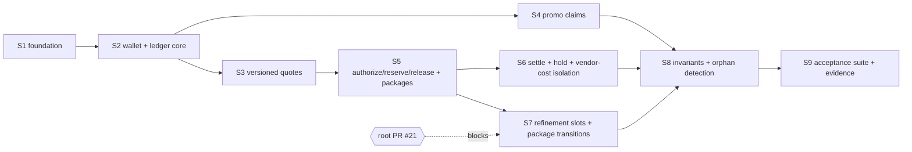

# M7 plan — credit-ledger core (W1)

Status: **APPROVED by the founder (rev 4, PR #20, merged `190a73e`); implementation round 1 (S1–S9, serial) authorized. Execution status: S1 merged (`714a0ae`), S2 merged (`c4b54dd`); rev 5 below records post-S2 corrections.** (registry rule 2: a plan is not authorization to implement; each step starts only after the previous PR is merged and its CI is green.) Author: M7 milestone manager. Base: `main` @ `92c8114`. Date: 2026-11-02. Revision 4 (rev 2 = blueprint adversarial review; rev 3 = rulings relayed by root; rev 4 = root's independent plan review and two CI/contract corrections — dispositions in §14. None of these approve the plan).

Authority: founder-authorized W1 scope as relayed in the M7 manager kickoff; ADR-0021, the `packages/db/ledger-migrations/` journal and the `packages/contracts` lane are granted by root. This document changes no code, schema, flag or protected file.

## 1. Objective and scope

Implement the **M7 credit-ledger core** in Neon/Drizzle with **no Medusa-funded flows**.

**In scope (W1)**
- Whole-number `credit_units` wallet with `available` / `reserved` / `held_for_review` buckets.
- Append-only, immutable ledger: every balance change has exactly one ledger entry with a unique cause.
- Versioned quotes (`quote_id`, `operation_kind`, `model`, `max_charge_units`, expiry, `price_version`), stale-quote renewal.
- Reserve → settle / release, one ACID transaction per state transition, idempotency key on every mutation.
- Unknown provider outcome ⇒ `reconciliation_hold`: no customer debit inferred from a vendor charge, no automatic retry, no automatic release.
- Promo-preview uniqueness per verified `issuer + subject`.
- Package / refinement-slot entitlement scaffolding per doc 06 v1.1.
- Read-only wallet-invariant check and orphaned-reservation detection.

**Out of scope (typed interfaces only, behind OFF flags, never stubbed as working)**
Medusa top-ups, payment-capture grants, refunds/chargebacks, digital-export purchase entitlements, physical-shirt redemption, any provider execution (M6b/M8a), remedy execution (blocked per doc 06). These need M4 or later.

**Acceptance targets (doc 15 M7):** 100-way concurrent balance operations; duplicate and out-of-order events; isolation of unknown provider cost; stale-quote renewal; no negative balance, no double charge or grant. Plus the doc 06 test-matrix rows that are in scope (§9).

## 2. Hard constraints (copy into every worker brief)

1. **System of record.** Neon/Drizzle owns the ledger. **Never write Medusa's database from Drizzle.** No FK to Medusa; cross-system references are text IDs only.
2. **No invented values.** No prices, credit costs, rate cards, markups, package sizes, currency amounts, SLAs, hold durations, orphan cut-offs. Production code uses typed config/ports with **no values**. Numeric fixtures exist only in `tests/`, are named `SYNTHETIC_*`, and are never exported from `src/`.
3. **Flags.** Every financial/paid flag stays OFF. The existing flags suffice (`credits.purchasing`, `studio.ai_generation_paid`, `studio.free_promo`, `exports.paid`, `payments.live`): **W1 adds no flag and does not touch `.env.example` or `packages/shared`.** The ledger is not imported by any runtime entry point in W1 (static test from S2, §5 D13).
4. **No uncontrolled billable retry.** Unknown state ⇒ hold + reconciliation; a human resolves it. Retrying a *ledger* command with the same idempotency key is safe and expected; retrying a *provider* call is never done by this code.
5. **Identity.** Actors are keyed by verified `issuer + subject` through `vynvori_identity.profiles(id)`. Never email. Never a Medusa customer ID.
6. **Migrations.** Non-destructive and additive; each with a documented rollback that is **tested** (up → down → up, and down refuses while data exists).
7. **No passed rows without evidence.** Postgres-backed tests count only when CI runs them (§4 F1). A local "not run" is reported `NOT_RUN`, never PASS.
8. **Lanes.** Not granted: dependencies/lockfile, `security/**`, `scripts/security/**`, `.github/workflows/**`, protected files (incl. `docs/technical/20-acceptance-matrix.md`), `MILESTONE-PROGRESS.md`, the registry, canonical specs `docs/technical/00`–`25`. Granted: `packages/contracts/**` (additive only), `packages/db/ledger-migrations/**`, ADR-0021. Workers edit `packages/db/**` (src, tests, and the `exports` map of `package.json` only — no dependency fields).
9. **Stop and escalate** (AGENTS.md): need for any invented value; Medusa-version or auth-source surprises; checkout/pricing questions; missing rights/print/shipping/payment gates; a change that breaks an approved requirement; a contract conflict with a canonical doc (see Q7); anything needing a lane not granted.

## 3. Cloud-sandbox facts (verbatim block for every brief)

- No Docker daemon or live databases in sessions; no GCP, Neon, R2 or Vercel access. A throwaway loopback PostgreSQL started from locally installed binaries (e.g. `/usr/lib/postgresql/16/bin`, if present in your container) is allowed for fast feedback only (founder ruling relayed by root); its results are reported `NOT_RUN` as evidence — only CI counts.
- Containers are ephemeral and isolated: only pushed work exists; sessions cannot see each other's files.
- One designated branch per session; GitHub through the MCP tools (`gh` only for search). Never push to another session's branch, never merge, never force-push shared branches.
- Before reporting a PR ready: `npm ci`, then `npm run verify`, `npm run security:audit`, and the affected tests.
- Only skills/commands listed in `.claude/VENDORED.md` exist (no `/security-scan`, `/verify`, `/tdd`, `/save-session`). For security review use `npm run smoke:security`, `npm run security:audit`, the `security-review` skill and the `security-reviewer` agent.

## 4. Verified repository findings (re-checked against `main` @ `92c8114`)

| # | Finding | Consequence for the plan |
|---|---|---|
| F1 | **Postgres tests only run in CI if a workflow sets their env var.** `m2.yml` `foundation` provides Postgres 17.6 and exports `M2_CREATIVE_DATABASE_URL` (loopback, user `synthetic`, a superuser in that container). No workflow sets `M3_TEST_POSTGRES_URL` or `M1B_TEST_POSTGRES_URL`. `m0.yml` runs `npm test` with **no** Postgres. | Ledger Postgres tests **gate on `M2_CREATIVE_DATABASE_URL`** (optional local override `M7_TEST_POSTGRES_URL`), connect to the maintenance DB and create disposable databases. They run in `foundation` with **no workflow change** and skip (= `NOT_RUN`) in the M0 job. Evidence must cite `foundation` log lines showing `ok` (not `# SKIP`). See Q4 for the M3/M1b side finding. |
| F2 | Migration pattern: `composition-migrations/` = `plan.json` + numbered SQL + `rollback/*.down.sql`; runner `packages/db/src/composition-migrations.ts`: loopback-only, pinned SHA-256, `pg_advisory_xact_lock(742110,3)`, journal-vs-schema drift check (`hasJournal !== hasSchema` ⇒ `HISTORY_OR_SCHEMA_DRIFT`), `OUTCOME_UNKNOWN` after `COMMIT` is sent. Its `0001` down script drops the data schema but **not** the journal schema. | Ledger journal copies the pattern with lock `(742110,7)`, journal schema `vynvori_ledger_migrations`, schema `vynvori_ledger`, `requires: ["vynvori_identity"]`. The ledger `0001` down script **must also drop the journal schema** or up → down → up trips the drift check. The composition runner is not refactored (M3's lane). |
| F3 | `vynvori_identity.profiles(id uuid pk, issuer, subject, UNIQUE(issuer, subject))`. | Wallet PK = `profiles.id`; promo claims also store `(issuer, subject)` with a composite FK. |
| F4 | Contracts already hold the public shapes: `QuoteViewV3` (+ `ConceptBundleQuoteV1` with `directionIds`, `downstreamEligibility`, `standardFinalQualified`, `paidTerms`), `CreditWalletSummaryV1`, `CustomerLedgerReceiptV1`, `PublicOperationV3`, `CustomerBundleFinancialSummaryV1`, `RefinementSlotV1`, `PackageStateV1`, Plane C graphs, and the guards `quoteGrantsEligibleBundleAuthorization`, `finalQuoteHasRequiredConsent`, `canMarkReceiptSettled`, `canMarkOperationDelivered`. `internal.ts` is `server-only` and outside the public barrel; `FORBIDDEN_PUBLIC_FIELDS` includes `idempotencyKey`. | New ledger-internal types go in a new `server-only` module `ledger-internal.ts` (exports subpath `./ledger-internal`). Public shapes are reused. Authorization **calls the existing guards** (D7). |
| F5 | `CustomerErrorCode` already has `INSUFFICIENT_CREDITS`, `QUOTE_STALE`, `QUOTE_EXPIRED`, `PROMO_ALREADY_USED`, `PROVIDER_OUTCOME_UNKNOWN`, `PACKAGE_CLOSURE_PENDING`, `INCLUDED_REFINEMENT_UNAVAILABLE`, `TERMS_NOT_APPROVED`, `CLAIM_CONFLICT`. | Internal `LedgerErrorCode` maps onto these for projection; additive internal-only codes (`IDEMPOTENCY_CONFLICT`, `INVALID_TRANSITION`, `ALLOCATION_INVALID`, …) never reach the public enum. |
| F6 | `packages/shared/src/public.ts` `featureDefaults` covers every gated capability; all `false`. | Constraint 3. |
| F7 | `test:m2` globs `packages/db/tests/*.test.ts`. The M2 job runs `lint`, `typecheck:m2` (db, commerce, medusa, image-processing — it type-checks contracts only transitively through db) and `test:m2`; **`test:contracts` runs only in the M0 job** (via `npm test`). | No root `package.json` change. Contract unit tests are evidence from the M0 job; Postgres tests are evidence from the M2 job. Briefs cite the right job for each. |
| F8 | `@vynvori/db` already depends on `@vynvori/contracts`, `pg`, `drizzle-orm`. | **No dependency or lockfile change.** If one seems needed → RESOURCE REQUEST. |
| F9 | PG 16 **server** binaries exist in this container at `/usr/lib/postgresql/16/bin` (not on `PATH`); `psql` and a `docker` CLI exist; no daemon. | Per the relayed ruling on Q5, workers **may** start a throwaway loopback cluster from these binaries for fast feedback; such runs are reported `NOT_RUN` as evidence (only CI counts). Workers must verify the binaries exist in their own container; sessions are isolated and not guaranteed to match. |
| F10 | `test:m2` passes many files to a single `node --test`, which runs test files as parallel subprocesses. The composition fixture avoids shared-database collisions with two database names. Per root (PR #21) the `foundation` job will run PostgreSQL with `max_connections` = 250 (asserted there), and the M1b and M3 suites will now run in that job too, sharing the budget. | Ledger fixture uses **one database name per test file** and enforces a per-file **connection budget** (D15). |
| F11 | **Two package-state vocabularies, plus one missing edge.** `PackageStateV1` (customer projection; protected reference contract `vynvori-v1_1-proposed.ts:142` and 21 protected fixtures) spells the state `refinements_open`; doc 04 `studio_packages.state`, doc 22 Plane C and `PLANE_C_BUNDLE_GRAPH` (internal) spell it `open_for_refinements`. Both are canonical — **no rename** (verified: the reference-contract line quoted above). Separately, `PLANE_C_BUNDLE_GRAPH` has no `closure_pending → open_for_refinements` edge, which doc 06 C-02 / doc 22 Plane B require for a verified-uncharged **first** final. | **Root-owned PR #21** (as described by root; re-verify on merge): keeps both vocabularies; adds `toCustomerPackageState(internal)` in `operations.ts`; adds `canTransitionPlaneCBundle(from, to, reopen?)`, allowing the reopen edge only with `BundleReopenContextV1 { finalAttempt: "first_final", outcome: "verified_uncharged", releaseReceiptDurable: true }` via `mayReopenBundleAfterUnchargedFinal(ctx)`, default deny. The ledger stores the **internal** names and maps at the projection boundary. S7 is blocked until #21 merges. M7 never edits Plane C in `state-machines.ts` or the package-state enum in `operations.ts`. |

## 5. Design decisions (proposed content of ADR-0021)

The council (Architect, Skeptic, Pragmatist, Critic; the three outside voices briefed with the question only) was convened for the one genuinely open question, **D5 reservation granularity**: all four chose one reservation per operation; their refinements are folded in. The adversarial review then hardened D2–D12. The founder may override any decision at plan review.

**D1 Actor key.** `wallets.user_id uuid PRIMARY KEY REFERENCES vynvori_identity.profiles(id) ON DELETE RESTRICT`. Every owned row carries `user_id`. No guest wallets (a guest has no profile row). No email column. No Medusa customer ID in W1.

**D2 Buckets and balanced entries.** Wallet: `available_units`, `reserved_units`, `held_for_review_units`, `consumed_units`, `revision`, all `bigint CHECK (>= 0 AND <= 9007199254740991)` so values round-trip exactly as the contract's `NaturalNumberSchema`; the store parses with `BigInt`. Every ledger entry has five deltas (`delta_available`, `delta_reserved`, `delta_held`, `delta_consumed`, `delta_external`) with a `CHECK` that they **sum to zero**, and a per-`entry_kind` `CHECK` fixing the sign pattern:

| entry_kind | available | reserved | held | consumed | external | notes |
|---|---|---|---|---|---|---|
| `grant` | +g | | | | −g | `g > 0`; needs a registered grant source (D12) |
| `reserve` | −h | +h | | | | `h > 0` |
| `release` | +h | −h | | | | needs release evidence (D6) |
| `settle` | +(h−c) | −h | | +c | | `0 < c ≤ h`; needs delivery evidence |
| `hold` | | −h | +h | | | reason + evidence |

Allocations must have `0 < charge_units ≤ hold_units` (a zero-charge operation has no meaning without an approved policy ⇒ fail closed). Hold-resolution entries (`hold_release`, `hold_settle`) and any entry that enters or leaves `operator_remedy` are **deferred to the remedy milestone** (an additive migration then relaxes the entry-kind `CHECK`): in W1 nothing can enter `operator_remedy`, so a held reservation stays held.

**D3 Wallet balances and reservation states change only through ledger entries, enforced by the database.**
- `ledger_entries` is append-only (UPDATE/DELETE/TRUNCATE rejected by trigger).
- `wallets`: a `BEFORE INSERT` trigger forces an all-zero row (a wallet cannot be created with credits); a `BEFORE UPDATE` trigger rejects any update unless `pg_trigger_depth() > 1` **and** `current_user` is the owner of the `SECURITY DEFINER` apply function (the depth check alone is bypassable by a trigger on a role-owned `TEMP` table — executed in the S2 security review, ADR-0021 S2 addendum). Balances are changed by the entry trigger only.
- **Entry ⇄ reservation binding.** A `BEFORE INSERT` trigger on `ledger_entries` for reservation kinds loads the reservation `FOR UPDATE`, and verifies: same `user_id` as the wallet; `h` equals the reservation's frozen `hold_units` (and `c` its `charge_units`); the state edge is legal under the Plane C command graph; then **sets the reservation state itself**. `credit_reservations` rejects direct state updates (**same pattern as the wallet guard: a `SECURITY DEFINER` writer function plus a guard requiring `current_user` to be that function's owner and a trigger-context check in every trigger function; `pg_trigger_depth()` alone is never sufficient** — binding for S5, ADR-0021 D3). Partial unique indexes allow at most one of {`release`, `settle`, `hold`} per reservation, and `UNIQUE(reservation_id, entry_kind)`. A deferred constraint trigger fails the commit if any reservation is left in `authorization_requested`.
- Unique cause: `UNIQUE(cause_kind, cause_ref)` (`{reservation_id}:{entry_kind}` or `{grant_source_id}:{source_ref}`).
- Wallet creation (all-zero, `ON CONFLICT DO NOTHING`) is not a balance change.
- **Privilege model (ADR decision, security-reviewer gate).** Default (A): the trigger functions are plain invoker-rights; the runtime role is granted column-level `UPDATE` on `wallets` and `credit_reservations`, which is neutralised by the depth guard + `CHECK`s + the absence of any other trigger that writes them; `ALTER … DISABLE TRIGGER` and `session_replication_role` are superuser-only and must stay off the runtime role. Alternative (B): `SECURITY DEFINER` trigger functions owned by a dedicated `NOLOGIN` role with a pinned `search_path`, so the runtime role needs no `UPDATE` at all. ADR-0021 chooses one; the S9 grants proposal must match it.
- Rollback caveat (documented, not hidden): append-only triggers mean deleting rows requires a superuser disabling triggers; the guarded down scripts therefore **refuse** while rows exist, and removal of real data is "restore from backup", not "run the down script".

**D4 Idempotency.** `ledger_commands(command_id, scope, idempotency_key, request_sha256, user_id, command_kind, outcome, rejection_code, created_at)` is **immutable** (no UPDATE; replay results are reconstructed from the entries that reference `command_id`). `UNIQUE(scope, idempotency_key)`; `scope = {user_id}:{command_kind}`. The command row and its entries commit in the same transaction. Same key + same canonical request hash ⇒ prior result; same key + different hash ⇒ `IDEMPOTENCY_CONFLICT`, nothing mutated; concurrent same-key requests serialize on the unique index and the loser returns the winner's result. **Terminal business rejections are persisted under the key** (`INSUFFICIENT_CREDITS`, `QUOTE_EXPIRED`, `QUOTE_STALE`, `ALLOCATION_INVALID`, eligibility/terms failures) in the same transaction under a savepoint while the wallet lock is held (as implemented in S2), so a stale replay of an old press can never authorize after a top-up; a new press uses a new key (doc 06: a top-up "does not authorize generation… require another press"). Transient failures (lock timeout, deadlock, connection loss, `LEDGER_OUTCOME_UNKNOWN`) are **not** recorded and are retried with the same key. **Quote-level double-charge guard:** `ledger_authorizations` has `UNIQUE(quote_version_id)` **and** `UNIQUE(quote_id)` (D7).

**D5 One reservation per operation (council: unanimous).** One `credit_reservations` row per provider operation; a bundle authorization creates its N operation reservations **atomically in one transaction** from per-operation allocations **frozen in the persisted quote** (`ledger_quote_allocations`: `operation_index`, `hold_units`, `charge_units`), idempotent on `(quote_version_id, operation_index)`.
- Σ`hold_units` = the quote's `max_charge_units` and Σ`charge_units` = `credits_quoted`, enforced by a **deferred constraint trigger** at commit. Missing/non-summing allocations ⇒ `ALLOCATION_INVALID`, fail closed. The ledger **never computes a split or rounding remainder**; the pricing policy supplies the vector and the ledger only verifies it.
- Settle amount must equal the allocation's `charge_units` and never exceeds `hold_units`; the unused remainder returns to `available` **in the same settle entry**. Variable/metered charges are out of W1 (Q6).
- Included refinements have **no reservation and no zero-unit row** (entitlement slots only, D9). Promo previews have no reservation (D8). A final render is a separate quote and reservation.
- An unknown outcome moves exactly one reservation to `reconciliation_hold`; siblings settle/release independently; a release returns units to `available` immediately and is never netted against a held sibling.
- The customer bundle summary is an aggregate over reservations by `package_id`; `quotedTotalUnits`/`maximumAuthorizedHoldUnits` come from the quote so a missing row shows as a discrepancy.

**D6 Release, settle and hold are evidence-gated; hold is never auto-resolved.** Every transition out of `reserved` is a *server-internal* command carrying `actor: { kind: "system", component }`, `expectedUserId`, and typed evidence that is stored on the entry (`evidence_kind`, `evidence_ref` bound to the `operation_id`; both non-null by `CHECK`):
- `settle` — Plane B status `persisted_delivered` with `canMarkOperationDelivered` (verified manifest hash + owner/rights verified). A vendor-charge message is never evidence.
- `release` — Plane B `verified_zero_charge_failure` **only**. There is no release for a reservation that was never dispatched: doc 06 keeps an un-enqueued job recoverable and does not lose the reservation, and doc 22 Plane B has no `prepared → released` edge. Such a reservation stays `reserved` and is reported by the orphan finder (D14) for a human. A timeout, cancel or unknown-outcome handler **cannot** release. Whether a pre-dispatch cancellation path should exist is a founder question (Q9), not W1.
- `hold` — Plane B `outcome_unknown` or `persistence_failed_under_review` (reason `outcome_unknown` | `persistence_unconfirmed`).
Evidence is caller-asserted typed data (the authority for Plane B truth is M6b/M8a); the ledger re-validates it with the existing contract guards and records it for audit. `hold → operator_remedy → settled|released` is in the Plane C graph, but **no W1 entry kind enters or leaves `operator_remedy`** (D2), so a held reservation stays held until the remedy milestone (blocked per doc 06). There is no timer or sweeper. Vendor-cost evidence lives in a separate internal table with **no FK to, and no trigger interaction with, the ledger** (S6 proves it).

**D7 Quotes and authorization.** Immutable `ledger_quotes(quote_version_id pk, quote_id, version_no, user_id, operation_kind, model_ref, max_charge_units, credits_quoted, issued_at, expires_at, price_version, capability_snapshot_id, consent_text_version, quote_view jsonb, content_sha256, …)`, `UNIQUE(quote_id, version_no)`. `quote_view` stores the full validated `QuoteViewV3` (so `directionIds`, `downstreamEligibility`, `standardFinalQualified`, `modelQualificationSnapshotId`, `paidTerms` are persisted and re-parseable). **(Refined in S3, rev 6, root-approved — see §14.)** `ledger_quote_lineages(quote_id pk, user_id, created_at, UNIQUE(quote_id, user_id))` is an **insert-only, immutable anchor** (never locked, never updated); every quote version carries a composite FK `(quote_id, user_id)` to it, so one `quote_id` can never hold versions of two users. The latest version is **derived** (`max(version_no)` read under the wallet lock; `version_no` contiguous by trigger, `UNIQUE(quote_id, version_no)` as the fail-safe backstop), and "lineage authorized" is derived in S5 from `ledger_authorizations UNIQUE(quote_id)`. Issue/renew/authorize are all commands of the quote owner, so they serialize on that user's wallet lock (D10); no lineage lock and no extra `UPDATE` privilege exist. `operation_kind` ∈ the four existing `offerKind`s. Column ↔ contract mapping (ADR table): `max_charge_units` = `maxHoldUnits`; `credits_quoted` = `creditsQuoted`; `price_version` = `pricePolicyVersion`; `operation_kind` = `offerKind`; `model_ref` = `modelQualificationSnapshotId` for finals, and for bundles the concept-model snapshot reference **supplied by the issuer** (the bundle contract has no model field — additive note for S1).

Authorization runs, in one transaction: owner match → lineage head is this version (else `QUOTE_STALE`) and lineage not yet authorized → `now < expires_at` (else `QUOTE_EXPIRED`; `now == expires_at` is expired) → `price_version` equals the `PricePolicyPort` value (else `QUOTE_STALE`) → re-parse `quote_view` and call `quoteGrantsEligibleBundleAuthorization` / `finalQuoteHasRequiredConsent` → `AuthorizationEligibilityPort` (rights/region, qualified Standard, a still-eligible downstream use, current plan, approved terms versions, the disclosed cancellation window (doc 06 authorization step 1); **default implementation absent ⇒ deny**, so production cannot authorize in W1) → allocations valid → explicit consent flag + matching `consent_text_version` → sufficient `available_units`. `renewQuote` inserts version n+1 from fresh port inputs and **refuses an already-authorized lineage**. **A grant/top-up event never authorizes anything**; no code path leads from a grant to an authorization. Expiry uses an injected clock; skew is documented in the ADR.

**D8 Promo uniqueness.** `promo_claims` with `UNIQUE(issuer, subject)` + composite FK to `profiles(issuer, subject)`; states per `PLANE_C_PROMO_GRAPH`; the two-device race resolves on the unique index (loser: `PROMO_ALREADY_USED`, or the prior claim if same key). The claim is an entitlement, not a wallet debit (promo quotes are 0/0). A paid concept never recycles promo bytes/slot. A verified-uncharged failure is **not** re-offered; one claim row per identity, ever (Q2, founder ruling relayed by root). Claim state changes only by inserting rows into an append-only `promo_claim_events` table (`from`, `to`, `evidence_kind`, `evidence_ref`); every transition needs typed evidence, gated like D6: `consumed` needs persisted-delivery evidence, `verified_uncharged_failure` needs verified-zero-charge evidence, `claim_unknown` needs unknown-outcome evidence, and `claim_unknown → consumed|verified_uncharged_failure` needs authoritative reconciliation evidence (`PLANE_C_PROMO_GRAPH` comment).

**D9 Packages and refinement slots (scaffolding).** `ledger_packages` (created in S5 in the same transaction as the bundle reservations; state per the Plane C bundle graph; trigger-enforced) and `refinement_slots` (S7; ordinal 1/2; states per `RefinementSlotV1`; `UNIQUE(package_id, ordinal)`). Guards: `skipped → available` only while `open_for_refinements`; `used` consumes exactly one slot; `pending`/`unknown` locked; `closure_pending` forbids silent consumption/forfeiture; `forfeited` only through closure with a non-null `refinementClosureNoticeVersion`; no clock-based expiry. Transitions into `partial` / `delivered_3_of_3` take a typed **evidence argument** (count of durable, rights-permitted artifacts) supplied by the caller — an integration seam to M6b/Plane B, **not** a working integration. The ledger stores the internal state names (`open_for_refinements`) and maps to the customer vocabulary (`refinements_open`) at the projection boundary with root's `toCustomerPackageState`. **C-02:** a `final_*` reservation records `original_package_id` and `pre_attempt_package_state` (both required by `CHECK` for final quotes). The package may go `closure_pending → open_for_refinements` only through root's guard (`mayReopenBundleAfterUnchargedFinal`) and only in the same transaction as, or after, the committed `release` of that final reservation (evidence `verified_zero_charge_failure`), when `pre_attempt_package_state = open_for_refinements` and no final has settled; a later revision on a `closed` package is rejected by the database and never recreates old slots. Gated by Q7/F11 (root's PR #21). Concept slots belong to Studio persistence (M6a).

**D10 Locking, transactions, outcomes.** **Binding invariant: every ledger command takes the user's wallet row `FOR UPDATE` first** (`runLedgerCommand`), then reservations in `id` order; no other order is permitted (documented to prevent deadlock). *(rev 6: the earlier "lineage row first" step is dropped — the lineage is an insert-only anchor and needs no lock; S3 adds a test that iterates the command kinds and fails if one does not take the wallet lock first.)* Only transaction-scoped features are used (`pg_advisory_xact_lock`, `SET LOCAL`), so Neon's pooled (transaction-mode) runtime connection is safe; migrations use the separate direct identity as today. **Commit classification:** the store runs `SET CONSTRAINTS ALL IMMEDIATE` before `COMMIT`, so deterministic deferred-constraint violations surface as ordinary errors with a SQLSTATE and are definite rollbacks; only a `COMMIT` that was sent and produced **no response** (connection error, no SQLSTATE) is `LEDGER_OUTCOME_UNKNOWN`, resolved by replaying the same idempotency key.

**D11 Ownership.** Customer-facing authorization takes the authenticated `userId`; every SQL predicate includes it; absent and foreign IDs return the same `NOT_FOUND`. Internal transitions carry `actor` + `expectedUserId`; a mismatch is `NOT_FOUND` (no confused deputy). Nothing here is a route; BFF authorization is M6.

**D12 Funding in W1: a grant-source registry, not a flag.** `grant` entries must reference a row in `ledger_grant_sources(grant_source_id, kind, …)`. Migration `0002` registers **no** sources; the runtime role gets no `INSERT` on that table (S9 grants proposal). So on any database where no source is registered — every real environment in W1 — credits cannot be minted by anyone with only runtime privileges. Test fixtures (in `packages/db/tests/`, **not** `src/`, no package export) register a `synthetic_test` source and grant through the ordinary internal grant function. `medusa_payment_capture` and `operator_adjustment` are typed ports only, with no registered source and no writer. The invariant checker reports any registered `synthetic_test` source and any grants against it as a finding.

**D13 Not reachable from runtime.** From S2 on, a static test asserts nothing under `apps/` and no non-test module imports `@vynvori/db/ledger*`, that `packages/db/src` exports no numeric price/rate/package constants, and that `featureDefaults` are all `false`. W1 ships a library plus schema, not a feature.

**D14 Read-only checks.** `checkWalletInvariants` runs in a `READ ONLY` `REPEATABLE READ` transaction and reports (never repairs): wallet bucket = Σ entry deltas; every entry sums to zero; no negative bucket; reserved bucket = Σ `hold_units` of `reserved` reservations; held bucket = Σ of hold-state reservations; each reservation state matches its entry trail; allocation sums; promo uniqueness; registered synthetic sources. `findOrphanedReservations(client, { olderThan })` takes the cut-off as a **required argument with no default** and classifies `reserved_never_dispatched` (no `workflow_ref`), `reserved_dispatch_stale`, `hold_present`; it is **report-only** — it never mutates and never releases, and a never-dispatched reservation stays `reserved` for a human to resolve (D6). `checkWalletInvariants` also verifies that the apply trigger and `wallets_update_guard` exist and are enabled (`DROP OWNED BY <definer> CASCADE` silently drops the apply trigger, after which entries are written with no wallet movement — executed).

**D15 Test databases and connection budget.** Each ledger test file uses its own database `vynvori_m7_<name>_test` (name from a fixture allow-list, loopback + user `synthetic` only), created/dropped by the fixture. All 100-way scenarios live in **one** file, `ledger-concurrency.test.ts` (extended by S2, S3, S5 and S6): it fires 100 commands simultaneously and may use up to 110 connections, i.e. a true 100-connection test; every other ledger file caps its pool at 5 (≤ 9 files ⇒ ≤ 45). Per root, PR #21 sets `max_connections` to 250 in the `foundation` job (asserted there), and the M1b and M3 suites now share that job, so the S1 ADR must record the measured budget: 110 + 45 + the existing suites' pools, which must stay below 250 minus the 3 reserved superuser slots. The fixture reads `SHOW max_connections` and `ledgerPool(kind)` enforces the caps; if `max_connections` is below the budget, the concurrency file **fails** when `CI_REQUIRE_PG_TESTS=1` and otherwise runs with a reduced pool and is reported degraded (the 100-connection row is then `NOT_RUN`).

## 6. Steps, dependencies and lanes

One step = one branch = one PR = one worker. Worker concurrency is 1 unless root confirms the second slot (shared with M3 closure). Suggested model tier: strongest for S2, S5, S6; default for the rest. Serial order is S1 → S9; the graph shows true dependencies only.

| Step | Title | Migration | Depends on |
|---|---|---|---|
| S1 | Foundation: ADR-0021, ledger journal skeleton + rollback, contract stubs, test harness | `0001_ledger_schema` | — |
| S2 | Wallet, immutable command log, append-only ledger, grant sources | `0002_wallet_ledger` | S1 |
| S3 | Versioned quotes, lineages, allocations, renewal | `0003_quotes` | S2 |
| S4 | Promo-claim uniqueness | `0004_promo_claims` | S2 |
| S5 | Authorize → reserve → release (single + atomic bundle), package creation | `0005_reservations` | S3 |
| S6 | Settle, reconciliation hold, vendor-cost isolation | `0006_vendor_cost_evidence` | S5 |
| S7 | Refinement slots, package transitions, closure | `0007_refinement_slots` | S5, **root PR #21 (Q7)** |
| S8 | Wallet-invariant check, orphan detection | none | S4, S6, S7 |
| S9 | Acceptance suite, evidence record, grants proposal | none | S1–S8 |

All migration steps append to `plan.json` and to the `package.json` `exports` map. Under the single worker slot steps run serially; migration numbers are fixed by step, not by merge order. If a second slot is ever granted and two migration steps run together, the later PR rebases those two files (SQL hashes are per file, so the rebase is mechanical).

| Step | Files touched (new unless noted) | Lanes |
|---|---|---|
| S1 | `docs/implementation/ADR-0021-M7-Core-Ledger-Foundation.md`; `packages/db/ledger-migrations/{plan.json,0001_ledger_schema.sql,rollback/0001_ledger_schema.down.sql}`; `packages/db/src/ledger-migrations.ts`; `packages/db/tests/{ledger-fixture.ts,ledger-migrations.test.ts}`; `packages/db/package.json` (edit: `exports`); `packages/contracts/src/ledger-internal.ts`; `packages/contracts/package.json` (edit: `exports`); `packages/contracts/tests/ledger-internal.test.ts` | contracts (granted), ledger journal (granted), ADR-0021 |
| S2 | `0002_wallet_ledger.sql` + rollback; `packages/db/src/ledger-core.ts`; `packages/db/tests/{ledger-core.test.ts,ledger-concurrency.test.ts,ledger-isolation.test.ts}`; `ledger-fixture.ts` (edit: synthetic grant helper); `plan.json`, `package.json` `exports` (edit) | ledger journal |
| S3 | `0003_quotes.sql` + rollback; `src/ledger-quotes.ts`; `tests/ledger-quotes.test.ts`; `ledger-concurrency.test.ts` (edit); `plan.json`, `exports` (edit); contracts additive only if a schema is missing | ledger journal, contracts |
| S4 | `0004_promo_claims.sql` + rollback; `src/ledger-promo.ts`; `tests/ledger-promo.test.ts`; `plan.json`, `exports` (edit) | ledger journal |
| S5 | `0005_reservations.sql` + rollback (adds the `ledger_entries.reservation_id` FK via `ALTER TABLE`, dropped by the rollback); `src/ledger-reservations.ts`; `tests/ledger-reservations.test.ts`; `ledger-concurrency.test.ts` (edit); `plan.json`, `exports` (edit) | ledger journal |
| S6 | `0006_vendor_cost_evidence.sql` + rollback; `src/{ledger-settlement.ts,ledger-evidence.ts}`; `tests/ledger-settlement.test.ts`; `ledger-concurrency.test.ts` (edit); `plan.json`, `exports` (edit) | ledger journal |
| S7 | `0007_refinement_slots.sql` + rollback; `src/ledger-entitlements.ts`; `tests/ledger-entitlements.test.ts`; `plan.json`, `exports` (edit); **no** edits to `state-machines.ts` / package-state definitions (root's PR) | ledger journal |
| S8 | `src/ledger-invariants.ts`; `tests/ledger-invariants.test.ts`; `exports` (edit) | — |
| S9 | `tests/ledger-acceptance.test.ts`; `docs/implementation/M7-Evidence.md`; `docs/implementation/M7-Runtime-Grants-Proposal.md` (proposal only, not applied) | — |

No step touches `apps/**`, `packages/commerce/**`, `packages/shared/**`, `.env.example`, `.github/**`, `security/**`, `scripts/**`, protected files, or any other journal.

## 7. Step briefs

Each brief is pasted to a worker **together with §2 and §3**. The worker also reads `AGENTS.md`, `CODING_AGENT_START_HERE.md`, `docs/implementation/ORCHESTRATION-REGISTRY.md`, `docs/technical/06`, `22`, and ADR-0021 (after S1). The `/orch-*` command per step is emitted by `plan-orchestrate` after founder approval (all are feature-add shaped).

Common exit criteria for every step: `npm ci`; `npm run lint`; `npm run typecheck`; `npm run test:m2` and `npm run test:contracts` (ledger Postgres tests skip locally ⇒ report `NOT_RUN`, never PASS); `npm run security:audit` and `npm run smoke:security` green; the PR's `M2 backend foundation` job log shows each new Postgres test as `ok`, and the `M0 foundation` job shows the contract tests (cite the lines). PR body: ADR link, migration + rollback, contract diff, security-review notes, an evidence table with an explicit **NOT RUN** column, flags unchanged. The manager runs `/orch-review`, the `security-reviewer` agent and the `security-review` skill on S1–S8.

### S1 — Foundation (no business logic)
**Goal.** ADR-0021, a verified ledger migration journal with tested rollback, additive contract stubs, the shared test harness.

**Tasks.**
1. ADR-0021: context, decisions D1–D15 (final wording incl. the privilege model A/B choice and the column↔contract mapping table), rollout (**not authorized**: no staging/production apply; needs a separate founder remote-database approval, native backup, pinned target, runtime-role grants), rollback (incl. the "restore from backup" caveat), security notes, API/event changes (none), flags (none), connection budget.
2. Journal: `plan.json`; `0001_ledger_schema.sql` creating only `vynvori_ledger` (additive, no grants); `rollback/0001_ledger_schema.down.sql` (guarded; drops `vynvori_ledger` **and** `vynvori_ledger_migrations`); runner `applyLedgerMigrations` + `ledgerMigrationPlan` copying the composition pattern with the ledger lock/names and a database allow-list pattern `vynvori_m7_<name>_test`; add `./ledger-migrations` to `packages/db/package.json` `exports`.
3. Contracts (additive; new `server-only` module `ledger-internal.ts`, exported as `./ledger-internal`, **not** in the public barrel): command envelope (scope, idempotency-key charset/length, `requestSha256`), `LedgerEntryKindV1`, `LedgerErrorCodeV1` (+ map to `CustomerErrorCode`), `LedgerQuoteRecordV1`, `QuoteAllocationV1`, `ReservationStateV1`, `HoldReasonV1`, `TransitionEvidenceV1` (settle / release / hold variants per D6), `GrantSourceKindV1`; **port interfaces for W1 logic only** (types, no implementations, no throwing stubs): `PricePolicyPort`, `AuthorizationEligibilityPort` (including the disclosed cancellation window) and `ProviderOutcomeEvidencePort`. For the out-of-scope capabilities (Medusa capture grants, refunds/reversals, digital-export entitlements, garment redemption, remedy execution) **no method shapes are defined** — they would be invented ahead of M4 decisions; a `DeferredCapabilityV1` registry records only `{ capability, governingFlag, owningMilestone, status: "not_implemented" }`, and `GrantSourceKindV1` reserves the kind names. No numeric defaults.
4. Harness `ledger-fixture.ts`: connection from `M7_TEST_POSTGRES_URL` or `M2_CREATIVE_DATABASE_URL`; refuse unless host `127.0.0.1` and user `synthetic`; create/drop the caller's `vynvori_m7_<name>_test`; rebuild `vynvori_identity` from `auth-migrations/plan.json`, then apply the ledger plan; `ledgerPool(kind)` enforcing D15 caps and reading `SHOW max_connections`. Tests declare `{ skip: !url && process.env.CI_REQUIRE_PG_TESTS !== "1" }` and assert the URL inside the test, so they **fail** (not skip) under `CI_REQUIRE_PG_TESTS=1` without a database, and skip (= `NOT_RUN`) otherwise.
5. Tests: plan loads, tamper ⇒ `PLAN_INVALID`; other/non-loopback targets ⇒ `TARGET_REJECTED`; (PG) apply → replay applies 0 → journal drift ⇒ `HISTORY_OR_SCHEMA_DRIFT` → down → up again; SQL additive (no `GRANT`/`DROP TABLE`/identity alteration); contracts: strict schemas, no numeric defaults, `findLeakedInternalFields` clean, internal module absent from the public barrel.

**Out of scope.** Tables, wallet/quote logic, other journals, workflows.
**Rollback.** Revert PR (nothing deployed); data: `0001` down script on a disposable DB.
**CI contract with root (Q3/Q4, root-owned PR #21; I do not edit workflows).** Per root: the `foundation` job sets `CI_REQUIRE_PG_TESTS=1` — deliberately **not** a `VYNVORI_*` variable, because `packages/shared` rejects unknown `VYNVORI_*` keys (verified in `packages/shared/src/server.ts`) and other gates require them to equal `false` — sets the M1b/M3 test URLs, and raises `max_connections` to 250. Ledger tests use the skip/assert pattern above (same as `composition.test.ts` in #21) and keep gating on `M2_CREATIVE_DATABASE_URL` (optional local override `M7_TEST_POSTGRES_URL`). The fixture's unit test covers the three branches (URL present / absent without the flag / absent with the flag) without a database. Root will confirm the final names and limit when #21 merges; S1 adopts them verbatim.

### S2 — Wallet, immutable command log, append-only ledger
**Goal.** D1–D4, D10–D13 in the database, plus the store primitive every later step uses.

**Tasks.** `0002_wallet_ledger.sql`: `wallets` (insert-zero trigger, update guard), `ledger_commands` (immutable), `ledger_grant_sources` (no rows), `ledger_entries` (append-only, balanced, per-kind sign `CHECK`, evidence columns, `reservation_id uuid NULL` with no FK yet, unique-cause constraints, partial unique indexes, wallet-apply trigger), safe-integer bounds, `ON DELETE RESTRICT`; guarded rollback. `ledger-core.ts`: `ensureWallet`, `getWalletSummary` (existing `CreditWalletSummaryV1` shape), `runLedgerCommand` (opens the transaction; lock order; inserts the command row; runs the callback; `SET CONSTRAINTS ALL IMMEDIATE` then `COMMIT`; maps SQLSTATE errors to `LedgerErrorCode`; persists terminal business rejections; classifies unknown commit outcomes), internal `appendGrantEntry` requiring a registered source. Fixture helper registers a `synthetic_test` source and grants. `ledger-isolation.test.ts` (D13).

**Tests (PG unless stated).** Direct `INSERT INTO wallets` with credits rejected; direct `UPDATE wallets` rejected; entry UPDATE/DELETE/TRUNCATE rejected; unbalanced / wrong-shape / negative-result entries rejected; `grant` without a registered source rejected, and no source exists after migration; wallet = Σ deltas after N random operations; same key+payload ⇒ one entry; same key+different payload ⇒ `IDEMPOTENCY_CONFLICT`; cross-user same key independent; a persisted rejection replays as the same rejection and does not authorize after the wallet is later funded (uses a synthetic stand-in command); **100 identical grants in flight ⇒ exactly one; 100 distinct ⇒ exact total** (in `ledger-concurrency.test.ts`); non-integer/negative/over-limit input rejected before SQL (unit); deferred-constraint failure at commit ⇒ definite error, not `LEDGER_OUTCOME_UNKNOWN`; fault-injected socket loss after `COMMIT` sent ⇒ `LEDGER_OUTCOME_UNKNOWN`, same-key replay converges; FK to a non-existent profile rejected; static isolation test (unit); rollback up → down → up and down refuses with data.

### S3 — Versioned quotes, lineages, allocations, renewal
**Goal.** D5 allocation rules and D7 storage; no reservation yet.

**Tasks.** `0003_quotes.sql`: `ledger_quotes` (immutable triggers; non-promo `max_charge_units > 0`, `credits_quoted ≤ max_charge_units`, `expires_at > issued_at`; promo 0/0), `ledger_quote_lineages` (**insert-only anchor**, rev 6), `ledger_quote_allocations` (positive units, `charge ≤ hold`), `version_no` contiguity trigger, deferred Σ-constraint triggers on both tables. `ledger-quotes.ts`: `issueQuote` (parses `QuoteViewV3Schema`; takes a caller-supplied priced input — **the repo ships no `PricePolicyPort` implementation**; a second issue for an existing `quote_id` is rejected), `renewQuote` (**compare-and-swap**: the caller names the latest version it saw, `expectedLatestVersionNo`; a mismatch is `QUOTE_STALE`, so N concurrent renewals of one quote yield exactly one new version; the refusal of an *already-authorized* lineage arrives in S5, which owns `ledger_authorizations`), `getQuote` (owner-scoped), `assessQuoteForAuthorization` (read-only: `QUOTE_EXPIRED` | `QUOTE_STALE` | `ALLOCATION_INVALID` | ok), canonical JSON + `content_sha256`.

**Tests.** Immutability; version monotonicity under 100 concurrent `renewQuote` calls (in `ledger-concurrency.test.ts`, per D15); superseded ⇒ `QUOTE_STALE`; expiry boundary with injected clock; `price_version` mismatch ⇒ `QUOTE_STALE`; allocation sums off by one either way ⇒ commit fails; zero-unit allocation rejected; cross-owner `getQuote` ⇒ `NOT_FOUND`; stored `quote_view` re-parses with `QuoteViewV3Schema` and its hash matches; renewing an authorized lineage refused (asserted again in S5).

### S4 — Promo-claim uniqueness
**Goal.** D8.

**Tasks.** `0004_promo_claims.sql`: `promo_claims` (`UNIQUE(issuer, subject)`, composite FK to `profiles(issuer, subject)`, state-graph trigger from `PLANE_C_PROMO_GRAPH`, `operation_id` unique). `promo_claim_events` (append-only; claim state changes only via event insert, depth-guard pattern). `ledger-promo.ts`: `claimPromo`, `markPromoOutcome` (consumed / verified_uncharged_failure / claim_unknown), idempotent via `runLedgerCommand` (so S4 depends on S2) and **evidence-gated like D6**: `claim_unknown` can resolve only with authoritative reconciliation evidence.

**Tests.** Two-device race ⇒ one claim; same-key replay ⇒ same claim; different identities independent; `claim_unknown` ⇒ no second claim; illegal graph edges rejected at DB level; no wallet/ledger rows are ever touched by a promo (row counts unchanged); guest (no profile) cannot claim.

### S5 — Authorize → reserve → release, package creation
**Goal.** D3 entry⇄reservation binding, D5, D6 (release), D7 authorization, D11.

**Tasks.** `0005_reservations.sql`: `ledger_authorizations` (`UNIQUE(quote_version_id)`, `UNIQUE(quote_id)`), `credit_reservations` (frozen `hold_units`/`charge_units`, `original_package_id` + `pre_attempt_package_state` (required by `CHECK` for `final_*` quotes; C-02), state set only by entry triggers, `UNIQUE(quote_version_id, operation_index)`, `UNIQUE(operation_id)`, `workflow_ref` settable once null→value), `ledger_packages` (state graph trigger; created `authorized`), `ALTER TABLE ledger_entries ADD CONSTRAINT … FOREIGN KEY (reservation_id)` (rollback drops it first), deferred "no reservation left in `authorization_requested`" trigger. `ledger-reservations.ts`: `authorizeQuote` (D7 sequence; creates all operation reservations + package + `reserve` entries atomically), `releaseReservation` (D6 evidence), `recordWorkflowRef`.

**Tests.** **100 authorizations in flight for a wallet that can fund exactly K ⇒ exactly K succeed, rest `INSUFFICIENT_CREDITS`, no negative bucket, reserved = Σ holds** (K = 1 case included); 100 replays of one key ⇒ one authorization; two different keys for one quote version ⇒ second rejected; **renew-then-authorize race (v1 and v2 of one lineage) ⇒ at most one authorization**; bundle atomicity under injected failure on the 3rd reservation ⇒ nothing persisted; expired/stale/superseded quotes rejected with no mutation; ineligible bundle (no downstream use, unqualified Standard, non-distinct directions, closed cancellation window) rejected; missing `AuthorizationEligibilityPort` ⇒ deny; top-up after a persisted rejection does not authorize on replay (needs a new key); cross-user ⇒ `NOT_FOUND`; **entry-binding negatives** (release with 2×`hold_units`, another user's wallet, double release+settle) rejected at the DB; `release` with unknown-outcome or missing evidence rejected; **a never-dispatched reservation (no `workflow_ref`) cannot be released**; `release` with `verified_zero_charge_failure` accepted and replay-safe; release does not net against a held sibling; fault-injected commit loss converges on replay.

### S6 — Settle, reconciliation hold, vendor-cost isolation
**Goal.** D6 and the "unknown provider cost" target.

**Tasks.** `0006_vendor_cost_evidence.sql`: internal table (`operation_id`, optional `reservation_id` **without FK**, `evidence_kind` usage/invoice/unknown, exact integer `amount_usd_micros`, nullable; the ADR documents the mapping to `privateVendorCostUsd: number` in `internal.ts`). `ledger-settlement.ts`: `settleReservation`, `holdReservation` per D6. `ledger-evidence.ts`: `recordVendorCostEvidence` (writes only that table).

**Tests.** Unknown outcome ⇒ hold; no exported function maps out of `reconciliation_hold`; **any invoice/usage evidence changes zero rows in wallets, ledger_entries, credit_reservations**; settle on a vendor-charge message / non-delivered status rejected; settle amount ≠ `charge_units` rejected; settle→release, release→settle, settle→hold, hold→release (no W1 path) all `INVALID_TRANSITION` with balances unchanged; one hold among three siblings leaves the others settleable; every transition replay-safe; out-of-order arrival (settle before reserve committed) ⇒ `NOT_FOUND`, safe to retry later; a reservation can never settle above `hold_units`; 100 mixed settle/release/hold commands over distinct reservations in the concurrency file ⇒ invariants hold.

### S7 — Refinement slots, package transitions, closure (blocked on root's contract PR, Q7)
**Goal.** D9.

**Pre-condition (blocked until root's PR #21 merges).** Root owns the contract change and, as described by root, #21 keeps both vocabularies (internal `open_for_refinements`, customer `refinements_open`), adds `toCustomerPackageState`, and adds `canTransitionPlaneCBundle(from, to, reopen?)` allowing `closure_pending → open_for_refinements` only with `BundleReopenContextV1 { finalAttempt: "first_final", outcome: "verified_uncharged", releaseReceiptDurable: true }` (`mayReopenBundleAfterUnchargedFinal`), default deny. The worker starts only after #21 is on `main`, never edits Plane C in `state-machines.ts` or the package-state enum in `operations.ts`, stores internal names, and derives the DB trigger from the merged guard. If the merged contract differs from this description, stop and report.

**Tasks.** `0007_refinement_slots.sql`: `refinement_slots` + guard triggers per D9. `ledger-entitlements.ts`: slot operations (`skip`, `restore`, `markPending`, `markUnknown`, `consume`), package transitions with typed evidence args, `closeWithForfeiture` requiring a non-null `refinementClosureNoticeVersion`; `reopenAfterUnchargedFinal` that, in one transaction, requires the committed `release` of the final reservation (S5 evidence), `pre_attempt_package_state = open_for_refinements`, no settled final, and root's guard.

**Tests.** `skipped → available` rejected unless `open_for_refinements`; `closure_pending` blocks consumption and forfeiture; `pending`/`unknown` locked; forfeiture needs the notice version; 0/3, 1/3, 2/3 evidence never reaches `delivered_3_of_3`; a failed first final on an open package returns to `open_for_refinements` with unused slots intact **only** after its release committed (reopen before the release, or without the context, is rejected), while a failed *later* revision on a `closed` package is rejected by the database and never recreates slots (C-02); refinements create no ledger rows; no clock-based expiry exists anywhere (static test).

### S8 — Wallet-invariant check and orphaned-reservation detection
**Goal.** D14, read-only.

**Tasks.** `ledger-invariants.ts` with `checkWalletInvariants(client)` and `findOrphanedReservations(client, { olderThan })`, structured report type, `READ ONLY` `REPEATABLE READ`; the invariants include the **trigger-presence check** (apply trigger and wallet guard exist and are enabled; wallet buckets equal ledger sums) — ADR-0021 follow-up.

**Tests.** Clean state ⇒ no findings; per invariant, a test that corrupts a **disposable** database through a superuser connection that disables triggers *inside the test only* and asserts the exact finding; registered-synthetic-source finding; each orphan class; `olderThan` required (type-level + runtime); the checker changes nothing (row counts + `xmin` before/after) and every statement is a `SELECT`; correct under concurrent writers.

### S9 — Acceptance suite, evidence record, grants proposal
**Goal.** The doc 15 / doc 06 matrix as one traceable suite, plus honest evidence.

**Tasks.** `ledger-acceptance.test.ts` implements §9 with test names carrying the row ids (reusing helpers; heavy 100-way cases stay in `ledger-concurrency.test.ts`); `M7-Evidence.md` (per check: command, result, **CI job + log line**, explicit NOT RUN list); `M7-Runtime-Grants-Proposal.md` (per-table privileges for a future restricted runtime role consistent with the ADR's privilege model, **no** `INSERT` on `ledger_grant_sources`, no DDL, no trigger or `session_replication_role` rights; marked **proposal, not applied**). **Binding S9 content from the S2 review (ADR-0021 S2 addendum):** the definer owner has no members and the runtime role cannot `SET ROLE` to it (test: `pg_has_role` false, also for a `pg_write_all_data` runtime variant); the owner-change procedure is executable by a non-superuser executor (transient `SET` membership and transient `CREATE` on the schema, both revoked immediately; end state exactly `USAGE` + `SELECT`/`UPDATE` on `wallets`, no `CREATE`, no members) and is tested as that executor; rollback after the re-own needs the function re-owned back first (test up → re-own → down); behaviour tests for the `TG_OP`/`TG_WHEN`/`TG_LEVEL` trigger-context branches and the other trigger functions; corrected break-glass note; the HARD GATE on grant sources.

**Out of scope.** Editing `20-acceptance-matrix.md`, `MILESTONE-PROGRESS.md`, the registry (root-only). The manager sends root the proposed row changes in the CLOSE REQUEST.

## 8. Rollback strategy

- Code: revert the PR; nothing is deployed and the ledger is unreachable from runtime (D13).
- Data: each migration has a guarded `rollback/000N_*.down.sql` (refuses while rows exist; drops its own objects; removes its journal row; `0001` also drops the journal schema); CI runs up → down → up on a disposable database. Rollbacks apply in reverse numeric order. Because the ledger is append-only, removing real data is **restore from backup**, not a down script.
- **Nothing is applied to staging/production by this milestone.** A future apply needs: separate founder remote-database approval, native backup first (M2 procedure), pinned target in `plan.json`, runtime-role grants (S9 proposal).

## 9. Test and evidence matrix

**Doc 15 acceptance targets**

| Target | Steps | Runs where |
|---|---|---|
| 100-way concurrent balance operations (100 commands in flight over up to 110 connections — D15) | S2, S5, S6 (`ledger-concurrency.test.ts`), S9 | CI `foundation` job only |
| Duplicate and out-of-order events | S2, S5, S6, S9 | CI only |
| Isolation of unknown provider cost | S6, S9 | CI only |
| Stale-quote renewal | S3, S5 | CI only (injected clock) |
| No negative balance / double charge / double grant | S2, S5, S6, S8 | CI only |

**Doc 06 test-matrix rows**

| Row | In W1? | Covered by |
|---|---|---|
| Simultaneous requests against a 1-credit wallet | yes | S5 (K = 1), S9 |
| Duplicated payment capture | **no** (needs M4) | duplicate *grant* idempotency in S2 via the synthetic source; Medusa capture = typed port only |
| Provider timeout after billing | yes (ledger side) | S6 hold + vendor-cost isolation |
| Provider returns artifact but DB write fails | yes (ledger side) | S6 `persistence_unconfirmed` hold |
| Webhook replay / out-of-order | yes (ledger commands; no webhook/inbox in W1) | S2, S5, S6 |
| Refund after partial credit consumption | **no** | typed `RefundReversalPort` only |
| Unauthorized redemption | **no** (redemption); ownership on every ID **yes** | S5/S6 cross-user tests |
| Concurrent carts reuse entitlement | **no** | redemption out of scope |
| Digital export paid then failed render | **no** | typed port only |
| Guest attempts credit purchase | yes (structurally) | S2/S4: no wallet or claim without a profile |
| Rounding of fractional USD costs | partly | whole-number units only; non-integers rejected; allocations must sum exactly; USD→credit conversion needs a rate card and is out |
| Package fee scenario | partly | S3/S5 bundle with *synthetic* allocations |

**Cannot run in the cloud sandbox** (reported `NOT_RUN` locally; count only from the CI `foundation` log): every Postgres-backed test. Unit tests (plan/SHA pinning, contract schemas, static isolation test, SQL-text lint) run locally; contract tests are evidenced by the M0 job.

**ACC rows the manager expects to propose at close** (root verifies; founder confirms; none is edited by M7): ACC-11 → **IN_PROGRESS** with core evidence only (the row also covers "double grant" via Medusa, which is out of W1); ACC-15 → **IN_PROGRESS**, ledger side only; ACC-23 → **IN_PROGRESS**, ledger-command replay only (no inbox/outbox, no Medusa events). No row is claimed PASSED.

## 10. Security review plan

`security-reviewer` agent + `security-review` skill on the diff for S1–S8, notes copied into the PR. Standing checklist: parameterized SQL only; every predicate owner-scoped; uniform `NOT_FOUND`; idempotency keys never logged and never in public projections; no secret/URL in tests; synthetic-only guards on the harness; lock-order compliance; **privilege model per ADR (A: invoker-rights triggers + column-level `UPDATE` neutralised by the depth guard, or B: a single reviewed `SECURITY DEFINER` function set owned by a `NOLOGIN` role with pinned `search_path` and `REVOKE … FROM PUBLIC`)**; no way to mint credits with runtime-role privileges alone (D12); trigger bypass (`DISABLE TRIGGER`, `session_replication_role`) kept off the runtime role; no dynamic SQL from user input; bigint → number conversion bounded; evidence cannot be forged into a settle by a customer-facing caller (internal commands only, `actor` + `expectedUserId`).

## 11. Stop conditions and plan mutation

Workers stop and message the manager (→ root → founder) if they need: any numeric business value; a dependency or lockfile change; a CI/workflow/security-policy change; a breaking or canonical-conflicting contract change; to touch Medusa data or another milestone's journal; or if a decision here proves unworkable. Plan mutations (split / insert / skip / reorder) are made by the manager in a new docs-only PR with a mutation log appended below; the founder re-approves anything that changes scope, lanes, or an ADR-level decision.

## 12. Open questions for the founder (answer at plan review; none blocks S1)

- **Q1 (D12) — founder ruling (relayed by root): default accepted.** Credits can exist only where a grant source has been **registered** (none in W1 migrations; tests register a synthetic one); there is deliberately no way to fund a real wallet until M4/W3 supplies a Medusa capture source.
- **Q2 (D8) — founder ruling (relayed by root): default accepted.** No promo re-offer after `verified_uncharged_failure`; one claim row per identity ever.
- **Q3 (S1/D15) — decided; root-owned (PR #21).** `CI_REQUIRE_PG_TESTS=1` (not a `VYNVORI_*` variable), M1b/M3 test URLs and `max_connections` 250 on the `foundation` job. Ledger tests follow the S1 skip/assert pattern.
- **Q4 (side finding) — decided; root-owned (PR #21).** The M1b/M3 Postgres suites will run in CI; they may surface pre-existing failures that are not M7's and share the connection budget.
- **Q5 (F9) — founder ruling (relayed by root): allowed.** Local PostgreSQL 16 binaries for development feedback only; results are `NOT_RUN` as evidence.
- **Q6 (D5) — founder ruling (relayed by root): default accepted.** Fixed quoted charges only (settle = allocation `charge_units`).
- **Q7 (F11) — decided; root-owned (PR #21).** No rename: `open_for_refinements` (internal) and `refinements_open` (customer projection) are both canonical, mapped by root's `toCustomerPackageState`; the C-02 reopen edge is guarded by `BundleReopenContextV1`. M7 never edits Plane C in `state-machines.ts` or the package-state enum in `operations.ts`; S7 waits for #21.
- **Q8 (D3) — RESOLVED: model B (`SECURITY DEFINER`).** Model A (invoker-rights triggers, depth guard) was rejected by the S2 security review on executed evidence (a trigger on a role-owned `TEMP` table minted credits with zero entries). B is confirmed, with the definer owner re-owned to a dedicated unprivileged role at rollout (ADR-0021 S2 addendum, plan D3 as amended). Not reopened.
- **Q9 (D6, new; deferred, not W1).** Should a pre-dispatch cancellation path exist that releases a reservation whose operation was never submitted? Doc 06 keeps such a job recoverable and doc 22 Plane B has no `prepared → released` edge, so W1 has none: the reservation stays `reserved` and the orphan finder reports it. If wanted, it needs a founder-approved cancellation rule (doc 06 asks for an upfront disclosed cancellation rule) and an authoritative proof of non-submission; root relays.

## 13. Resources requested from root

| Resource | Status |
|---|---|
| ADR-0021, ledger journal, contracts lane | granted (kickoff) |
| Worker slot | 1 at a time; a second only on root's confirmation |
| `m2.yml` env/`max_connections` (Q3/Q4) | root-owned PR #21: `CI_REQUIRE_PG_TESTS=1`, M1b/M3 URLs, `max_connections` 250; final names confirmed on merge |
| Contract change for Q7 | root-owned PR #21; S7 blocked until it merges; M7 does not edit Plane C in `state-machines.ts` or the package-state enum in `operations.ts` |
| Further ADR numbers | none (D1–D15 all live in ADR-0021) |

## 14. Plan review log

**Revision 2 — adversarial review (strongest-model sub-agent, 2026-11-02): 3 critical, 6 high, 4 medium, 2 low. All findings accepted; dispositions:**

| # | Sev | Finding | Disposition |
|---|---|---|---|
| 1 | Critical | `release` had no evidence gate; a timeout handler could release an unknown outcome | D6: release/settle/hold are evidence-gated, evidence stored on the entry; S5 negative test |
| 2 | Critical | `INSERT INTO wallets` with credits (and `operator_adjustment` grants) bypassed the ledger | D3 zero-insert trigger; D12 registered-grant-source table with no W1 sources |
| 3 | Critical | Entries not bound to reservations (wrong amount/user, release+settle both allowed) | D3 entry⇄reservation binding trigger + partial unique indexes; FK added in 0005 |
| 4 | High | Double reservation by renewing a quote and authorizing both versions | D4/D7 `UNIQUE(quote_id)`, lineage lock, `renewQuote` refuses authorized lineage; S5 race test |
| 5 | High | Authorization omitted rights/region/qualified-Standard/downstream/direction/plan/terms gates and the existing contract guards | D7 persists full `QuoteViewV3`, calls the guards, adds fail-closed `AuthorizationEligibilityPort` |
| 6 | High | "No SECURITY DEFINER" + "no wallet UPDATE" contradicted the apply trigger | D3 privilege model A/B decided in ADR; §10 and S9 aligned (Q8) |
| 7 | High | Shared test database and `max_connections` made CI flaky | F10, D15 per-file databases, connection budget, single concurrency file |
| 8 | High | S4 not parallel-safe (packages FK to quotes) | Reordered: S4 = promo only; packages created in S5; slots in S7 |
| 9 | High | Deferred-constraint failures at COMMIT misreported as outcome-unknown | D10 `SET CONSTRAINTS ALL IMMEDIATE`; SQLSTATE ⇒ definite; S2 tests |
| 10 | Medium | Unrecorded rejections let a stale replay authorize after a top-up | D4 persists terminal business rejections under the key |
| 11 | Medium | Graph lacks the C-02 edge; `refinements_open` vs `open_for_refinements` | F11, Q7; S7 gated; not silently encoded |
| 12 | Medium | D2 table did not balance for hold resolution; `c > 0` vs zero charge; naming drift | D2 table fixed; allocations strictly positive; D7 mapping table |
| 13 | Medium | Rollback up → down → up trips journal drift check; "delete rows first" impossible | F2, S1: `0001` down drops journal schema; D3/§8 restore-from-backup caveat |
| 14 | Medium | `ledger-testing` export is a reachable mint path; isolation test came last | D12 helper lives in `tests/` only; D13 test moves to S2 |
| 15 | Low | Wrong settle guard pair; evidence unbound; `ledger_commands` mutable; micro-USD vs `number` | D6 uses `canMarkOperationDelivered` and binds evidence to `operation_id`; D4 immutable commands; S6/ADR mapping note |
| 16 | Low | F7 wrong about typecheck coverage; file table omitted `package.json` | F7 corrected; §6 table lists `package.json` `exports` edits |

Reviewer also confirmed as sound: F1 (and the Q4 side finding), F2–F6 details, state-graph fidelity, no invented values, lane table, conservative ACC proposals.

**Revision 3 — rulings relayed by root (message from the root session, which reports that the founder gave them to root directly).** Q1, Q2, Q6 defaults accepted; Q3/Q4 CI changes and the Q7 contract fix are root-owned; Q5 allows local PG16 for non-evidentiary feedback. Root also independently verified Q4 and Q7 and is doing a read-only consistency review of this plan; its findings, if any, will be appended here. These rulings change no step's scope except: S7 is blocked on root's contract PR, and the S1 harness must honour `VYNVORI_REQUIRE_PG_TESTS`. A message between sessions is not plan approval. **Where rev 3 differs from rev 4 below (flag name `VYNVORI_REQUIRE_PG_TESTS`, the proposed `refinements_open` rename), rev 4 governs.**

**Revision 4 — root's independent read-only plan review (verdict: APPROVE WITH CHANGES; no hard-constraint violations) and two corrections.**

| # | Sev | Item | Disposition |
|---|---|---|---|
| a | — | CI flag is `CI_REQUIRE_PG_TESTS`, not `VYNVORI_REQUIRE_PG_TESTS` | Accepted; verified `packages/shared/src/server.ts` throws on unknown `VYNVORI_*` keys. My rev-3 name would have broken the job. F10, S1, §12, §13 updated |
| b | — | Q7: no rename; both vocabularies canonical | Accepted; verified reference contract line 142 spells `refinements_open`. F11, D9, S7, Q7 rewritten; M7 stores internal names |
| 1 | High | Drop the "never dispatched → release" basis | Accepted — my design flaw (workflow_ref could lag dispatch). D6, D14, S5 test changed; new deferred founder question Q9 |
| 2 | Medium | S4 depends on S2 (`runLedgerCommand`) | Accepted; graph/table fixed, parallel column dropped |
| 3 | Medium | C-02 under-specified for S7 | Accepted; D9/S5/S7: final reservations record `original_package_id` and `pre_attempt_package_state`; reopen only with a committed release and root's guard |
| 4 | Medium | Cancellation-window check missing | Accepted; added to `AuthorizationEligibilityPort` (D7, S1, S5 test) |
| 5 | Medium | Stale CI text; connection budget | Accepted; rewritten; D15 recomputed for 250 connections and a true 100-connection test |
| 6 | Medium | Q7 text let M7 touch the graph/enum | Accepted; rewritten as root-owned |
| 7 | Low | Mark Q1/Q2/Q6 rulings; Q5; §3 sandbox block | Accepted (marked as relayed by root); §3 updated |
| 8 | Low | S1 must not invent ports for M4-era capabilities | Accepted; S1 defines only `PricePolicyPort`, `AuthorizationEligibilityPort`, `ProviderOutcomeEvidencePort`; other capabilities appear only in a `DeferredCapabilityV1` registry (name, flag, owning milestone, status) with no method shapes. This is narrower than the kickoff's "typed interfaces" wording and is the manager's reading of its intent; flagged here for visibility |
| 9 | Low | `markPromoOutcome` must not resolve `claim_unknown` without evidence | Accepted; D8/S4: append-only `promo_claim_events`, evidence-gated like D6 |
| 10 | Low | `hold_release`/`hold_settle` unreachable in W1 | Accepted — deferred to the remedy milestone; D2 table and D3 indexes updated; a held reservation stays held |

**Revision 5 — post-S2 corrections (docs-only; this PR).** (a) D3: privilege model B confirmed; the wallet guard requires `current_user` to be the owner of the apply function; S5 reservation guards must use the same pattern; Q8 resolved. (b) D4: rejections are recorded in the same transaction under a savepoint (as implemented). (c) D14/S8: trigger-presence check added. (d) S9: binding content from the S2 security review (no members / no `SET ROLE`; executable owner-change procedure; rollback after re-own; trigger-context behaviour tests; break-glass). (e) Status header refreshed (approved; S1 and S2 merged). The M1b flake seen in S2's first CI attempt is an M1b code race (`commerce-mappings.ts` `reserve()` `ON CONFLICT` on the wrong constraint, root-caused by root), not a ledger or connection-budget issue; `--test-concurrency=1` is not its remedy.

**Revision 6 — S3 refinement (root-approved 2026-11-04; docs-only record).** D7/D10 as approved described a mutable `ledger_quote_lineages` pointer (`latest_version_no`, `authorized_version_id`) locked `FOR UPDATE`, and lock order lineage → wallet → reservations. Reading the merged S2 code showed `runLedgerCommand` already locks the user's wallet row first in every command, and every quote operation is a command of the quote owner, so they already serialize there; the pointer lock was redundant and would have needed an extra runtime `UPDATE` privilege (`FOR UPDATE` needs `UPDATE` — executed in S2) and another guarded mutable row. S3 therefore uses an insert-only anchor with a derived latest version; effective lock order is wallet → reservations. Root's conditions: (1) `UNIQUE(quote_id, version_no)` plus the contiguity trigger are the fail-safe if a writer ever bypasses the lock (a unique violation, never a duplicate or a gap); (2) "every ledger command takes the wallet row first" is a binding invariant with a test that iterates the command kinds; (3) concurrent renewals of one quote produce exactly one new version (compare-and-swap), never a duplicate and never an authorization against a superseded version; (4) S9 runtime grants for S3: `SELECT, INSERT` on the three quote tables only, no `UPDATE`, no `EXECUTE` in migrations; (5) this note. *Honest limit:* the runtime role keeps `INSERT` on the quote tables (it is the role `runLedgerCommand` runs as), so a code path that wrote quote rows outside `runLedgerCommand` is **not** impossible by privilege; the database constraints make such a path fail-safe, and a definer-only write path is the same architecture as the grant-source HARD GATE (M4/W3), out of scope here.

_Founder review outcome (plan approval): APPROVED (rev 4). Implementation round 1 authorized by the founder; steps run serially, one worker at a time._
