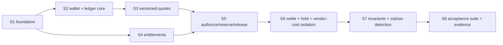

# M7 plan — credit-ledger core (W1)

Status: **PROPOSED — awaiting founder review. No worker may start until the founder approves this plan** (registry rule 2: a plan is not authorization to implement). Author: M7 milestone manager. Base: `main` @ `92c8114`. Date: 2026-11-02.

Authority: founder-authorized W1 scope as relayed in the M7 manager kickoff; ADR-0021, the `packages/db/ledger-migrations/` journal and the `packages/contracts` lane are granted by root. This document changes no code, schema, flag or protected file.

## 1. Objective and scope

Implement the **M7 credit-ledger core** in Neon/Drizzle with **no Medusa-funded flows**.

**In scope (W1)**
- Whole-number `credit_units` wallet with `available` / `reserved` / `held_for_review` buckets.
- Append-only, immutable ledger: every balance change has exactly one ledger entry with a unique cause.
- Versioned quotes (`quote_id`, `operation_kind`, `model`, `max_charge_units`, expiry, `price_version`), stale-quote renewal.
- Reserve → settle / release, one ACID transaction per state transition, idempotency key on every mutation.
- Unknown provider outcome ⇒ `reconciliation_hold`: no customer debit inferred from a vendor charge, no automatic retry, no automatic release.
- Promo-preview uniqueness per verified `issuer + subject`.
- Package / refinement-slot entitlement scaffolding per doc 06 v1.1.
- Read-only wallet-invariant check and orphaned-reservation detection.

**Out of scope (typed interfaces only, behind OFF flags, never stubbed as working)**
Medusa top-ups, payment-capture grants, refunds/chargebacks, digital-export purchase entitlements, physical-shirt redemption, any provider execution (M6b/M8a), remedy execution (blocked per doc 06). These need M4 or later.

**Acceptance targets (doc 15 M7):** 100-way concurrent balance operations; duplicate and out-of-order events; isolation of unknown provider cost; stale-quote renewal; no negative balance, no double charge or grant. Plus the doc 06 test-matrix rows that are in scope (§9).

## 2. Hard constraints (copy into every worker brief)

1. **System of record.** Neon/Drizzle owns the ledger. **Never write Medusa's database from Drizzle.** No FK to Medusa; cross-system references are text IDs only.
2. **No invented values.** No prices, credit costs, rate cards, markups, package sizes, currency amounts, SLAs, hold durations, orphan cut-offs. Production code uses typed config/ports with **no values**. Numeric fixtures exist only in `tests/`, are named `SYNTHETIC_*`, and are never exported from `src/`.
3. **Flags.** Every financial/paid flag stays OFF. The existing flags suffice (`credits.purchasing`, `studio.ai_generation_paid`, `studio.free_promo`, `exports.paid`, `payments.live`): **W1 adds no flag and does not touch `.env.example` or `packages/shared`.** The ledger is not imported by any runtime entry point in W1 (enforced by a static test, §5 D13).
4. **No uncontrolled billable retry.** Unknown state ⇒ hold + reconciliation; a human resolves it. (Retrying a *ledger* command with the same idempotency key is safe and expected; retrying a *provider* call is never done by this code.)
5. **Identity.** Actors are keyed by verified `issuer + subject` through `vynvori_identity.profiles(id)`. Never email. Never a Medusa customer ID.
6. **Migrations.** Non-destructive and additive; each with a documented rollback that is **tested** (up → down → up, and down refuses while data exists).
7. **No passed rows without evidence.** Postgres-backed tests count only when CI runs them (§4 F1). A local "not run" is reported `NOT_RUN`, never PASS.
8. **Lanes.** Not granted: dependencies/lockfile, `security/**`, `scripts/security/**`, `.github/workflows/**`, protected files (incl. `docs/technical/20-acceptance-matrix.md`), `MILESTONE-PROGRESS.md`, the registry, canonical specs `docs/technical/00`–`25`. Granted: `packages/contracts/**` (additive only), `packages/db/ledger-migrations/**`, ADR-0021. Workers edit `packages/db/**` (src, tests, `exports` in `package.json` only — no dependency fields).
9. **Stop and escalate** (AGENTS.md): need for any invented value; Medusa-version or auth-source surprises; checkout/pricing questions; missing rights/print/shipping/payment gates; a change that breaks an approved requirement; anything needing a lane not granted.

## 3. Cloud-sandbox facts (verbatim block for every brief)

- No Docker daemon or live databases in sessions; no GCP, Neon, R2 or Vercel access.
- Containers are ephemeral and isolated: only pushed work exists; sessions cannot see each other's files.
- One designated branch per session; GitHub through the MCP tools (`gh` only for search). Never push to another session's branch, never merge, never force-push shared branches.
- Before reporting a PR ready: `npm ci`, then `npm run verify`, `npm run security:audit`, and the affected tests.
- Only skills/commands listed in `.claude/VENDORED.md` exist (no `/security-scan`, `/verify`, `/tdd`, `/save-session`). For security review use `npm run smoke:security`, `npm run security:audit`, the `security-review` skill and the `security-reviewer` agent.

## 4. Verified repository findings (all re-checked against `main` @ `92c8114`)

| # | Finding | Consequence for the plan |
|---|---|---|
| F1 | **Postgres tests only run in CI if their env var is set by a workflow.** `m2.yml` `foundation` provides Postgres 17.6 and exports `M2_CREATIVE_DATABASE_URL` (loopback, user `synthetic`). No workflow sets `M3_TEST_POSTGRES_URL` or `M1B_TEST_POSTGRES_URL` (grep of `.github/`, `scripts/`, `package.json` files). `m0.yml` runs `npm test` with **no** Postgres. | Ledger Postgres tests **gate on `M2_CREATIVE_DATABASE_URL`** (optional local override `M7_TEST_POSTGRES_URL`), connect to the maintenance DB and create the disposable `vynvori_m7_ledger_test`. They run in the `foundation` job with **no workflow change**, and skip (= `NOT_RUN`) in the M0 job. Evidence must cite the `foundation` job log showing `ok` (not `# SKIP`) for each ledger test. See also Q4 for a side finding about M3/M1b tests. |
| F2 | Migration pattern: `composition-migrations/` = `plan.json` (version, purpose, `requires`, `journalSchema`, per-file sha256) + numbered SQL + `rollback/*.down.sql`; runner in `packages/db/src/composition-migrations.ts` accepts only loopback disposable DBs and pinned SHA-256, uses `pg_advisory_xact_lock(742110,3)`, journal-vs-schema drift check, `OUTCOME_UNKNOWN` on commit-time failure. Rollback SQL is manual and guarded (refuses while data exists). | Ledger journal copies the pattern with its own lock `(742110,7)`, journal schema `vynvori_ledger_migrations`, schema `vynvori_ledger`, `requires: ["vynvori_identity"]`. The composition runner is **not** refactored (M3's lane). |
| F3 | Identity key: `vynvori_identity.profiles(id uuid pk, issuer, subject, UNIQUE(issuer, subject))`. | Wallet PK = `profiles.id`; promo claims also store `(issuer, subject)` with a composite FK to `profiles(issuer, subject)`. |
| F4 | Contracts already hold the public shapes: `QuoteViewV3`, `CreditWalletSummaryV1` (available / reserved / **heldForReview**), `CustomerLedgerReceiptV1`, `PublicOperationV3`, `CustomerBundleFinancialSummaryV1`, `RefinementSlotV1`, `PackageStateV1`, Plane C graphs (`PLANE_C_COMMAND_GRAPH`, `PLANE_C_BUNDLE_GRAPH`, `PLANE_C_PROMO_GRAPH`), `canMarkReceiptSettled`, `FORBIDDEN_PUBLIC_FIELDS` (includes `idempotencyKey`). `internal.ts` is `server-only` and excluded from the public barrel. | New ledger-internal types go in a **new `server-only` module `ledger-internal.ts`** (exports subpath `./ledger-internal`), not in the public barrel. Public shapes are reused, not redefined. The ledger store derives its transition legality from the existing graphs, not a second copy. |
| F5 | `CustomerErrorCode` already has `INSUFFICIENT_CREDITS`, `QUOTE_STALE`, `QUOTE_EXPIRED`, `PROMO_ALREADY_USED`, `PROVIDER_OUTCOME_UNKNOWN`, `PACKAGE_CLOSURE_PENDING`, `INCLUDED_REFINEMENT_UNAVAILABLE`, `TERMS_NOT_APPROVED`, `CLAIM_CONFLICT`. | Internal `LedgerErrorCode` maps onto these for customer projection; additive internal-only codes (e.g. `IDEMPOTENCY_CONFLICT`, `INVALID_TRANSITION`) never reach the public enum. |
| F6 | Existing flags in `packages/shared/src/public.ts` cover every gated capability; all `false`. | See constraint 3. |
| F7 | `npm run test:m2` globs `packages/db/tests/*.test.ts`; root `lint`/`typecheck:m2` already cover `packages/db` and `packages/contracts`. | No root `package.json` script change is needed. New test files are picked up automatically. |
| F8 | `@vynvori/db` already depends on `@vynvori/contracts`, `pg`, `drizzle-orm`. | **No dependency or lockfile change.** If a worker believes one is needed → RESOURCE REQUEST, do not edit. |
| F9 | PG 16 **server** binaries exist in this container at `/usr/lib/postgresql/16/bin` (not on `PATH`); `psql` and a `docker` CLI exist; no daemon. | Not assumed available to workers. Q5 asks root whether a throwaway loopback cluster may be used for **local development feedback only** (result would still be reported `NOT_RUN` as CI evidence). |

## 5. Design decisions (proposed content of ADR-0021)

The council (Architect, Skeptic, Pragmatist, Critic; the three outside voices briefed with the question only) was convened for one genuinely open question, **D5 reservation granularity**. All four voices chose Option B; their refinements are folded in below. The other decisions follow directly from docs 04/06/22/23 and were not council matters. Founder may override any of them at plan review.

**D1 Actor key.** `wallets.user_id uuid PRIMARY KEY REFERENCES vynvori_identity.profiles(id) ON DELETE RESTRICT`. Every row with an owner carries `user_id`. No guest wallets (a guest has no profile row, so a guest purchase/grant path cannot exist). No email column anywhere. No Medusa customer ID in W1.

**D2 Buckets and balanced entries.** Wallet columns: `available_units`, `reserved_units`, `held_for_review_units`, `consumed_units`, `revision`; all `bigint CHECK (>= 0 AND <= 9007199254740991)` so values round-trip exactly as the contract's `NaturalNumberSchema` (JS safe integers); the store parses `bigint` via `BigInt`, never `Number` on unchecked strings. Every ledger entry carries five deltas — `delta_available`, `delta_reserved`, `delta_held`, `delta_consumed`, `delta_external` — and a `CHECK` that they **sum to zero** (double-entry; `delta_external` is the sink/source for grants). A per-`entry_kind` `CHECK` fixes the legal sign pattern:

| entry_kind | available | reserved | held | consumed | external | notes |
|---|---|---|---|---|---|---|
| `grant` | +g | | | | −g | `g > 0`; source columns below |
| `reserve` | −h | +h | | | | |
| `release` | +h | −h | | | | |
| `settle` | +(h−c) | −h | | +c | | `0 < c ≤ h` |
| `hold` | | −h | +h | | | unknown/unconfirmed outcome |
| `hold_release` / `hold_settle` | | | −h | (+c) | | **exist in the DB graph only**; no W1 store function (remedy execution blocked) |

**D3 Wallet balances are derived from the ledger by the database.** `ledger_entries` is append-only (UPDATE/DELETE/TRUNCATE rejected by trigger). An `AFTER INSERT` trigger applies the deltas to `wallets`; a `BEFORE UPDATE` trigger on `wallets` rejects any update unless `pg_trigger_depth() > 1` (i.e. issued from the ledger trigger); the wallet `CHECK`s are the backstop against negatives. So "every balance change has exactly one ledger entry" is structural, not a convention. Unique cause: `UNIQUE(cause_kind, cause_ref)` (`cause_ref` = `{reservation_id}:{entry_kind}` or `{grant_source_kind}:{source_ref}`) and `UNIQUE(reservation_id, entry_kind)` so each reservation transition happens at most once. Wallet creation (all-zero row, `ON CONFLICT DO NOTHING`) is not a balance change.

**D4 Idempotency.** Table `ledger_commands(command_id, scope, idempotency_key, request_sha256, user_id, command_kind, result jsonb, created_at)` with `UNIQUE(scope, idempotency_key)`; `scope = {user_id}:{command_kind}` (no cross-user key collision or probing). The command row and its ledger entries commit in the **same** transaction. Replay with the same key and same canonical request hash returns the stored result; same key with a different hash is `IDEMPOTENCY_CONFLICT` and mutates nothing. Concurrent same-key requests serialize on the unique index; the loser returns the winner's result. Rejected commands (insufficient funds, expired quote…) record nothing, so the caller may retry them later with the same key. Every mutation, including internal system transitions, requires a key. **Quote-level double-charge guard:** `ledger_authorizations` has `UNIQUE(quote_version_id)` — a second authorization of the same quote version under a *different* idempotency key still cannot reserve twice.

**D5 One reservation per operation (council verdict: unanimous B).** `credit_reservations` has one row per provider operation. A bundle authorization creates its N operation reservations **atomically in one transaction** from per-operation allocations **frozen in the persisted quote** (`ledger_quote_allocations`: `operation_index`, `hold_units`, `charge_units`), idempotent on `(quote_version_id, operation_index)`. Rules the council added:
- Σ`hold_units` must equal the quote's `max_charge_units` and Σ`charge_units` must equal `credits_quoted`, enforced by a **deferred constraint trigger** at commit (a row `CHECK` cannot see siblings). Missing or non-summing allocations ⇒ authorization **fails closed** (`ALLOCATION_INVALID`). The ledger **never computes a split or a rounding remainder** — the pricing policy supplies the vector; the ledger only verifies it.
- Settle amount must equal the allocation's `charge_units` (fixed quoted charge; variable charge needs a future approved pricing policy and is out of W1) and never exceeds `hold_units`; the unused remainder is released **in the same settle entry** (nothing falls between settled and released).
- Included refinements get **no reservation and no zero-unit row**; they are entitlement slots only (D9). Promo previews also have no reservation (D8). A final render is a separate quote and separate reservation.
- Isolation: an unknown outcome moves exactly one reservation to `reconciliation_hold`; siblings settle/release independently. Releasing one sibling returns units to `available` immediately (never netted against a held sibling).
- Customer bundle summary is a pure aggregate over reservations by `package_id`, with `quotedTotalUnits`/`maximumAuthorizedHoldUnits` read from the quote, so a missing row shows as a discrepancy instead of shrinking totals.

**D6 Reconciliation hold.** `reserved → reconciliation_hold` is a ledger `hold` entry (reserved → held bucket). Reasons: `outcome_unknown`, `persistence_unconfirmed`. There is no timer, no sweeper and no code path that settles or releases from hold; the DB trigger encodes the full Plane C graph (hold may only go to `operator_remedy`, which may only go to `settled`/`released`) but **W1 exposes no function for those edges** — remedy execution is blocked and is a typed port only. Vendor cost evidence lives in a separate internal table with **no foreign key to, and no trigger interaction with, the ledger**; a test proves that recording any evidence changes zero wallet/ledger/reservation rows and that no store function reads it.

**D7 Quotes.** Immutable rows `ledger_quotes(quote_version_id pk, quote_id, version_no, user_id, operation_kind, model_ref, max_charge_units, charge_units, issued_at, expires_at, price_version, capability_snapshot_id, consent_text_version, terms jsonb, content_sha256, project/plan/source refs)`, `UNIQUE(quote_id, version_no)`. `operation_kind` ∈ {`concept_bundle_3x2`, `promo_single_preview`, `final_standard`, `final_premium`} (the existing `offerKind`). Supersession is derived (latest `version_no`), never an UPDATE. Authorization requires, in one transaction: owner match; quote version is the latest; `now < expires_at` (`QUOTE_EXPIRED` otherwise); `price_version` equals the value returned by a typed `PricePolicyPort` (`QUOTE_STALE` otherwise, including superseded); allocations valid; explicit consent flag with matching `consent_text_version`; non-null approved terms versions where live-paid (`TERMS_NOT_APPROVED`); sufficient `available_units`. **Renewal** (`renewQuote`) inserts version n+1 from fresh port inputs. **A top-up or grant event never authorizes anything** — there is no code path from a grant to an authorization (tested). Expiry uses an injected clock (tests) / app clock (prod); skew is documented in the ADR.

**D8 Promo uniqueness.** `promo_claims` with `UNIQUE(issuer, subject)` plus composite FK to `profiles(issuer, subject)`; state per `PLANE_C_PROMO_GRAPH`; two-device race resolves on the unique index (loser gets `PROMO_ALREADY_USED`, or the prior claim if same idempotency key). The claim is an entitlement, not a wallet debit (promo quotes are 0/0). A paid concept never recycles promo bytes/slot. **Whether a verified-uncharged failure may be re-offered is an open policy question (Q2); W1 default is conservative: one claim row per identity, ever.**

**D9 Packages and refinement slots (scaffolding).** `ledger_packages` (state = `PLANE_C_BUNDLE_GRAPH`, created in the same transaction as the bundle reservations) and `refinement_slots` (ordinal 1/2; states per `RefinementSlotV1`; `UNIQUE(package_id, ordinal)`). DB guards: `skipped → available` only while the package is `open_for_refinements`; `used` consumes exactly one slot; `pending`/`unknown` locked; `closure_pending` forbids silent consumption/forfeiture; `forfeited` only through closure with a non-null `refinementClosureNoticeVersion`; no clock-based expiry anywhere. Transitions into `partial` / `delivered_3_of_3` take a **typed evidence argument** (count of durable, rights-permitted artifacts) supplied by the caller — this is an integration seam to M6b/Plane B, **not** a working integration; tests use synthetic evidence. Concept slots belong to Studio persistence (M6a) and are not built here.

**D10 Lock order and Neon.** Every balance-changing transaction takes the wallet row `FOR UPDATE` first, then reservations in `id` order; no other lock order is permitted (documented to prevent deadlock). Only transaction-scoped features are used (`pg_advisory_xact_lock`, `SET LOCAL`), so Neon's pooled (PgBouncer transaction-mode) runtime connection is safe; migrations use the separate direct identity as today. A `COMMIT` with no acknowledgement surfaces as `LEDGER_OUTCOME_UNKNOWN`; the only remedy is replaying the same idempotency key.

**D11 Ownership.** Customer-facing authorization takes the authenticated `userId`; every SQL predicate includes it; absent and foreign IDs return the same `NOT_FOUND`. Internal transitions (settle/release/hold) are server-internal commands carrying an `actor: { kind: "system", component }` **and** an `expectedUserId`; a mismatch is `NOT_FOUND` (no confused deputy). Nothing here is a route; BFF authorization is M6.

**D12 Grant source in W1.** Credits must exist to test anything, but Medusa top-ups are out of scope. `grant` entries carry `grant_source_kind` ∈ {`synthetic_test`, `medusa_payment_capture`, `operator_adjustment`} and `source_ref`; the DB allows all three, the **only W1 writer** is `synthetic_test`, exposed solely from `@vynvori/db/ledger-testing` (a separate module that no runtime code may import; static test in D13). The invariant checker reports any `synthetic_test` grant as a finding so one leaking into a real environment is visible. `medusa_payment_capture` and `operator_adjustment` exist as typed ports only.

**D13 Not reachable from runtime.** A static test asserts nothing under `apps/` and no module other than tests imports `@vynvori/db/ledger*` or `ledger-testing`, and that `src/` exports no numeric price/rate/package constants. W1 ships a library plus schema, not a feature.

**D14 Read-only checks.** `checkWalletInvariants` runs in a `READ ONLY` `REPEATABLE READ` transaction and reports (never repairs): wallet bucket = Σ entry deltas; every entry sums to zero; no negative bucket; reserved bucket = Σ `hold_units` of `reserved` reservations; held bucket = Σ of hold-state reservations; each reservation state matches its entry trail (exactly one entry per transition); allocation sums; promo uniqueness; synthetic-grant presence. `findOrphanedReservations(client, { olderThan })` takes the cut-off as an **explicit argument with no default** and classifies `reserved_never_dispatched` (no `workflow_ref`), `reserved_dispatch_stale`, `hold_present`; it never mutates and never releases.

## 6. Steps, dependencies and lanes

One step = one branch = one PR = one worker. Worker concurrency is 1 unless root confirms the second slot (shared with M3 closure). Suggested model tier: strongest for S2, S5, S6; default for the rest.

| Step | Title | Migration | Depends on | Parallel-safe with |
|---|---|---|---|---|
| S1 | Foundation: ADR-0021, ledger journal skeleton + rollback, contract stubs, test harness | `0001_ledger_schema` | — | — |
| S2 | Wallet, idempotent command log, append-only ledger | `0002_wallet_ledger` | S1 | S4 |
| S3 | Versioned quotes, allocations, renewal | `0003_quotes` | S2 | S4 |
| S4 | Promo uniqueness, packages, refinement slots | `0004_entitlements` | S1 | S2, S3 |
| S5 | Authorize → reserve → release (single + atomic bundle) | `0005_reservations` | S3, S4 | — |
| S6 | Settle, reconciliation hold, vendor-cost isolation | `0006_vendor_cost_evidence` | S5 | — |
| S7 | Wallet-invariant check, orphan detection | none | S5, S6, S4 | — |
| S8 | Acceptance suite, evidence record, grants proposal | none | S1–S7 | — |

S2/S3/S4 touch disjoint source files but all append to `plan.json` and `package.json` `exports`; if ever run in parallel the later PR rebases those two files (SQL hashes are per-file, so the rebase is mechanical). Default is serial.

| Step | Files touched (all new unless noted) | Lanes |
|---|---|---|
| S1 | `docs/implementation/ADR-0021-M7-Core-Ledger-Foundation.md`; `packages/db/ledger-migrations/{plan.json,0001_ledger_schema.sql,rollback/0001_ledger_schema.down.sql}`; `packages/db/src/ledger-migrations.ts`; `packages/db/tests/ledger-fixture.ts`, `ledger-migrations.test.ts`; `packages/db/package.json` (`exports` only); `packages/contracts/src/ledger-internal.ts` (+ `exports` entry in its `package.json`), `packages/contracts/tests/ledger-internal.test.ts` | contracts (granted), ledger journal (granted), ADR-0021 |
| S2 | `ledger-migrations/0002_wallet_ledger.sql` + rollback; `packages/db/src/ledger-core.ts`, `ledger-testing.ts`; tests `ledger-core.test.ts`, `ledger-core-concurrency.test.ts`; plan.json entry | ledger journal |
| S3 | `0003_quotes.sql` + rollback; `ledger-quotes.ts`; `ledger-quotes.test.ts`; plan.json | ledger journal; contracts (additive, if a schema is missing) |
| S4 | `0004_entitlements.sql` + rollback; `ledger-entitlements.ts`; `ledger-entitlements.test.ts`; plan.json | ledger journal |
| S5 | `0005_reservations.sql` + rollback; `ledger-reservations.ts`; `ledger-reservations.test.ts`, `ledger-reservations-concurrency.test.ts`; plan.json | ledger journal |
| S6 | `0006_vendor_cost_evidence.sql` + rollback; `ledger-settlement.ts`, `ledger-evidence.ts`; tests; plan.json | ledger journal |
| S7 | `ledger-invariants.ts`; `ledger-invariants.test.ts` | — |
| S8 | `packages/db/tests/ledger-acceptance.test.ts`, `ledger-runtime-isolation.test.ts`; `docs/implementation/M7-Evidence.md`; `docs/implementation/M7-Runtime-Grants-Proposal.md` (proposal only, not applied) | — |

No step touches `apps/**`, `packages/commerce/**`, `packages/shared/**`, `.env.example`, `.github/**`, `security/**`, `scripts/**`, protected files, or any other journal.

## 7. Step briefs

Each brief is meant to be pasted to a worker **with §2 and §3 above**. The worker still reads `AGENTS.md`, `CODING_AGENT_START_HERE.md`, `docs/implementation/ORCHESTRATION-REGISTRY.md`, `docs/technical/06`, `22`, and ADR-0021 (after S1). Command per step is emitted by `plan-orchestrate` after founder approval (all are feature-add shaped: `/orch-add-feature`).

Common exit criteria for every step: `npm ci`; `npm run lint`; `npm run typecheck`; `npm run test:m2` (ledger PG tests will skip locally → report `NOT_RUN`, never PASS); `npm run test:contracts`; `npm run security:audit` and `npm run smoke:security` unchanged-green; the PR's `M2 backend foundation` job log shows the new ledger tests as `ok` (cite the lines). PR body contains: ADR link, migration + rollback, API/contract diff, security-review notes, evidence table with an explicit **NOT RUN** column, flags unchanged. Reviewer: manager runs `/orch-review`, `security-reviewer` agent and `security-review` skill on every step that touches money, idempotency or persistence (S1–S7).

### S1 — Foundation (no business logic)
**Goal.** Land ADR-0021, an empty-but-verified ledger migration journal with tested rollback, additive contract stubs and the shared test harness.

**Context.** Copy the *pattern* (not the code path) of `packages/db/composition-migrations` and `src/composition-migrations.ts`; do not edit them. Lock `(742110,7)`, journal schema `vynvori_ledger_migrations`, schema `vynvori_ledger`, `requires: ["vynvori_identity"]`, loopback + disposable DB allow-list (`vynvori_m7_ledger_test`), pinned SHA-256 per SQL file, `OUTCOME_UNKNOWN` handling.

**Tasks.**
1. ADR-0021: context, decisions D1–D14 (§5, final wording), rollout (**not authorized**: no staging/production apply; needs a separate founder remote-database approval, backup, runtime-role grants), rollback, security review notes, API/event changes (none), flags (none).
2. Journal: `plan.json`; `0001_ledger_schema.sql` creating only `vynvori_ledger` (additive, no grants); `rollback/0001_ledger_schema.down.sql` (guarded, drops the empty schema, deletes the journal row); runner `applyLedgerMigrations` + `ledgerMigrationPlan`; add `./ledger-migrations` to `packages/db/package.json` `exports` (not dependency fields).
3. Contracts (additive; new `server-only` module `ledger-internal.ts`, exported as `./ledger-internal`, **not** in the public barrel): Zod/TS for `LedgerCommandEnvelopeV1` (scope, idempotency key charset/length, `requestSha256`), `LedgerEntryKindV1`, `LedgerErrorCodeV1` (+ mapping to `CustomerErrorCode`), `LedgerQuoteRecordV1`, `QuoteAllocationV1`, `ReservationStateV1` (derived from the existing Plane C command states), `HoldReasonV1`, `GrantSourceKindV1`; **port interfaces only** (types, no implementations, no throwing stubs): `PricePolicyPort`, `MedusaCaptureGrantPort`, `RefundReversalPort`, `DigitalExportEntitlementPort`, `GarmentRedemptionPort`, `RemedyExecutionPort`, `ProviderOutcomeEvidencePort`, each annotated with its governing existing flag and "OFF/blocked". No numeric defaults anywhere.
4. Harness `ledger-fixture.ts`: derive connection from `M7_TEST_POSTGRES_URL` or `M2_CREATIVE_DATABASE_URL`; refuse unless host is `127.0.0.1` and user `synthetic`; create/drop `vynvori_m7_ledger_test`; rebuild `vynvori_identity` from `auth-migrations/plan.json`, then apply the ledger plan. Missing URL ⇒ tests `skip` (= NOT_RUN).
5. Tests: plan loads and SHA pins are enforced (tamper ⇒ `PLAN_INVALID`); non-loopback/other-DB targets ⇒ `TARGET_REJECTED`; (PG) apply → replay applies 0 → journal drift ⇒ `HISTORY_OR_SCHEMA_DRIFT` → down script → up again; SQL is additive (no `GRANT`/`DROP TABLE`/identity alteration); contracts: schemas strict, no numeric defaults, `findLeakedInternalFields` on the new types, internal module absent from the public barrel.

**Out of scope.** Any table, wallet, quote logic; any change to other journals; workflows.

**Evidence.** Unit test output; CI `foundation` log lines for PG tests; ADR link; contract diff.

**Rollback.** Revert PR (nothing deployed); data: `0001` down script on a disposable DB.

**Resource request attached (optional, Q3).** Ask root to export `VYNVORI_REQUIRE_PG_TESTS=1` in the `m2.yml` `foundation` job so ledger tests fail instead of skip if the DB is missing. Without it, evidence is a manual log citation.

### S2 — Wallet, idempotent command log, append-only ledger
**Goal.** D1–D4 in the database and a store that can grant (synthetic, test-only) and read a wallet summary.

**Tasks.** `0002_wallet_ledger.sql`: `wallets`, `ledger_commands`, `ledger_entries`, triggers (append-only, apply-to-wallet, wallet-update guard via `pg_trigger_depth()`), per-kind delta-shape `CHECK`s, balanced-entry `CHECK`, unique-cause constraints, safe-integer bounds, `ON DELETE RESTRICT` FKs; rollback guarded on any wallet/entry row. `ledger-core.ts`: `ensureWallet`, `getWalletSummary` (returns the existing `CreditWalletSummaryV1` shape; `walletRevision` from `revision`), `runLedgerCommand` (the single place that opens the transaction, takes the wallet lock first, inserts the command row, executes a callback, stores the result, maps constraint errors to `LedgerErrorCode`, converts commit-time failure to `LEDGER_OUTCOME_UNKNOWN`). `ledger-testing.ts`: `grantSyntheticCredits` (the only W1 grant writer).

**Tests (PG).** Direct `UPDATE wallets` rejected; entry UPDATE/DELETE/TRUNCATE rejected; unbalanced / wrong-shape / negative-result entries rejected; wallet = Σ deltas after N random operations; same key+same payload ⇒ one entry; same key+different payload ⇒ `IDEMPOTENCY_CONFLICT`, no mutation; two users, same key ⇒ independent; **100 concurrent identical grants ⇒ exactly one**; 100 concurrent distinct grants ⇒ exact total, no lost update; non-integer/negative/over-limit input rejected before SQL; FK to a non-existent profile rejected; rollback: refuses with data, succeeds when empty, journal row removed, re-up works.

### S3 — Versioned quotes, allocations, renewal
**Goal.** D5 (allocation rules) and D7 in storage; no reservation yet.

**Tasks.** `0003_quotes.sql`: `ledger_quotes` (immutable triggers), `ledger_quote_allocations`, deferred constraint trigger enforcing Σ allocation = quote totals; promo quotes 0/0 with no allocations; non-promo `max_charge_units > 0`, `charge_units ≤ max_charge_units`, `expires_at > issued_at`. `ledger-quotes.ts`: `issueQuote` (input already priced by a `PricePolicyPort` implementation supplied by the caller — **the repo ships none**), `renewQuote` (n+1, fresh inputs), `getQuote` (owner-scoped), `assessQuoteForAuthorization` (pure/read: returns `QUOTE_EXPIRED` | `QUOTE_STALE` | `ALLOCATION_INVALID` | `TERMS_NOT_APPROVED` | ok), canonical JSON + SHA-256 `content_sha256`.

**Tests.** Immutability; version monotonicity under 100 concurrent `renewQuote`; superseded ⇒ `QUOTE_STALE`; time expiry ⇒ `QUOTE_EXPIRED` using an injected clock (boundary: `now == expires_at` is expired); `price_version` mismatch ⇒ `QUOTE_STALE`; allocation sums off by one in either direction ⇒ rejected at commit; cross-owner `getQuote` ⇒ `NOT_FOUND`; tampering `terms` changes `content_sha256`; contract `QuoteViewV3` projection of a stored quote validates.

### S4 — Promo uniqueness, packages, refinement slots
**Goal.** D8, D9 scaffolding.

**Tasks.** `0004_entitlements.sql`: `promo_claims` (`UNIQUE(issuer, subject)`, composite FK to `profiles(issuer, subject)`, state graph trigger from `PLANE_C_PROMO_GRAPH`), `ledger_packages` (`PLANE_C_BUNDLE_GRAPH` trigger; quote-version FK; `UNIQUE` active package per quote version), `refinement_slots` (ordinal 1/2, state guards per D9, no zero-unit financial rows). `ledger-entitlements.ts`: `claimPromo`, `markPromoOutcome` (consumed / verified_uncharged_failure / claim_unknown, per graph), package transitions with typed evidence args, slot operations (`skip`, `restore`, `markPending`, `markUnknown`, `consume`, `closeWithForfeiture`).

**Tests.** Two-device race ⇒ one claim; same key replay ⇒ same claim; different identity ⇒ independent; `claim_unknown` ⇒ no second claim and no re-offer; illegal graph edges rejected at DB level; `skipped → available` rejected unless `open_for_refinements`; `closure_pending` blocks consumption and forfeiture; forfeiture requires the closure-notice version; 0/3, 1/3, 2/3 evidence never reaches `delivered_3_of_3`; promo never touches wallet tables (row counts unchanged).

### S5 — Authorize → reserve → release
**Goal.** D5 reservation and release; D7 authorization; D11 ownership.

**Tasks.** `0005_reservations.sql`: `ledger_authorizations` (`UNIQUE(quote_version_id)`), `credit_reservations` (state per Plane C command graph trigger, `hold_units`/`charge_units` frozen from allocation, `UNIQUE(quote_version_id, operation_index)`, `UNIQUE(operation_id)`, `workflow_ref` settable once null→value), deferred trigger "reservation state ⇔ exactly one matching ledger entry". `ledger-reservations.ts`: `authorizeQuote` (single transaction: lock wallet, validate quote via `assessQuoteForAuthorization`, require explicit consent + matching consent-text version, insert authorization, create **all** operation reservations plus the package row (bundle) atomically, write `reserve` entries), `releaseReservation` (system command, `expectedUserId`, only from `reserved`), `recordWorkflowRef`.

**Tests.** **100 concurrent authorizations racing for a wallet that can fund exactly K ⇒ exactly K succeed, rest `INSUFFICIENT_CREDITS`, no negative bucket, reserved = Σ holds**; 100 concurrent replays of one key ⇒ one authorization; two *different* keys for one quote version ⇒ second rejected (no double reserve); bundle atomicity under injected failure on the 3rd reservation insert ⇒ nothing persisted (no partial bundle); expired/stale/superseded quotes rejected with no mutation; top-up after a stale rejection does not auto-authorize (assert no code path); cross-user authorization ⇒ `NOT_FOUND`; release returns exact units and is replay-safe; release of a non-`reserved` reservation ⇒ `INVALID_TRANSITION`; release while a sibling is held does not net against it; commit-time connection loss ⇒ `LEDGER_OUTCOME_UNKNOWN`, replay with same key converges.

### S6 — Settle, reconciliation hold, vendor-cost isolation
**Goal.** D6 and the "unknown provider cost" acceptance target.

**Tasks.** `0006_vendor_cost_evidence.sql`: internal table (`operation_id`, optional `reservation_id` as plain text/uuid **without FK**, `evidence_kind` ∈ usage/invoice/unknown, exact integer micro-USD amount nullable; internal-only, no customer projection). `ledger-settlement.ts`: `settleReservation` (system command; requires typed evidence `{ providerStatus ∈ persisted_delivered | reconciled_delivered, hasVerifiedManifestHash, ownerAndRightsVerified }` re-validated with the existing `canMarkReceiptSettled` / `canMarkOperationDelivered` guards; amount must equal frozen `charge_units`; remainder released in the same entry), `holdReservation` (reason `outcome_unknown` | `persistence_unconfirmed`; moves units reserved → held). `ledger-evidence.ts`: `recordVendorCostEvidence` (writes only the evidence table).

**Tests.** Unknown outcome ⇒ hold; no later function settles or releases it (grep-level test that no exported function maps from `reconciliation_hold`); **recording invoice/usage evidence of any amount changes zero rows in wallets, ledger_entries, credit_reservations** and cannot be read by any settle path; settle with a vendor-charge message alone (non-delivered status) rejected; settle amount ≠ charge rejected; settle after release / release after settle / hold after settle ⇒ `INVALID_TRANSITION`, balances unchanged; one hold among three siblings leaves the others settleable; replay of every transition is idempotent; out-of-order arrival (settle command before the reserve committed) ⇒ `NOT_FOUND`, safe to retry later; per-call cap: a reservation can never settle above its `hold_units`.

### S7 — Wallet-invariant check and orphaned-reservation detection
**Goal.** D14, read-only.

**Tasks.** `ledger-invariants.ts`: `checkWalletInvariants(client)` and `findOrphanedReservations(client, { olderThan })` as specified in D14; structured report type; READ ONLY REPEATABLE READ; no write statements (a test asserts the connection's transaction is read-only and every statement is a `SELECT`).

**Tests.** Clean state ⇒ no findings; for each invariant, a test that corrupts a **disposable** database via a superuser connection that bypasses the guards (disabling triggers inside the test only) and asserts the exact finding; synthetic-grant finding present; orphan classes; `olderThan` is required (type-level + runtime); the checker never changes a row (row-count/xmin comparison before and after); runs correctly with concurrent writers.

### S8 — Acceptance suite, evidence record, grants proposal
**Goal.** Close the loop: the doc 15 / doc 06 matrix as executable tests, plus honest evidence.

**Tasks.** `ledger-acceptance.test.ts` implements §9 as one traceable suite (test names carry the row ids); `ledger-runtime-isolation.test.ts` (D13: no `apps/**` or non-test import of the ledger modules or `ledger-testing`; no numeric price/rate/package constants exported from `src/`; flags in `featureDefaults` all `false`); `M7-Evidence.md` (per check: command, result, **CI job + log line**, and an explicit NOT RUN list); `M7-Runtime-Grants-Proposal.md` (SELECT/INSERT/UPDATE per table for a future restricted runtime role, wallets `INSERT` only, **no** wallet `UPDATE`, no DDL; marked **proposal, not applied**).

**Out of scope.** Editing `20-acceptance-matrix.md`, `MILESTONE-PROGRESS.md`, the registry (root-only). The manager sends root the proposed row changes in the CLOSE REQUEST.

## 8. Rollback strategy (per step and overall)

- Code: revert the PR; nothing is deployed and the ledger is unreachable from runtime (D13).
- Data: each migration has a guarded `rollback/000N_*.down.sql` (refuses while rows exist; drops its own objects; removes its journal row); tests run up → down → up on a disposable database in CI. Rollbacks are applied in reverse numeric order.
- **Nothing is applied to staging/production by this milestone.** A future apply needs: separate founder remote-database approval, native backup first (M2 procedure), pinned target in `plan.json`, runtime-role grants (S8 proposal).

## 9. Test and evidence matrix

**Doc 15 acceptance targets**

| Target | Step | Where it runs |
|---|---|---|
| 100-way concurrent balance operations | S2, S5, S6, S8 | CI `foundation` job only (Postgres) |
| Duplicate and out-of-order events | S2, S5, S6, S8 | CI only |
| Isolation of unknown provider cost | S6, S8 | CI only |
| Stale-quote renewal | S3, S5 | CI only (clock injected) |
| No negative balance / double charge / double grant | S2, S5, S6, S7 | CI only |

**Doc 06 test-matrix rows**

| Row | In W1? | Covered by |
|---|---|---|
| Simultaneous requests against a 1-credit wallet | yes | S5 (K = 1 case), S8 |
| Duplicated payment capture | **no** (needs M4) | duplicate *grant* idempotency tested in S2 with the synthetic source; Medusa capture = typed port only |
| Provider timeout after billing | yes (ledger side) | S6 hold + vendor-cost isolation |
| Provider returns artifact but DB write fails | yes (ledger side) | S6 `persistence_unconfirmed` hold |
| Webhook replay / out-of-order | yes (ledger commands; no webhook/inbox in W1) | S2, S5, S6 |
| Refund after partial credit consumption | **no** | typed `RefundReversalPort` only |
| Unauthorized redemption | **no** (redemption); ownership on every ID **yes** | S5/S6 cross-user tests |
| Concurrent carts reuse entitlement | **no** | redemption out of scope |
| Digital export paid then failed render | **no** | typed port only |
| Guest attempts credit purchase | yes (structurally) | S2: no wallet without a profile |
| Rounding of fractional USD costs | partly | whole-number units only, non-integers rejected, allocations must sum exactly; USD→credit conversion needs a rate card and is out |
| Package fee scenario | partly | S3/S5 bundle with *synthetic* allocations |

**Checks that cannot run in the cloud sandbox** (reported `NOT_RUN` locally; count only from the CI `foundation` log): every Postgres-backed test. Pure unit tests (plan/SHA pinning, contract schemas, static isolation test, SQL-text lint) run locally and in CI.

**ACC rows the manager expects to propose at close** (root verifies; founder confirms; none is edited by M7): ACC-11 → **IN_PROGRESS** with core evidence only (the row also covers "double grant" via Medusa, which is out of W1, so PASSED would overclaim); ACC-15 → **IN_PROGRESS**, ledger side only (no provider side exists); ACC-23 → **IN_PROGRESS**, ledger-command replay only (no inbox/outbox, no Medusa events). No row is claimed PASSED.

## 10. Security review plan

Applies to S1–S7 (S8 lighter): `security-reviewer` agent + `security-review` skill on the diff, notes copied into the PR. Standing checklist: parameterized SQL only; every predicate owner-scoped; uniform `NOT_FOUND`; idempotency keys never logged and never in public projections (`FORBIDDEN_PUBLIC_FIELDS`); no secret/URL in tests; synthetic-only guards on the harness; lock-order compliance; no `SECURITY DEFINER` functions; no dynamic SQL from user input; trigger bypass (`session_replication_role`, `ALTER TABLE … DISABLE TRIGGER`) is a superuser-only capability and is listed in the grants proposal as a thing the runtime role must not have; bigint → number conversion bounded.

## 11. Stop conditions and plan mutation

Workers stop and message the manager (→ root → founder) if they need: any numeric business value; a dependency or lockfile change; a CI/workflow/security-policy change; a breaking contract change; to touch Medusa data or another milestone's journal; or if a decision here proves unworkable. Plan mutations (split / insert / skip / reorder) are made by the manager through a new docs-only PR with a mutation log appended below; the founder re-approves anything that changes scope, lanes, or an ADR-level decision.

## 12. Open questions for the founder (answer at plan review; none blocks S1)

- **Q1 (D12).** Confirm that W1 may include a **test-only synthetic grant** writer (isolated in `ledger-testing`, flagged by the invariant checker) so the ledger can be exercised without Medusa. Alternative: build wallet/reservation logic with no way to fund a wallet outside tests, which is what this is; there is no third option without inventing a funding path.
- **Q2 (D8).** After a promo claim ends `verified_uncharged_failure`, may the identity be offered the free preview again? Default in the plan: **no** (one claim row per identity ever) until the founder sets a policy.
- **Q3 (S1).** Approve a root-owned one-line `m2.yml` change (`VYNVORI_REQUIRE_PG_TESTS=1` on the `foundation` job) so ledger Postgres tests fail rather than skip when the DB is missing. Optional; without it we rely on citing the CI log.
- **Q4 (side finding, not M7 scope).** `M3_TEST_POSTGRES_URL` and `M1B_TEST_POSTGRES_URL` are not set by any workflow, so the existing composition/identity Postgres tests appear to skip in CI. Statements such as "PG-verified" for ACC-06 therefore reflect local runs only. Worth a root/M3-closure look; it also means M7 cannot lean on those suites as CI evidence.
- **Q5 (F9).** May workers start a throwaway loopback Postgres from the container's PG16 binaries for development feedback? Results would be local-only and reported `NOT_RUN` as CI evidence. Default in the plan: no.
- **Q6 (D5).** Confirm that W1 supports only **fixed** quoted charges (settle amount = allocation `charge_units`). Variable/metered customer charges need an approved pricing policy and are deferred.

## 13. Resources requested from root

| Resource | Status |
|---|---|
| ADR-0021, ledger journal, contracts lane | granted (kickoff) |
| Worker slot | 1 at a time; a second only on root's confirmation |
| `m2.yml` env line (Q3) | optional request, to be sent only if the founder approves Q3 |
| Further ADR numbers | none needed (D1–D14 all live in ADR-0021) |

## 14. Plan review log

_Appended after the adversarial review of this document (blueprint review gate) and after founder review._
