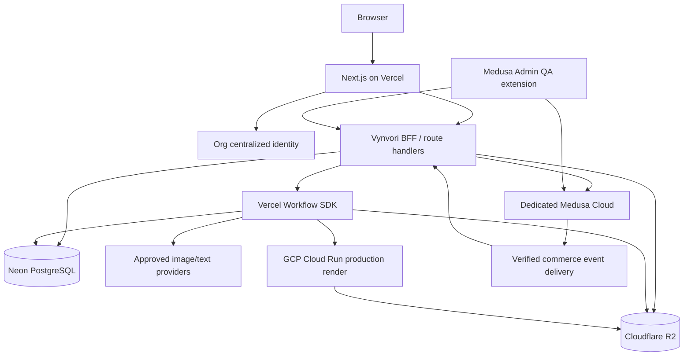

# 01 — Runtime architecture and service boundaries

## Context

**Important:** Diagram describes a proposed topology; the verified LuckyLittleDevil identity exchange must be inserted rather than assumed.

## Boundaries

- The **browser** never receives Medusa admin keys, provider API secrets, R2 object secrets, Cloud Run service credentials, signed internal event keys or raw third-party billing payloads.
- **Next.js BFF** validates the centralized session and domain ownership, mediates Medusa customer calls when needed, issues presigned R2 upload/download URLs, starts workflows and serves authorized design state.
- **Medusa** alone changes inventory, prices, checkout state, order statuses, refunds and shipping fulfillment records. Additional placement prices and promotions are applied in trusted Medusa workflow hooks after server-side composition quote verification.
- **Neon** is the authoritative writer for creative entities, credit ledgers, source assets, user/project mapping, publication permissions and print QA decision records. Monotonic lifecycle transitions under transaction control.
- **R2** stores binary bytes. Keys are opaque, never sensitive plaintext; DB references private asset records. Public gallery receives redacted approved derivatives in distinct paths or bucket access policy.
- **Cloud Run** accepts authenticated, versioned render tasks via trusted caller, fetches authorized original objects, returns validated output manifest and signed checksums. No open public arbitrary URL fetch.
- **Workflow SDK** runs bounded durable creative/reconciliation/print operations; not a replacement for Medusa's internal commerce workflows. Paid provider calls have provider request IDs and unknown-outcome reconciliation. Do not presume workflow-step retry gives exactly-once third-party billing.

## Integration contracts

Every boundary must have: idempotency key, schema version, stable entity identifier, trace/correlation ID, explicit timeout, least-privilege auth, retry policy, and a test of failure between persistence and delivery.

**Vynvori → Medusa:** signed server-only API or internal custom Medusa endpoints; stateful product/order actions in Medusa, immutable composition IDs and Vynvori authorization receipts.

**Medusa → Vynvori:** durable authenticated event notification, inbox table, and scheduled reconciliation; no assumption of atomic commit across both databases.

**Vynvori → Cloud Run:** per-job scoped service credentials, source asset IDs plus measured location/sizing, fixed font manifests; Cloud Run confirms emitted artifact dimensions/checksums/alpha/color warnings.

## Scalability and availability

- Prefer server-side caching for public catalog; authenticated price/cart/owner requests never share caches across identities.
- Neon pooled Postgres from Vercel Node.js runtime with reasonable pool limits; transactions require `pg`, not Neon HTTP-only driver. No cross-request transaction object reuse.
- Long processing external to request-response lifecycle; the UI polls/streams verified state from database.
- Operations should degrade by capability: no new paid AI generation if providers unhealthy; existing compositions remain accessible; checkout only if Medusa/merchant validated.
- Shared correlation ID flows end to end, with redacted error logs and incident runbooks.

## ADRs required before implementation

Identity transport and bridge after Lucky audit; customer-vs-admin operator identity mapping; chosen Medusa customization API after version pin; CDN/private R2 access; Cloud Run job execution authentication; deterministic render engine for vector text/print quality; payment/refund provider after eligibility verification.

## Integration/authority layering (v1.1)

- **UI stage** is a server-derived view of separate records, not the authoritative provider or wallet state. No route change, refresh or background poll starts paid execution.
- **Provider adapter** owns submission/request evidence and artifact arrival; `WorkflowAgent` orchestrates but must not reinterpret unknown external billing as failed-uncharged.
- **Neon credit ledger** owns customer authorization/holds/settlement; Medusa owns payment capture, wallet top-up merchandise and physical order financial state. Atomicity is local to each DB; outbox/inbox + reconciliation are mandatory for cross-system effects.
- **Neon production job** owns exact physical proof/approved print release and supplier progress; Medusa owns actual commerce fulfillment and shipment financial/order records. Customer status is a projection, not a third mutable owner.
- **Org SSO** owns human identity; Vynvori/Medusa map stable verified subject, not mutable email. Real bridge blocked pending source-SHA audit and staging Medusa.
- No region is activated by marketing copy. US and AU are initial shipping modes but each region's real merchant/duty/ETA and printer economics must be verified before checkout. [F-R07,E01,E02]
