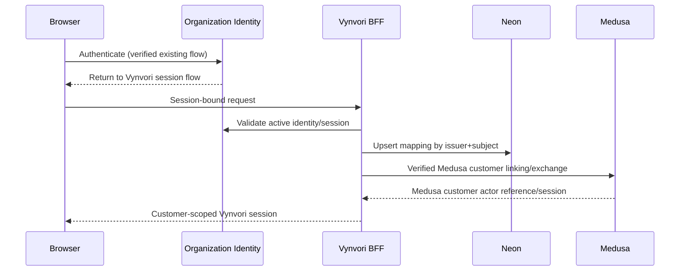

# 03 — Centralized authentication (T03 override) and Medusa identity bridge

## Status and source truth

**Founder locked:** Organization-wide authentication is the sole login/credential authority. Reuse the mechanism already implemented in `TheCrimsonMarket/LuckyLittleDevil` to bridge a centrally authenticated customer into Medusa. **The original repo returned 404 to the connected GitHub app; its implementation was not verified during blueprint authorship.** Never describe any endpoint, secret, auth SDK or token exchange as confirmed until this audit is complete.

## Required M1 source audit — implementation-blocking

1. Obtain read access to the LuckyLittleDevil repo and identify the central identity issuer, client application, login start/callback, logout, refresh, cookie/session model, CSRF/PKCE protections, claim fields, JWKS/verification approach and error handling.
2. Locate its Medusa bridge: custom authentication provider or token-exchange route, customer lookup/provisioning, AuthIdentity linking, Medusa session issuance, role mapping, retries, deletion/deprovision, admin/customer segregation and tests. Capture **code file paths and commit SHA**.
3. Document trust boundaries. Determine which server validates issuer/audience/subject and which secret manager holds keys. Verify central tokens are not simply forwarded as Medusa JWTs unless explicitly supported by a validated Medusa provider.
4. Verify Medusa major/minor compatibility. Consult official Medusa v2 auth-provider documentation and the actual deployed version. If LuckyLittleDevil uses Medusa v1 or deprecated modules, **adapt deliberately**, not a blind copy.
5. Write `docs/technical/research/lucky-little-devil-auth-audit.md`: trust diagram, request/response shapes, files/versions, verified configurations, migration requirements, tests, limitations and recommendation. Get reviewer approval before implementing production bridge.

## Target security contracts (independent of concrete Lucky transport)

- Canonical identity: `(issuer, subject)` (stable immutable subject, never unverified email). Use `user_id` in Neon as local UUID with unique `(identity_issuer, identity_subject)`. Link a distinct `medusa_customer_id` using unique constraints.
- Browser: secure HttpOnly cookie session under correct domain boundary; CSRF protection for cookie-bearing mutating operations; SameSite, Secure and session lifetime according to organization's verified SSO scheme.
- Server: verify authentic issuer, expected audience, signature via trusted mechanism, time claims, session revocation and replay mitigations before creating or retrieving local account or making customer-scoped Medusa requests.
- Medusa: commerce customer actor obtained through **validated** mapping/bridge (AuthIdentity with `app_metadata.customer_id` or verified equivalent). Do not create privileged Medusa tokens by trusting a customer-supplied email/user ID. Separate customer and Medusa-admin staff actor scopes.
- Provisioning: first verified login links/creates local profile and correct Medusa customer exactly once, protected by unique keys/idempotency and raced-login tests. Email change must not create second user. If an existing Medusa customer conflicts, require controlled manual or verified migration workflow.
- Logout/deprovision: clear Vynvori session; revoke/expire Medusa customer access consistently with known central auth behavior; deactivate entitlement access as instructed by verified policy.
- Profile data: minimize personally identifying fields; mutable email/name treated as profile attributes; Medusa commerce stores its required billing/shipping fields only.
- Staff access: **do not** infer authorization to Medusa Admin from central customer SSO. Separate role/claims and server-side role enforcement; preserve Medusa Admin authentication policies.
- Guests: no permanent identity needed to edit or preview. Anonymous draft ID is a signed, scoped capability with expiry, upload quota and no credit purchase; migrate guest project atomically following verified login.

## Bridge lifecycle

**Diagram is conceptual.** The final SSO transport and Medusa exchange must be replaced with real audited LuckyLittleDevil behavior before implementation.

## Concrete test cases

- New verified identity creates one Vynvori account and one mapped Medusa customer.
- Existing identity returns same mapping across sessions and browsers; concurrent first logins remain one account.
- Login with same email but different verified subject cannot hijack an account.
- Tampered signature, wrong audience/issuer, expired/revoked token, replayed exchange code and insufficient staff claim rejected.
- Customer A can't fetch, mutate, credit, refund, upload, publish or order on customer B's IDs.
- Guest data migrates only when owning guest capability and authenticated identity both presented; stolen draft ID insufficient.
- Logout expires access to both application and commerce operations according to audited central auth semantics.
- Refresh/token expiry recovery doesn't create duplicate Medusa customers or expose privileged tokens.

## Relevant vendor references

Medusa v2 custom auth providers: https://docs.medusajs.com/resources/commerce-modules/auth/auth-providers
Medusa AuthIdentity/actor model: https://docs.medusajs.com/resources/commerce-modules/auth/auth-identity-and-actor-types
Medusa provider linking: https://docs.medusajs.com/resources/commerce-modules/auth/link-provider-identity
Medusa protected route middleware: https://docs.medusajs.com/learn/fundamentals/api-routes/protected-routes
