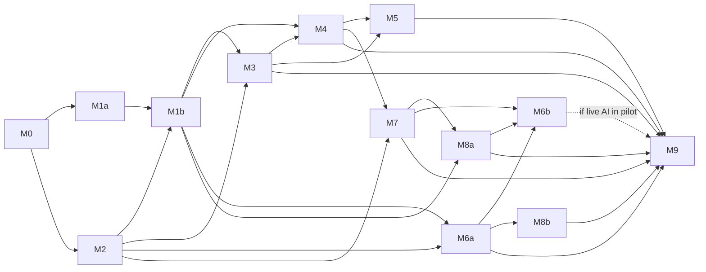

# 15 — v1.1 dependency-ordered implementation milestones (v1.1)

**Status:** canonical documentation applied locally; implementation milestones not executed. This plan replaces contradictory v1.0 M1/M2 and M6/M7/M8 dependency ordering, retains M0–M9 identifiers and splits M1, M6, M8 where essential. Milestones are evidence-gated, not a promise of completion in 90 days. Preserve all existing repo and benchmark source.

## M0 — Baseline inventory, contract sign-off and CI scaffold
- Verify exact repository head and all tracked baseline file hashes; preserve brand assets, ignored Phase05 artifacts and benchmark fixture/tests. The founder authorized local v1.1 documentation application only. Review proposed typed contracts separately and obtain implementation authorization before code changes.
- Establish code ownership, package/runtime version matrix, non-destructive CI, reviewable migrations and contract/feature flag policy. No live credentials.
- **Acceptance:** no source loss, benchmark commands still pass after *future approved implementation*, acceptance statuses remain NOT_RUN until exercised.

## M1a — Organization SSO/Medusa bridge source audit (may begin after M0)
- Obtain LuckyLittleDevil read access; pin source SHA, verified issuer/subject, session/cookie/refresh/logout, Medusa auth module, privileges, token exchange and version compatibility; write threat model. Do NOT infer implementation details from prior discussions.
- **Acceptance:** source-referenced audit and proposed adapter tests only. No real integration until M2 staging infrastructure.

## M2 — Dedicated staging infrastructure and workspace skeleton
- Create staging **separate Medusa Cloud project**, Next.js web skeleton, Neon DB/Drizzle schema review, Cloudflare R2 segregated test buckets, Cloud Run dry processing, typed shared contracts and CI. All charges/live execution disabled. Preserve npm workspace benchmark.
- **Acceptance:** staging Medusa API reachability, migration baseline, isolated secrets, mock jobs/no billable requests.

## M1b — Auth bridge and secured guest claim (depends on M1a AND M2)
- Implement verified org SSO adapter, stable issuer/subject→Vynvori user→Medusa customer mapping, refresh/revocation and STAFF separation. Build guest claim/expiry and owner permission tests.
- **Acceptance:** unique identity in concurrent logins, wrong issuer rejected, guest BYO claim safe, no separate passwords.

## M3 — Independent BYO garment editor (depends M2; persistence/owned flow depends M1b)
- Versioned multilayer scene with physical mm coordinate system, exact text/font rights, private originals/derivatives, independent guest `/customize`, source hashes and preview-only print profile flags.
- **Acceptance:** no AI wallet prerequisite, upload/edit/preview/save/restore under correct guest+owner rights, same geometry after reload, numeric keyboard alternative, no unapproved print.

## M4 — Medusa sandbox catalog, cart and entitlement commerce (M2 + M1b + M3 scene contracts)
- Dedicated product and variants, personalized validated frozen snapshot pricing, signed quote expiration, customer/store ownership, mock shipping, sandbox capture/payment events with idempotent Neon outbox/inbox.
- **Acceptance:** quote tamper rejected; no product/cart cross-user confusion; sandbox purchase creates exactly one entitlement/job, never a live shipment.

## M5 — Image processing, preflight, human print QA and shipment projections (M3 + M4)
- Original-versus-derivative/print-manifest lineage, deterministic Cloud Run export, manufacturer profile version, HUMAN pre-print signoff, Medusa order/fulfillment projections, US direct/AU consolidation when validated.
- **Acceptance:** no `released_to_partner` without captured payment, rights-approved print asset/profile, proof hash and authorized human QA. Real printing disabled until vendor validation.

## M6a — Mock Studio workflow and UX contracts (M2 + M1b; may parallelize with M3)
- Unified briefs, bounded nonbillable Director, immutable three-direction approval, two offer cards, promo race mock, three new concept-slot allocations, 0/3–3/3 persisted partial states, optional two refinement slots, final availability/quality use/save/case screens, rights-aware version history. Mock provider outcomes only.
- **Acceptance:** strict typed/runtimed validated fixture suite, idempotent reconnect, no simulated paid operation disguised as production, mobile+screen-level coverage.

## M7 — Credit ledger, purchasing and entitlements foundation (M2 + M4 for top-ups)
- ACID credit wallet, immutable ledger, quote versioning, reservation/release/settlement, promo uniqueness, package/slot entitlements, Medusa payment confirmation grants, redemption/digital paid entitlement scaffolds, cross-system reconciliation.
- **Acceptance:** 100-way balance concurrency, duplicate/out-of-order events, unknown provider cost isolation and renewal of stale quotes, no negative/double charges. No live paid AI without M8a.

## M8a — Minimal paid-AI operational support (M2 + M1b + M7 contracts)
- Authenticated customer case creation/status, staff operator inbox, audited authority/remedy commands, customer notification logs, provider billing reconciliation screens and escalation. Numeric maximum hold/response/remedy policies must be approved before live M6b.
- **Acceptance:** unknown provider and no-artifact incident can be opened, notified, tracked, reconciled, and resolved under correct roles, with no blind retry. Staff authorization and remedy dry runs.

## M6b — Billable AI execution (M6a + M7 + M8a + qualified rights/models + merchant)
- Production adapters and qualified Standard only, workflow durable external job requests and asset persistence, quote/consent+reservations, three concept fulfillment with operator remedies, final separate quote, slot/closure rules. Premia disabled unless independently qualified.
- **Acceptance:** real paid feature stays OFF until model/rights evidence, approved price/credit/cancellation/hold SLAs and legitimate payment are documented. A controlled paid smoke is a separate explicit founder authorization, not automatic.

## M8b — Gallery, extended analytics/customer support (M3 + M4 + M6a as applicable)
- Private-default moderated opt-in showcase, analytics, operational dashboards, newsletters / SEO/event instrumentation. No creator marketplace or source download.
- **Acceptance:** permission and privacy tests, moderated publication/unpublish, accessibility.

## M9 — Staging acceptance and region-gated pilot (M3+M4+M5+M6a+M7+M8a+M8b; M6b only if paid AI in release)
- Run full owner/security/ledger/event recovery and editor/printing pipeline tests, supplier DTF samples, authenticated order pilot, region-specific merchant/tax/duties/ETA, physical fulfillment QA. Feature flags may leave unqualified paid AI/print regions disabled.
- **Acceptance:** signed evidence-based go/no-go; no prototype screenshot/browser check counts as backend acceptance.

## Acyclic dependency graph

**External gates:** Lucky source audit for M1b; qualified model/rights + approved operational SLA for M6b; actual supplier print profile/sample + signed QA for live physical release; legal merchant/payment and US/AU shipping quotes for live checkout. Unmet external gates do not prevent implementing safe mocks or non-billable drafts.

## PR requirements (when later authorized)

One concern per PR, exact baseline commit, contract diff, forward/rollback schema plan, security threats, disabled-by-default flags, tests and reviewer acknowledgment. **Phase 6C itself authorizes no PR, merge or deployment.**
